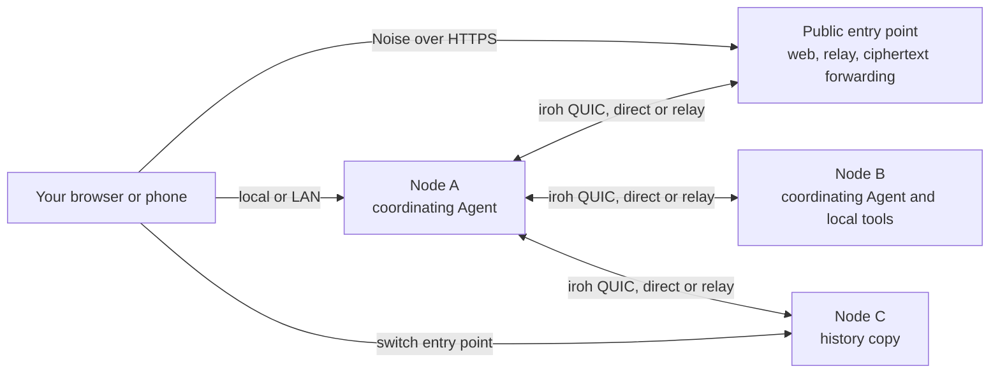

<div align="center">

# Vibeface

**A private network for your own computers. Chat with a bot, choose where work runs, and keep the result in the same conversation.**

[English](README.md) · [简体中文](README.zh-CN.md)

[](https://github.com/leaperone/vibeface/actions/workflows/ci.yml)
[](https://github.com/leaperone/vibeface/releases)
[](Cargo.toml)
[](packages/docs/releasing.md)

</div>

> [!NOTE]
> Vibeface is in the Nightly stage. The protocol, data format, and APIs may change before the first stable release.

## Contents

- [What it does](#what-it-does)
- [How it works](#how-it-works)
- [Start here](#start-here)
- [Use more than one computer](#use-more-than-one-computer)
- [Build from source](#build-from-source)
- [Repository layout](#repository-layout)
- [Read the docs](#read-the-docs)
- [Contribute](#contribute)
- [License](#license)

## What it does

- **Chat-driven bots.** Give a bot a name, a job, and a project folder. Ask for work in its long-running conversation.
- **Your own computers.** Run a Node on each Mac or Linux computer. A bot on one computer can send work to another computer that you approved.
- **Continue on another computer.** Signed history keeps the bot conversation, settings, task stages, summaries, and durable results available on approved Nodes. Replaying history never starts old work, and project files, logins, and SDK state do not move by themselves.
- **Encrypted connections.** Browsers and phones use their device key to create a Noise connection to a Node. A public entry point can relay ciphertext without joining your private network.
- **One local package.** The package includes the `vibeface` CLI, `vibeface-core`, and a static `web/` app. A production web server does not need Node.js.
- **Native mobile apps.** The Expo iOS and Android apps use the same client protocol. Device keys stay in the system secure store.

> [!WARNING]
> File delivery is an experimental feature and is off by default. Public forwarding does not need a wallet. Paid delivery only uses the local `chain_id=31337` test chain and never handles real assets. See the [file delivery reference](packages/docs/paid-delivery.md) for its limits.

## How it works



| Part | Responsibility |
| --- | --- |
| **Node** | Rust service for identity, routing, signed history, SQLite storage, scheduling, deduplication, and notifications. |
| **Coordinating Agent** | Codex, Claude Code, pi, opencode, or Cursor SDK. Cursor uses its native SDK tools. Other products call the Node through the local `vibeface tool` command and do not need MCP. |
| **Execution** | The selected Agent uses its own shell and file tools on the selected computer. |
| **Web app** | A static SPA served from the package or an explicit app directory. The browser signs requests with its device key and connects to the selected Node through Noise. |
| **Mobile app** | Expo iOS and Android clients that reuse the shared client and native secure modules. |

Keep these boundaries in mind:

- Each person manages a separate device network. A public server can be a Node in that network or only a public entry point.
- A public entry point does not store private network data by default. If you enable file delivery, the separate `delivery/` area stores delivery objects, a service ledger, and local recovery material. Treat anything that may contain keys or private proofs as a credential.
- Bot definitions and shared chat history are separate from local SDK caches. Creating a bot does not start a model.
- If a write result is unknown, check the original result before retrying. Do not send the same write with a new ID or device.
- Every data directory has a data epoch. A program opens only its matching epoch and does not upgrade the database. Nodes in one network use the same version.

## Start here

Read the [quick start](packages/docs/quick-start.md) first. Use [first-time setup](packages/docs/onboarding.md) to add a device or restore an identity, then use the [user guide](packages/docs/user-guide.md) for daily work. The [product overview](packages/docs/overview.md) explains the boundaries. The [troubleshooting guide](packages/docs/troubleshooting.md) covers failed connections.

### Requirements

| Requirement | Version | Use |
| --- | --- | --- |
| macOS Apple Silicon, Linux x64, or Linux ARM64 with glibc | | Node host |
| Node.js | 22+ | npm installation only |
| Codex CLI | installed and logged in for this Node | Optional Codex bot and task execution |
| [Claude Code](https://docs.anthropic.com/en/docs/claude-code) | installed and logged in for this Node | Optional Claude Code bot and task execution |
| [pi](https://www.npmjs.com/package/@earendil-works/pi-coding-agent) | installed and signed in | Optional pi bot and task execution |
| [opencode](https://opencode.ai) | 2.2.0, logged in for this Node | Optional opencode bot and task execution |
| [Cursor SDK Bridge](https://github.com/cursor/sdk-bridge/releases/tag/v1.2.0) | 1.2.0 package, verified for your environment | Optional Cursor bot and task execution |

### Install

The npm Nightly package is configured but not public yet. After the first release, install it with:

```sh
npm install -g @leaperone/vibeface@nightly
vibeface --version
```

The npm package includes the platform binaries and service scripts. It does not download, initialize, or start a service during `postinstall`. Until then, download a complete package from [GitHub Releases](https://github.com/leaperone/vibeface/releases) and follow the [installation guide](packages/docs/install.md).

### Run the first Node

```sh
vibeface
```

The default data directory is `~/.vibeface`. Set `--data-dir` or `VIBEFACE_DATA_DIR` to use another absolute path. The first run initializes only a missing or empty directory and listens on `127.0.0.1:4790`.

1. Open `http://localhost:4790` in the local browser. Keep `localhost` because saving a device key needs a secure context.
2. Select **Create my network**, name the computer, set a recovery password, and download the recovery file.
3. In **Run a bot on this computer**, choose a service, sign it in for the Node's private directory, check availability, and enable it.
4. Create a bot and send a test message. To let it work on a project, enable **Task execution** in the device's **AI** settings and add the project folder.

### Configure a Node

You can configure a Node in the web app. You can also write the initial `config.json` with:

```sh
vibeface init \
	--root /absolute/path/to/projects \
	--manager codex \
	--codex-socket '<absolute App Server socket path>' \
	--workspace /absolute/path/to/manager-workspace
```

| Option | Meaning |
| --- | --- |
| `--root` | A project folder that an Agent may access. Repeat it for more folders. |
| `--manager` | The coordinating product: `codex`, `cursor`, `claude`, `pi`, or `opencode`. |
| `--workspace` | The coordinating Agent's working directory. Keep it separate from project folders. |
| `--model` | Model name. The product default is used when omitted. Cursor defaults to `auto`. |
| `--listen` | Listen address. The default is `127.0.0.1:4790`. |
| `--no-web` | Disable the browser app while keeping Node transport and local tools. |
| `--relay` / `--relay-listen` | Connect to another Node's relay or run a relay locally. |
| `--relay-mode discovery-only` | Use a public service only for discovery and direct connections. |
| `--discovery` | Set a pinned public discovery service. |
| `--public-entry` | Run a public entry point or discovery service without joining a private network. |

Set `CURSOR_API_KEY` in the Node environment when you use the Cursor SDK. Never put keys in a command, URL, Git, or chat record. See [using Claude Code, pi, or opencode](packages/docs/node.md#使用-claude-codepi-或-opencode) and the [Node configuration reference](packages/docs/node-protocol.md#本机配置) for all fields.

## Use more than one computer

### Add another computer

On the new computer, run:

```sh
vibeface join '<join link>' --name '<device name>'
```

Create the join link in **Add device** on a computer that already manages the network. Compare the six-digit code on both computers before approving it. Do not create a second personal network on the new computer. See [add your own devices](packages/docs/node.md#添加自己的设备).

### Send work and continue elsewhere

- Ask a bot on computer A to send work to computer B. Task stages, summaries, and durable results return to the original conversation.
- When A is offline, open the same conversation on a synchronized computer C and select **Hand off to this computer**. C uses its local Agent to continue.
- Notifications do not call a model. An offline client keeps unread notifications and receives them after reconnecting.
- Execution Agents run in bypass mode by default. The coordinating Agent handles requests that need your decision.

### Common commands

| Command | Use |
| --- | --- |
| `vibeface` | Initialize a configured data directory if needed and start the Node. |
| `vibeface serve` | Start a Node from its existing configuration. |
| `vibeface status` | Check Node status through the local maintenance socket. |
| `vibeface access` | Show the local browser entry point. |
| `vibeface service` | Manage the background service and update timer. |
| `vibeface update` | Select an update channel, check for updates, or apply one. |
| `vibeface hooks` | Install, remove, or test Codex and Claude Code hooks plus pi and opencode extensions. |
| `vibeface logs` | Read local Node logs. |

Run `vibeface --help` for the complete list. For public deployments, use `init --public-entry` for a public entry point, or use `init --relay-listen` to run a relay for your private network. See [public entry points](packages/docs/node.md#配置公共入口) and [Node connections](packages/docs/node.md#node-之间的连接).

## Build from source

You need Rust 1.91+, Node.js 22.12+, pnpm 11.9.0, and `wasm-bindgen-cli` 0.2.129.

```sh
rustup target add wasm32-unknown-unknown
bash scripts/build-web-crypto.sh
bash scripts/build-web.sh
cargo build --release -p vibeface -p vibeface-core --locked
bash scripts/package-node.sh
./target/release/vibeface init \
	--root /absolute/path/to/projects
./target/release/vibeface serve
```

`init` accepts only a missing or empty data directory. It writes `identity.json`, `config.json`, a one-time `bootstrap.json`, `data-epoch.json`, and `node.sqlite3`. `serve` and `join` lock the data directory. `join` hands the request to a running Node instead of taking its lock.

`bash scripts/package-node.sh` writes the current platform archive and SHA256 file to `.artifacts/packages/`. A complete package contains `vibeface`, `vibeface-core`, `BUILD-INFO.json`, and `web/`. The updater switches the whole release directory atomically.

Build the mobile secure module with `bash scripts/build-mobile-secure.sh ios` or `bash scripts/build-mobile-secure.sh android`, then use the Expo scripts in `apps/mobile`.

## Repository layout

```text
.
├── apps/
│   ├── app/         # Web app served by Core
│   ├── cli/         # vibeface command line and local control client
│   ├── core/        # Node service, storage, sync, scheduling, and execution
│   ├── mobile/      # Expo iOS and Android clients
│   └── www/         # Public portal, docs, and downloads
├── crates/
│   ├── control/     # CLI and Core control DTOs and client
│   ├── bridge/      # Codex App Server and Agent clients
│   ├── protocol/    # Shared RPC and message types
│   ├── secure/      # Device identity, membership, Noise, and recovery
│   ├── secure-ffi/  # UniFFI bindings for mobile native modules
│   └── delivery/    # File delivery statements, encryption, and proofs
├── packages/        # Shared client, theme, and native modules
├── contracts/       # Delivery contracts, verifier, and local chain scripts
├── scripts/         # Web, mobile, packaging, CI, and acceptance scripts
├── tests/           # Controlled fixtures and end-to-end tests
├── packages/docs/   # User guides, protocol references, and design docs
└── install.sh       # GitHub package installer
```

## Read the docs

| Document | Covers |
| --- | --- |
| [Product overview](packages/docs/overview.md) | The product, bots, execution, and first-computer requirements. |
| [Comparison](packages/docs/comparison.md) | Vibeface, Codex, Claude Code, and OpenClaw use cases. |
| [Bots and task execution](packages/docs/bot-and-execution.md) | Coordination, local Agents, and returned results. |
| [History sync](packages/docs/history-sync.md) | Signed history, handoff, and backup boundaries. |
| [Privacy and security](packages/docs/privacy-security.md) | Device identity, access, credentials, and recovery. |
| [Installation](packages/docs/install.md) | npm Nightly, complete packages, initialization, status, and services. |
| [Deployment](packages/docs/deployment.md) | Data directories, platforms, and integrations. |
| [Node guide](packages/docs/node.md) | LAN, public entry points, relays, Agents, services, updates, and recovery. |
| [Node protocol](packages/docs/node-protocol.md) | Configuration, browser transport, RPC, signed events, and iroh. |
| [File delivery](packages/docs/paid-delivery.md) | VDP-1 roles, fees, wallets, proofs, and settlement limits. |
| [Troubleshooting](packages/docs/troubleshooting.md) | Status, logs, diagnostics, and fork handling. |
| [Release guide](packages/docs/releasing.md) | Platform packages, SHA256, release channels, and tags. |
| [CI](packages/docs/ci.md) | Main checks, extended CI, and local focused checks. |

## Contribute

- **Report a bug.** Open an [Issue](https://github.com/leaperone/vibeface/issues) with `vibeface --version`, the platform, and `vibeface status`. Do not paste keys or recovery files.
- **Open a pull request.** Start from `main`, use Conventional Commits, and run the checks that match your change. Sync, recovery, scheduling, and execution changes also need the local checks in [CI](packages/docs/ci.md).

Before you submit a change, run the relevant checks from the repository root:

```sh
cargo fmt --all -- --check
cargo clippy --workspace --all-targets --locked -- -D warnings
cargo test --workspace --locked
```

## License

This repository does not include a `LICENSE` file yet. The license is still under review. Until it is published, all rights are reserved.
