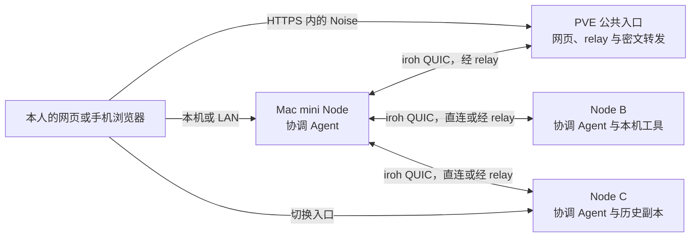

# Vibeface

在自己的 Mac 或 Linux 设备上运行 `vibeface`，创建有名称、职责和项目配置的机器人，直接在它的聊天中提出要求。协调 Agent 用宿主 SDK 的 Shell、文件工具和 Codex App Server 完成本机工作，也能向另一台设备的 Agent 发任务。机器人定义、聊天历史和任务结果在本人授权的节点间同步，换一个入口也能查询原来的工作。



所有设备运行同一种 Node。公网 Server 是 Node 的一种部署方式：可以作为成员加入个人网络并按需启用 Agent，也可以作为公共入口只提供网页、relay 和密文转发，不加入网络、不保存数据。每个人拥有独立的设备网络，Node 之间经 iroh QUIC 直连或经 relay 互通，已投递任务的目标固定不变。

网页使用 React 和 TanStack Start 构建静态 SPA，随 Rust 程序内嵌分发，生产运行不需要 Node.js Web 服务。浏览器用不可导出的设备密钥和 Noise 通道连接指定 Node，中间的入口只转发密文。

Rust 核心负责认证、路由、签名日志同步、写入保护、SQLite 存储、任务调度、去重和通知。Cursor SDK 聊天 Agent 通过原生自定义工具回调协调 Node，不需要 MCP。宿主命令和文件操作直接使用 SDK 工具；Codex 使用薄原生客户端访问 App Server，不经过独立执行适配层。机器人定义和共享聊天历史独立于本机 SDK 缓存，创建机器人不会启动模型。

本版本使用新的机器人和数据库结构，部署时使用全新的数据目录重新初始化。旧数据库不自动升级，个人网络中的节点使用同一新版本。

## 安装与开始

主程序是 Rust 二进制 CLI `vibeface`，支持 macOS Apple Silicon、Linux x64 和 Linux ARM64（glibc）。npm 安装入口需要 Node.js 22+，网页仍由 Rust 程序提供。

npm Nightly 分发已配置，包尚未公开发布。首次发布后使用：

```sh
npm install -g @leaperone/vibeface@nightly
vibeface --version
```

npm 包包含完整平台程序、SDK sidecar 和服务脚本，不通过 postinstall 下载程序，不初始化身份或启动服务。发布前可从 PR 的 CI 下载 `.tgz`，在隔离 prefix 中安装验收。当前尚无正式版，GitHub 完整包安装入口见 [安装说明](docs/install.md)。

安装后直接启动：

```sh
vibeface
```

首次运行仅在不存在或为空的数据目录中初始化，默认使用 `~/.vibeface` 并监听 `127.0.0.1:4790`，不授予执行目录或启用管理 Agent。同一数据格式的节点重启保留原身份和配置。npm 安装由 npm 更新；后台节点先确认空闲并停止服务，再更新、重启和核对状态。GitHub 受管安装仍使用 `vibeface update apply`。安装、更新与 CLI 管理见 [安装说明](docs/install.md)。

## 从源码开始

从源码构建需要 Rust 1.91+、Node.js 22.12+、pnpm 11.9.0 和 wasm-bindgen-cli 0.2.129。运行任务前，安装并登录需要的 SDK 和 Codex CLI。

```sh
rustup target add wasm32-unknown-unknown
bash scripts/build-web-crypto.sh
bash scripts/build-web.sh
cargo build --release -p vibeface --locked
./target/release/vibeface init \
	--data-dir "$HOME/.vibeface" \
	--root /absolute/path/to/projects
./target/release/vibeface serve --data-dir "$HOME/.vibeface"
```

`init` 要求数据目录为空或不存在，默认是 `$HOME/.vibeface`。它写入 `identity.json`、`config.json`、一次性 `bootstrap.json`、`data-epoch.json` 和单一 `node.sqlite3`，设备授权与业务记录使用同一个 Store。数据格式 epoch 为 9，数据库 `user_version` 为 9。运行时日志写在同一目录的 `node.log`。不注册网站账号，也不保存个人根私钥。`serve` 和 `join` 用目录锁独占该目录。

在本机可信浏览器打开 `http://localhost:4790`，填写浏览器名称及恢复包口令，下载并确认保存加密恢复包后创建个人网络。初始化材料由本机页面自动取得，无需运行 `access` 或复制邀请。已有网络的节点不会因浏览器未授权而另建网络；新浏览器可使用本机自动访问，永久成员授权仍需成员邀请或恢复包。`vibeface access --data-dir "$HOME/.vibeface"` 保留为备用入口。

保存密钥的页面需要安全上下文，推荐固定使用 `http://localhost:4790`。网络建立后，默认开启的本机自动访问可通过独立回环入口建立本机会话，不必重复配对；可在网页或 `config.json` 关闭。本机会话可配置本机 Agent 和项目目录，个人网络成员管理仍要求签名管理身份。公网访问验证设备身份。创建机器人后进入它的长期聊天，设备、连接和恢复放在设置中。聊天调度需要另外配置 [管理 Agent](docs/node.md#配置管理-agent)。启用 Codex SDK 时可启动私有 App Server；网页可用不代表 Codex 已安装、登录或模型可用。

Node 之间经 iroh QUIC 互连。有公网地址的机器（例如 PVE）有两种用法：用 `init --public-entry` 运行公共入口，家里的 Node 用 `--entry` 和入口令牌指向它，入口不加入网络；或者作为成员用 `init --relay-listen` 为个人网络运行 relay，其他 Node 用 `--relay` 指向它。浏览器可经任意一个入口访问其他设备。见 [配置公共入口](docs/node.md#配置公共入口)、[Node 之间的连接](docs/node.md#node-之间的连接) 和 [多个访问地址](docs/node.md#多个访问地址)。

另一台 Node 用 `vibeface init` 初始化后，执行 `vibeface join <加入链接>`。链接由管理设备的**添加设备**生成，终端显示 6 位安全码，在管理设备上核对一致后批准。Node 入网不授予浏览器管理权限；进入本机工作区可使用本机自动访问，管理网络成员须用加入链接或恢复包取得签名授权。不要用新建个人网络代替加入。操作步骤见 [添加自己的设备](docs/node.md#添加自己的设备)。

## 接续工作与通知

A 把任务派发到 B 后，任务、进度、审批和结果写进签名日志并同步到每台 Node。A 离线时，可以在已同步的 C 打开同一会话，点**交给这台设备处理**，由 C 的管理 Agent 接着回复，已经执行过的工作不会重放。

普通进度和通知不调用管理模型。B 完成后保存结果和通知，通过可达节点同步到当前入口；客户端离线时保留未读通知，重连后补发。浏览器关闭后的系统推送不在当前范围内。

结果回到聊天后，协调 Agent 以完整权限汇报，可以继续派发工作。一次 Codex turn 结束不等于用户目标已经达成。Codex 默认 bypass，它发起的请求由协调 Agent 处理，需要本人拍板时才生成拍板卡片或转发 Grok Bot。写操作结果未知时，在原聊天中核查实际结果，不换一个 ID 或设备重新派发。

## 安装、协议与验证

- [首次安装与 CLI 管理](docs/install.md) 包括 npm Nightly、GitHub 完整包、初始化、状态和后台服务命令。
- [部署与使用 Node](docs/node.md) 包括局域网、公共入口、relay、SDK、后台运行和制品安装。
- [Node 协议参考](docs/node-protocol.md) 包括配置、HTTP 与浏览器通道、业务 RPC、事件 DAG、写入保护和 iroh 传输。
- [排障](docs/troubleshooting.md) 说明 `status`、`node.log`、诊断包，以及只读和分叉的处理。
- [构建与发布](docs/releasing.md) 说明 Linux x64（`x86_64-unknown-linux-gnu`）、Linux ARM64（`aarch64-unknown-linux-gnu`）和 macOS Apple Silicon（`aarch64-apple-darwin`）三个包、SHA256、Stable 与 Nightly 更新渠道，以及 stable/nightly/rc tag 规则。PR 与 `main` 的 [CI](https://github.com/leaperone/vibeface/actions/workflows/ci.yml) 只生成 Actions 制品；公开版本见 [Releases](https://github.com/leaperone/vibeface/releases)，nightly 与 rc 为预发布。
- [选择更新渠道](docs/node.md#选择更新渠道) 适用于 GitHub 受管安装，可开启空闲时的后台升级；npm 安装由 npm 更新。
- `scripts/package-node.sh` 生成当前平台的压缩包和 SHA256 文件，默认输出到 `.artifacts/packages/`。

可在仓库根目录运行对应检查。命令本身不代表本次提交已经通过，实际结果以 PR 的验证记录为准。

```sh
cargo fmt --all -- --check
cargo test --workspace --locked
cargo clippy --workspace --all-targets --locked -- -D warnings
```

当前没有原生手机 App。模型额度和计费由各 Provider 决定，每日决策次数限制不是 token 或费用上限。
