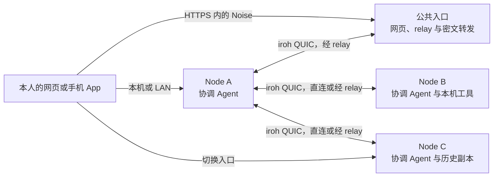

<div align="center">

<!-- Logo 占位：放入 docs/assets/logo.svg 后替换本行 -->

# Vibeface

**把自己的每台 Mac 和 Linux 设备连成一张私有网络，在聊天里指挥本机的 Codex、Claude Code、pi、opencode 与 Cursor Agent 干活。**

[](https://github.com/leaperone/vibeface/actions/workflows/ci.yml)
[](https://github.com/leaperone/vibeface/releases)
[](Cargo.toml)
[](docs/releasing.md)

</div>

> [!NOTE]
> 项目处于 Nightly 阶段，尚无正式版。正式版发布前，协议、数据格式和 API 会直接改成最终形态，不做向后兼容。

## ✨ 核心特性

- 🤖 **聊天驱动的 bot**。创建有名称、职责和项目目录的 bot，在它的长期聊天里提要求。协调 Agent 用自己的 Shell 和文件工具读写本机，把改代码的任务派给本机或其他设备的 Agent。
- 🌐 **个人设备网络**。每台 Node 运行 `vibeface-core` 后台，由 `vibeface` CLI 管理，经 iroh QUIC 直连或经 relay 互通。A 设备上的 bot 可以把任务派给 B 设备执行。
- 🔁 **换设备接着干**。Bot 聊天、设置、任务阶段、摘要和结果写进签名 DAG 并在授权 Node 间同步，完整逐字进度不进入共享历史。A 离线时，在已同步的 C 打开原聊天，由本人切换负责人后接着协调。历史回放不启动旧工作，工程、登录和原生 SDK 状态不会自动迁移。
- 🔐 **端到端加密入口**。浏览器和手机 App 用本机设备密钥与 Node 建立 Noise 通道。公网入口只转发密文，不加入个人网络。
- 📦 **完整本机包**。包内同时提供 `vibeface` CLI、`vibeface-core` 和 `web/` 静态 SPA，生产环境不需要 Node.js Web 服务。
- 📱 **原生移动端**。Expo iOS/Android 客户端复用同一套 client 协议、恢复包和加入链接，设备密钥保存在系统安全存储。

> [!WARNING]
> 文件交付仍是实验功能，默认关闭。公益转发不需要钱包；付费交付只接受本机 `chain_id=31337` 测试链，不接入真实资产。配置、费用和证据边界见[文件交付实验参考](docs/paid-delivery.md)。

## 🏗️ 工作原理



| 层 | 职责 |
|---|---|
| **Node**（Rust） | 认证、路由、签名日志同步、写入保护、SQLite 存储、任务调度、去重和通知。 |
| **协调 Agent** | Codex、Claude Code、pi、opencode 或 Cursor SDK 驱动。Cursor 用 SDK 原生自定义工具，其余经本机 `vibeface tool` 命令回调 Node，不需要 MCP。 |
| **执行** | 宿主命令和文件操作直接用 Agent 自己的工具。任务在本机 Codex App Server、Claude Code、pi、opencode 或 Cursor 的会话里运行。 |
| **网页** | Core 从同包 `web/` 或显式 App 目录提供静态 SPA。浏览器设备密钥签名，经 Noise 通道访问指定 Node。 |
| **手机 App**（Expo） | 复用共享 client 与原生安全模块，设备密钥保存在系统安全存储。 |

几条设计约束值得先知道：

- 每个人管理自己的设备网络，网络之间完全隔离。公网服务器只是 Node 的一种部署方式，可以作为成员加入网络，也可以只当公共入口。
- 公共入口默认不保存个人网络数据；显式启用文件交付后，独立 `delivery/` 保存交付对象、服务账本和本机恢复材料，可能含私钥及私密证明材料，须按凭证保管。启用交付不授予个人网络成员权限，见[文件交付实验参考](docs/paid-delivery.md#接收密钥和恢复材料)。
- bot 定义和共享聊天历史独立于本机 SDK 缓存。创建 bot 不会启动模型。
- 写操作结果未知时先核对实际结果，不换 ID 或设备重发。
- 数据目录带数据格式 epoch，程序只打开同一 epoch 的目录，不升级数据库。同一网络里的节点使用同一版本。

## 🚀 快速开始

初次使用先看 [快速上手](docs/quick-start.md)；添加设备或恢复身份看 [首次配置](docs/onboarding.md)，已完成配置后看 [日常使用指南](docs/user-guide.md)。功能边界见 [产品概览](docs/overview.md)，连接失败见 [排障](docs/troubleshooting.md)。

### 前置条件

| 依赖 | 版本 | 用途 |
|---|---|---|
| macOS Apple Silicon、Linux x64 或 Linux ARM64（glibc） | | 运行平台 |
| Node.js | 22+ | 仅 npm 安装入口需要 |
| Codex CLI | 已安装，按设备 AI 设置为 Node 登录 | 可选，Codex bot 与执行任务 |
| [Claude Code](https://docs.anthropic.com/en/docs/claude-code) | 已安装，按设备 AI 设置为 Node 登录 | 可选，Claude Code bot 与执行任务 |
| [pi](https://www.npmjs.com/package/@earendil-works/pi-coding-agent) | 已安装并登录 | 可选，pi bot 与执行任务 |
| [opencode](https://opencode.ai) | v2.2.0，按设备 AI 设置为 Node 登录 | 可选，opencode bot 与执行任务 |
| [Cursor SDK Bridge](https://github.com/cursor/sdk-bridge/releases/tag/v1.2.0) | v1.2.0 发布包，需按自己的环境验证 | 可选，Cursor Bot、协调 Agent 与执行任务 |

### 安装

npm Nightly 分发已配置，包尚未公开发布。首次发布后可以这样安装：

```sh
npm install -g @leaperone/vibeface@nightly
vibeface --version
```

npm 包内含完整平台程序和服务脚本，不在 postinstall 阶段下载、初始化或启动服务。在此之前，可从 [Releases](https://github.com/leaperone/vibeface/releases) 下载 GitHub 完整包，步骤见 [安装说明](docs/install.md)。

### 首次启动

```sh
vibeface
```

数据目录默认为 `~/.vibeface`，可用 `--data-dir` 或 `VIBEFACE_DATA_DIR` 指定其他绝对路径，见[部署配置](docs/deployment.md)。首次运行只在空目录或不存在的目录初始化，并监听 `127.0.0.1:4790`。然后：

1. 在本机浏览器打开 `http://localhost:4790`（保存密钥需要安全上下文，请固定用 `localhost`）。
2. 选择 **新建我的网络**，填写电脑名称，设置恢复密码，下载并确认保存恢复文件。浏览器名称已有默认值。
3. 在 **让这台电脑运行 Bot** 中选择服务，按页面提供的命令为 Node 私有目录登录，点 **检查可用性** 后开启 Bot。原来在终端登录过不代表此目录已登录。
4. 创建第一个 Bot，发送一条测试消息。需要操作项目时，在设备 **AI** 中启用 **执行任务**，并在 **可用文件夹** 里添加项目目录。

### 配置

日常配置可在网页里完成。也可以在初始化时用参数写入所选数据目录的 `config.json`：

```sh
vibeface init \
	--root /absolute/path/to/projects \
	--manager codex \
	--codex-socket '<App Server socket 的绝对路径>' \
	--workspace /absolute/path/to/manager-workspace
```

| 参数 | 说明 |
|---|---|
| `--root` | 允许 Agent 访问的项目目录，可重复。 |
| `--manager` | 运行协调 Agent 的产品，取值 `codex`、`cursor`、`claude`、`pi` 或 `opencode`。 |
| `--workspace` | 协调 Agent 的工作目录，须与项目目录分开。 |
| `--model` | 模型名。省略时用该产品的默认模型，Cursor 默认 `auto`。 |
| `--listen` | 监听地址，默认 `127.0.0.1:4790`。 |
| `--no-web` | 启动时关闭网页和浏览器访问，保留节点传输及本地工具。 |
| `--relay` / `--relay-listen` | 连接其他 Node 的 relay，或在本机运行 relay。 |
| `--relay-mode discovery-only` | 公共服务只协助发现和直连，不转发业务数据。 |
| `--discovery` | 配置钉住身份的公共发现服务，Node 自动选择连接路径。 |
| `--public-entry` | 不加入个人网络的公共入口或发现服务。 |

使用 Cursor SDK 时，在运行 Node 的环境中设置 `CURSOR_API_KEY`。不要把密钥写进命令行、URL、Git 或聊天记录。Claude Code、pi 和 opencode 见 [使用 Claude Code、pi 或 opencode](docs/node.md#使用-claude-codepi-或-opencode)。全部字段见 [本机配置](docs/node-protocol.md#本机配置)。

## 📖 使用指南

### 添加另一台设备

在新设备上执行加入命令：

```sh
vibeface join '<加入链接>' --name '<设备显示名称>'
```

数据目录为空或不存在时，`join` 先按直接启动的默认配置初始化；要预设执行目录或 relay，可先运行 `vibeface init`。加入链接由管理设备的 **添加设备** 生成。终端会显示 6 位安全码，在管理设备上核对一致后批准。不要在新设备上另建个人网络。详见 [添加自己的设备](docs/node.md#添加自己的设备)。

### 跨设备派活与接续

- 在 A 的 bot 聊天里让它把任务交给 B。任务阶段、摘要和持久结果回到原聊天，逐字流式进度是来源 Node 的临时观察数据。协调 Agent 汇报后可继续派发。
- A 离线时，在已同步的 C 打开同一会话，点 **交给这台设备处理**，由 C 的协调 Agent 接着回复。
- 普通进度和通知不调用模型。客户端离线时保留未读通知，重连后补发。
- 执行任务的 Agent 默认 bypass。会话发起的请求由协调 Agent 处理，需要本人拍板时才在 bot 聊天里提问，也可经 webhook 转发给 Grok Bot。

### 常用命令

| 命令 | 作用 |
|---|---|
| `vibeface` | 在明确配置的数据目录初始化（如需要）并启动节点。 |
| `vibeface serve` | 按已有配置启动节点。 |
| `vibeface status` | 通过本机维护 socket 检查节点状态。 |
| `vibeface access` | 显示本机浏览器入口。 |
| `vibeface service` | 管理后台服务与更新定时器。 |
| `vibeface update` | 选择更新渠道、检查或应用受管更新。 |
| `vibeface hooks` | 安装、移除或测试 Codex、Claude Code hooks 与 pi、opencode 扩展。 |
| `vibeface logs` | 读取本机 Node 日志。 |

完整说明运行 `vibeface --help`，或见 [安装与 CLI 管理](docs/install.md)。

### 公网部署

有公网地址的服务器有两种用法。用 `init --public-entry` 运行公共入口，本地 Node 用 `--entry` 指向它。或者作为成员用 `init --relay-listen` 为个人网络运行 relay，其他 Node 用 `--relay` 指向它。见 [配置公共入口](docs/node.md#配置公共入口) 和 [Node 之间的连接](docs/node.md#node-之间的连接)。

## 🛠️ 从源码构建

需要 Rust 1.91+、Node.js 22.12+、pnpm 11.9.0 和 wasm-bindgen-cli 0.2.129。

```sh
rustup target add wasm32-unknown-unknown
bash scripts/build-web-crypto.sh
bash scripts/build-web.sh
cargo build --release -p vibeface -p vibeface-core --locked
bash scripts/package-node.sh
./target/release/vibeface init \
	--root /absolute/path/to/projects
./target/release/vibeface serve
```

`init` 要求数据目录为空或不存在。它写入 `identity.json`、`config.json`、一次性 `bootstrap.json`、`data-epoch.json` 和 `node.sqlite3`，运行日志写在 `node.log`。`serve` 和 `join` 用目录锁独占数据目录；`join` 遇到正在运行的 Node 时不抢锁，交给它加入。

`bash scripts/package-node.sh` 生成当前平台的压缩包和 SHA256 文件，输出到 `.artifacts/packages/`。

完整包根目录同时包含 `vibeface`、`vibeface-core`、`BUILD-INFO.json` 和 `web/`。Core 从同目录的 `web/` 读取静态 App；源码运行时可用 `VIBEFACE_APP_DIR` 指向 `apps/app/dist/client`。更新器原子切换整个发行目录，不单独替换其中一个程序。

移动端先用 `bash scripts/build-mobile-secure.sh ios` 或 `bash scripts/build-mobile-secure.sh android` 构建原生安全模块，再按 `apps/mobile` 的 Expo 脚本构建对应平台。

## 📁 目录结构

```text
.
├── apps/
│   ├── app/         # 独立 Web App，产出可由 Core 读取的 dist/client
│   ├── cli/         # vibeface 命令行与本机控制客户端
│   ├── core/        # vibeface-core 后台、存储、同步、调度与执行
│   ├── mobile/      # Expo iOS/Android 客户端，复用 packages/client
│   └── www/         # 产品门户、公开文档与下载入口
├── crates/
│   ├── control/     # CLI/Core 使用的无数据库控制 DTO 与客户端
│   ├── bridge/      # Codex App Server 与 Agent 客户端
│   ├── protocol/    # 共享 RPC 与消息类型
│   ├── secure/      # 设备签名、成员关系、Noise 通道与恢复逻辑（含 wasm 构建）
│   ├── secure-ffi/  # secure 的 UniFFI 绑定，供移动端原生模块使用
│   └── delivery/    # 文件交付的语句、加密与证明领域库
├── packages/        # 共享 client、主题与移动端原生安全模块
├── contracts/       # 交付托管合约、verifier 与本地测试链脚本
├── proofs/          # 文件交付的 RISC Zero guest、host 与 profile
├── npm/             # npm 分发包
├── scripts/         # 网页与移动端构建、打包、CI 与验收脚本
├── tests/           # e2e 场景、fixtures 与 delivery probe
├── docs/            # 用户文档、协议参考与设计文档
└── install.sh       # GitHub 完整包安装脚本
```

## 📚 文档

| 文档 | 内容 |
|---|---|
| [产品概览](docs/overview.md) | 用途、Bot 与执行的关系，以及从一台电脑开始的条件。 |
| [选型比较](docs/comparison.md) | Codex、Claude Code、OpenClaw 与 Vibeface 各自适合的工作方式。 |
| [Bot 与任务执行](docs/bot-and-execution.md) | 复用本机 Agent、协调与执行分工、任务结果回到原聊天。 |
| [历史同步](docs/history-sync.md) | DAG 同步范围、换设备接手条件、同步与备份的区别。 |
| [隐私与安全](docs/privacy-security.md) | 设备身份、谁能读到内容、凭证、本机权限与恢复边界。 |
| [安装说明](docs/install.md) | npm Nightly、GitHub 完整包、初始化、状态和后台服务。 |
| [部署配置](docs/deployment.md) | 数据目录、运行平台和首次部署时要启用的集成。 |
| [部署与使用 Node](docs/node.md) | 局域网、公共入口、relay、SDK、后台运行、更新渠道、备份恢复。 |
| [Node 协议参考](docs/node-protocol.md) | 配置、HTTP 与浏览器通道、业务 RPC、事件 DAG、写入保护、iroh 传输。 |
| [文件交付实验参考](docs/paid-delivery.md) | VDP-1 的角色、费用、钱包、证明与结算边界。 |
| [排障](docs/troubleshooting.md) | `status`、`node.log`、诊断包，只读与分叉处理。 |
| [构建与发布](docs/releasing.md) | 三个平台包、SHA256、Stable 与 Nightly 渠道、tag 规则。 |
| [CI](docs/ci.md) | 主分支、扩展 CI 与本地专项检查。 |

## 🤝 参与贡献

- **报告问题**：在 [Issues](https://github.com/leaperone/vibeface/issues) 附上 `vibeface --version`、平台和 `vibeface status` 输出。诊断方法见 [排障](docs/troubleshooting.md)。请勿粘贴密钥或恢复包。
- **提交 PR**：从 `main` 拉独立分支，使用 Conventional Commits。开发分支 PR 不自动运行 [CI](https://github.com/leaperone/vibeface/actions/workflows/ci.yml)，提交前运行相关本地检查，必要时手动触发扩展 CI。改动同步、恢复、调度或工具执行时，按 [docs/ci.md](docs/ci.md) 补跑本地专项并在 PR 中记录结果。

提交前可在仓库根目录运行：

```sh
cargo fmt --all -- --check
cargo clippy --workspace --all-targets --locked -- -D warnings
cargo test --workspace --locked
```

## 📄 License

仓库尚未包含 LICENSE 文件，开源协议待定。在协议确定前，代码默认保留所有权利。
