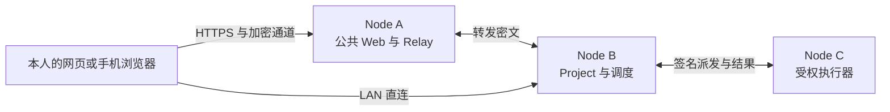

# Vibeface

在自己的 Mac 或 Linux 设备上运行 `vibeface`，创建有名称、职责和项目配置的机器人，直接在它的聊天中提出要求。机器人可以回答问题、运行受管命令，或按需委派编码 Agent。机器人定义、聊天历史和执行结果在本人授权的节点间同步，换一个入口也能查询原来的工作。



所有设备运行同一种 Node，按配置启用角色。公网入口可只提供 Web 和 Relay，不加入个人身份网络；本人设备分别承担 Project、同步、调度和执行。程序为每次请求选择已授权的可用节点，并固定已派发操作的目标。

网页使用 React 和 TanStack Start 构建静态 SPA，随 Rust 程序内嵌分发，生产运行不需要 Node.js Web 服务。可信网页通过设备密钥和 Noise 通道连接指定 Node。

Rust 核心负责认证、路由、DAG 同步、SQLite 存储、执行去重和通知。管理 Agent 通过受管 sidecar 的私有工具通道操作 Node，不需要 MCP。Codex 执行器通过 App Server 协议接收指令并上报事件。机器人定义和共享聊天历史独立于本机 SDK 缓存，创建机器人不会启动模型。

本版本使用新的机器人和数据库结构，部署时使用全新的数据目录重新初始化。旧数据库不自动升级，个人网络中的节点使用同一新版本。

## 安装与开始

主程序是 Rust 二进制 CLI `vibeface`。支持 macOS Apple Silicon、Linux x64 和 Linux ARM64（glibc），运行网页不需要 Node.js。首次安装选最新正式版：

```sh
curl -fsSL https://raw.githubusercontent.com/leaperone/vibeface/main/install.sh | bash
```

当前尚无正式版，需要显式选择 Nightly：

```sh
curl -fsSL https://raw.githubusercontent.com/leaperone/vibeface/main/install.sh | bash -s -- --channel nightly
```

安装器验证完整包及 SHA256，不创建身份、启动服务或配置自动更新；没有 Stable 时也不会自动改装 Nightly。安装后直接启动：

```sh
vibeface
```

在另一个终端运行 `vibeface open` 打开本机入口。首次完成账户授权后，此浏览器默认自动解锁并连接本机节点；可在网页的「允许本机自动登录」中关闭。公网入口仍需正常验证身份。详见[本机自动登录](docs/node.md#本机自动登录)。

首次运行仅在不存在或为空的数据目录中初始化，默认使用 `~/.vibeface` 并监听 `127.0.0.1:4790`，不授予执行目录或启用管理 Agent。当前格式的已有节点使用原身份和配置启动。旧格式目录在任何数据库写入或 Provider 启动前拒绝，原目录保持不变。安装和 CLI 管理见 [安装说明](docs/install.md)。受管安装使用 `vibeface update apply`；旧版程序和数据的处理见 [手动更换程序](docs/releasing.md#手动建立受管安装或更换程序)。

## 从源码开始

从源码构建需要 Rust 1.89+、Node.js 22.12+、pnpm 11.9.0 和 wasm-bindgen-cli 0.2.129。运行编码任务前，安装并登录需要的执行器。

```sh
rustup target add wasm32-unknown-unknown
bash scripts/build-web-crypto.sh
bash scripts/build-web.sh
cargo build --release -p vibeface --locked
./target/release/vibeface init \
	--data-dir "$HOME/.vibeface" \
	--root /absolute/path/to/projects
./target/release/vibeface serve --data-dir "$HOME/.vibeface"
```

`init` 要求数据目录为空或不存在，默认是 `$HOME/.vibeface`。它写入 `identity.json`、`config.json`、一次性 `bootstrap.json`、`data-epoch.json` 和唯一数据库 `node.sqlite3`，不注册网站账号，也不保存个人根私钥。目录标记为 `{"format":"vibeface-node","data_epoch":3,"layout_version":1}`。身份授权和业务状态共用这一个数据库，不导入旧库。运行进程用目录锁独占该目录。

```sh
./target/release/vibeface access --data-dir "$HOME/.vibeface"
```

在自己信任的浏览器打开 `access` 打印的链接，填写此浏览器的设备名称，核对个人网络指纹，并保存加密恢复包。保存密钥的页面需要安全上下文，推荐 `http://localhost:4790`。之后自动核验设备指纹和成员授权，不使用账号密码。创建机器人后进入它的长期聊天，设备、连接和恢复放在设置中。聊天调度需要另外配置 [管理 Agent](docs/node.md#配置管理-agent)。Node 默认尝试启动私有 Codex App Server；未安装 Codex 时，网页可用不代表执行器可用。

另一台 Node 使用独立空目录初始化，客户端核对新 Node 的可信连接卡后，用已有账户完成 Service 登记。登记本身不授予 Project 历史或执行权限，资源授权仍需单独提交签名政策。具体协议见 [添加自己的设备](docs/node.md#添加自己的设备)。

## 接续工作与通知

Project 节点派发任务后，执行节点在接单前取得所需上下文。已授权副本保留同步的历史，切换网页入口仍连接原 Project 宿主并核对原执行目标；副本同步不会自动转移宿主身份或启动另一份管理任务。缺失且不可达的历史会阻止继续执行，系统不会用摘要猜测缺失内容。

普通进度和通知不调用管理模型。B 完成后保存结果和通知，通过可达节点同步到当前入口；客户端离线时保留未读通知，重连后补发。浏览器关闭后的系统推送不在当前范围内。

一次 Codex turn 结束不等于用户目标已经达成。审批仍由本人决定。写操作结果未知时，在原聊天中核查实际结果，不换一个 ID 或设备重新派发。

## 安装、协议与验证

- [首次安装与 CLI 管理](docs/install.md) 包括 Stable/Nightly 一行安装、初始化、状态和后台服务命令。
- [部署与使用 Node](docs/node.md) 包括局域网、公网中继、SDK、后台运行和制品安装。
- [Node 协议参考](docs/node-protocol.md) 包括 HTTP、事件 DAG、操作状态和通知确认。
- [构建与发布](docs/releasing.md) 说明 Linux x64（`x86_64-unknown-linux-gnu`）、Linux ARM64（`aarch64-unknown-linux-gnu`）和 macOS Apple Silicon（`aarch64-apple-darwin`）三个包、SHA256、Stable 与 Nightly 更新渠道，以及 stable/nightly/rc tag 规则。PR 与 `main` 的 [CI](https://github.com/leaperone/vibeface/actions/workflows/ci.yml) 只生成 Actions 制品；公开版本见 [Releases](https://github.com/leaperone/vibeface/releases)，nightly 与 rc 为预发布。
- [选择更新渠道](docs/node.md#选择更新渠道) 可开启空闲时的后台升级；默认 Stable，自动更新默认关闭。
- `scripts/package-node.sh` 生成当前平台的压缩包和 SHA256 文件，默认输出到 `.artifacts/packages/`。

可在仓库根目录运行对应检查。命令本身不代表本次提交已经通过，实际结果以 PR 的验证记录为准。

```sh
cargo fmt --all -- --check
cargo test --workspace --locked
cargo clippy --workspace --all-targets --locked -- -D warnings
```

当前没有原生手机 App。Claude Code 和 Cursor CLI 执行器只支持打开及发送消息，不能代替 Codex 的完整会话控制。模型额度和计费由各 Provider 决定，每日决策次数限制不是 token 或费用上限。
