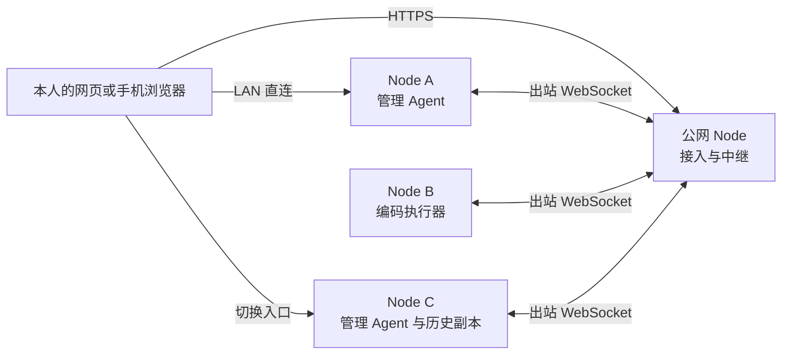

# Vibeface

在自己的 Mac 或 Linux 设备上运行 `vibeface-node`，通过网页与管理 Agent 聊天，让它把任务交给指定设备上的编码 Agent。会话、工单和执行记录在本人授权的节点间同步，换一个入口也能查询原来的工作。



所有设备运行同一种 Node。公网 Server 是 Node 的一种部署方式，可以同时调度和执行。每个人拥有独立的设备网络，不做团队共享设备池，也没有固定的工单调度负责人。

Rust 核心负责认证、路由、DAG 同步、SQLite 存储、执行去重和通知。Cursor SDK 管理 Agent 通过原生自定义工具回调操作 Node，不需要 MCP。Codex 执行器通过 App Server 协议接收指令并上报事件。

## 在本机开始

从源码构建需要 Rust 1.89+。运行编码任务前，安装并登录需要的执行器。

```sh
cargo build --release -p vibeface-node --locked
./target/release/vibeface-node init \
	--data-dir "$HOME/.vibeface" \
	--root /absolute/path/to/projects
./target/release/vibeface-node serve --data-dir "$HOME/.vibeface"
```

`init` 要求数据目录为空或不存在，默认是 `$HOME/.vibeface`。它写入 `identity.json`、`config.json`、`identity.sqlite3`、一次性 `bootstrap.json` 和 `data-epoch.json`（当前数据格式 epoch 为 2），不注册网站账号，也不保存个人根私钥。业务历史在进程打开后写入同目录的 `node.sqlite3`。`serve` 和 `pair` 用目录锁独占该目录。

```sh
./target/release/vibeface-node access --data-dir "$HOME/.vibeface"
```

在自己信任的浏览器打开 `access` 打印的链接，填写此浏览器的设备名称，核对个人网络指纹，并保存加密恢复包。保存密钥的页面需要安全上下文，推荐 `http://localhost:4790`。之后自动核验设备指纹和成员授权，不使用账号密码。可以创建会话、工单，查看设备和执行记录。聊天调度需要另外配置 [管理 Agent](docs/node.md#配置管理-agent)。Node 默认尝试启动私有 Codex App Server；未安装 Codex 时，网页可用不代表执行器可用。

另一台 Node 使用独立的空数据目录先 `init`。管理客户端复制的一次性配对信息传给 `pair --invite`；同一内容存成 JSON 文件时使用 `pair --invite-file`。不要用新建个人网络代替配对。操作步骤见 [添加自己的设备](docs/node.md#添加自己的设备)。

## 接续工作与通知

A 把任务派发到 B 后，B 在接单前取得所需上下文。A 离线时，可以在已同步的 C 查询会话，由 C 核对 B 的实际状态，再使用 C 自己的管理 Agent 回答。缺失且不可达的历史会阻止继续执行，系统不会用摘要猜测缺失内容。

普通进度和通知不调用管理模型。B 完成后保存结果和通知，通过可达节点同步到当前入口；客户端离线时保留未读通知，重连后补发。浏览器关闭后的系统推送不在当前范围内。

一次 Codex turn 结束不等于工单通过验收。审批和工单验收仍由本人决定。写操作结果未知时，先核对原操作和执行会话，不换一个 ID 重新派发。

## 安装、协议与验证

- [部署与使用 Node](docs/node.md) 包括局域网、公网中继、SDK、后台运行和制品安装。
- [Node 协议参考](docs/node-protocol.md) 包括 HTTP、事件 DAG、操作状态和通知确认。
- [构建与发布](docs/releasing.md) 说明 Linux x64（`x86_64-unknown-linux-gnu`）、Linux ARM64（`aarch64-unknown-linux-gnu`）和 macOS Apple Silicon（`aarch64-apple-darwin`）三个包、SHA256、Stable 与 Nightly 更新渠道，以及 stable/nightly/rc tag 规则。PR 与 `main` 的 [CI](https://github.com/leaperone/vibeface/actions/workflows/ci.yml) 只生成 Actions 制品；公开版本见 [Releases](https://github.com/leaperone/vibeface/releases)，nightly 与 rc 为预发布。
- [选择更新渠道](docs/node.md#选择更新渠道) 可开启空闲时的后台升级；默认 Stable，自动更新默认关闭。
- `scripts/package-node.sh` 生成当前平台的压缩包和 SHA256 文件，默认输出到 `.artifacts/packages/`。

可在仓库根目录运行对应检查。命令本身不代表本次提交已经通过，实际结果以 PR 的验证记录为准。

```sh
cargo fmt --all -- --check
cargo test --workspace --locked
cargo clippy --workspace --all-targets --locked -- -D warnings
```

当前没有原生手机 App。Claude Code 和 Cursor CLI 执行器只支持打开及发送消息，不能代替 Codex 的完整会话控制。模型额度和计费由各 Provider 决定，每日决策次数限制不是 token 或费用上限。
