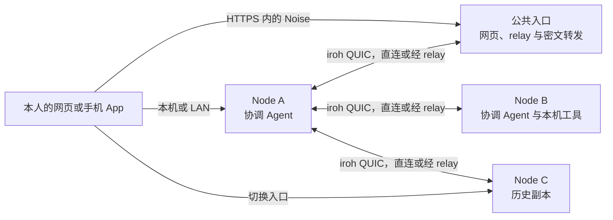

<div align="center">

# Vibeface

**把自己的电脑连成一张私有网络，用聊天派活，选择执行的电脑，并在同一段对话里查看结果。**

[English](README.md) · [简体中文](README.zh-CN.md)

[](https://github.com/leaperone/vibeface/actions/workflows/ci.yml)
[](https://github.com/leaperone/vibeface/releases)
[](Cargo.toml)
[](packages/docs/releasing.md)

</div>

> [!NOTE]
> Vibeface 目前处于 Nightly 阶段。正式版发布前，协议、数据格式和 API 可能继续调整。

## 目录

- [功能概览](#功能概览)
- [工作原理](#工作原理)
- [从这里开始](#从这里开始)
- [使用多台电脑](#使用多台电脑)
- [从源码构建](#从源码构建)
- [仓库结构](#仓库结构)
- [阅读文档](#阅读文档)
- [参与贡献](#参与贡献)
- [许可证](#许可证)

## 功能概览

- **聊天驱动的 Bot。** 给 Bot 设置名称、职责和项目目录，在长期对话里直接提出需求。
- **自己的电脑。** 每台 Mac 或 Linux 电脑运行一个 Node。某台电脑上的 Bot 可以把工作交给另一台已批准的电脑。
- **换电脑继续。** 签名历史会在已授权的 Node 间同步 Bot 对话、设置、任务阶段、摘要和持久结果。回放历史不会重新启动旧工作，项目文件、登录状态和 SDK 状态也不会自动迁移。
- **加密连接。** 浏览器和手机使用设备密钥与 Node 建立 Noise 连接。公共入口可以转发密文，但不会因此加入你的私有网络。
- **一个完整的本机包。** 包内同时提供 `vibeface` CLI、`vibeface-core` 和静态 `web/` 应用，生产环境不需要 Node.js Web 服务。
- **原生移动端。** Expo iOS 和 Android 应用复用同一套 client 协议，设备密钥保存在系统安全存储中。

> [!WARNING]
> 文件交付是实验功能，默认关闭。公益转发不需要钱包，付费交付只使用本机 `chain_id=31337` 测试链，不处理真实资产。边界见[文件交付实验参考](packages/docs/paid-delivery.md)。

## 工作原理



| 部分 | 职责 |
| --- | --- |
| **Node** | Rust 服务，负责身份、路由、签名历史、SQLite 存储、调度、去重和通知。 |
| **协调 Agent** | Codex、Claude Code、pi、opencode 或 Cursor SDK。Cursor 使用原生 SDK 工具，其他产品通过本机 `vibeface tool` 命令调用 Node，不需要 MCP。 |
| **执行** | 选定的 Agent 在选定的电脑上使用自己的 Shell 和文件工具。 |
| **网页应用** | 从完整包或显式应用目录提供静态 SPA。浏览器用设备密钥签名请求，通过 Noise 访问指定 Node。 |
| **手机应用** | Expo iOS 和 Android 客户端，复用共享 client 与原生安全模块。 |

请先了解这些边界：

- 每个人管理独立的设备网络。公网服务器可以作为该网络里的 Node，也可以只做公共入口。
- 公共入口默认不保存个人网络数据。启用文件交付后，独立的 `delivery/` 会保存交付对象、服务账本和本机恢复材料，其中可能有密钥或私密证明材料，请按凭证保管。
- Bot 定义和共享聊天历史与本机 SDK 缓存分开。创建 Bot 不会启动模型。
- 写操作结果未知时，先核对原结果再重试。不要换 ID 或设备直接再次发送同一写操作。
- 每个数据目录都有 data epoch。程序只打开匹配的 epoch，不升级数据库。同一网络里的 Node 使用同一版本。

## 从这里开始

先看[快速上手](packages/docs/quick-start.md)。添加设备或恢复身份看[首次配置](packages/docs/onboarding.md)，日常工作看[用户指南](packages/docs/user-guide.md)。[产品概览](packages/docs/overview.md)介绍功能边界，[排障](packages/docs/troubleshooting.md)介绍连接失败时的处理方法。

### 前置条件

| 依赖 | 版本 | 用途 |
| --- | --- | --- |
| macOS Apple Silicon、Linux x64 或 Linux ARM64（glibc） | | 运行 Node |
| Node.js | 22+ | 仅 npm 安装入口需要 |
| Codex CLI | 已安装并按此 Node 登录 | 可选的 Codex Bot 和任务执行 |
| [Claude Code](https://docs.anthropic.com/en/docs/claude-code) | 已安装并按此 Node 登录 | 可选的 Claude Code Bot 和任务执行 |
| [pi](https://www.npmjs.com/package/@earendil-works/pi-coding-agent) | 已安装并登录 | 可选的 pi Bot 和任务执行 |
| [opencode](https://opencode.ai) | 2.2.0，并按此 Node 登录 | 可选的 opencode Bot 和任务执行 |
| [Cursor SDK Bridge](https://github.com/cursor/sdk-bridge/releases/tag/v1.2.0) | 1.2.0 发布包，需按自己的环境验证 | 可选的 Cursor Bot 和任务执行 |

### 安装

npm Nightly 分发已配置，但尚未公开发布。首次发布后可以这样安装：

```sh
npm install -g @leaperone/vibeface@nightly
vibeface --version
```

npm 包包含平台程序和服务脚本，不会在 `postinstall` 阶段下载、初始化或启动服务。在此之前，可以从 [GitHub Releases](https://github.com/leaperone/vibeface/releases) 下载完整包，并按[安装说明](packages/docs/install.md)操作。

### 启动第一台 Node

```sh
vibeface
```

数据目录默认为 `~/.vibeface`，可以用 `--data-dir` 或 `VIBEFACE_DATA_DIR` 指定其他绝对路径。首次运行只初始化不存在或为空的目录，并监听 `127.0.0.1:4790`。

1. 在本机浏览器打开 `http://localhost:4790`。保存设备密钥需要安全上下文，请固定使用 `localhost`。
2. 选择**新建我的网络**，填写电脑名称，设置恢复密码，并下载恢复文件。
3. 在**让这台电脑运行 Bot**中选择服务，按此 Node 的私有目录完成登录，检查可用性后启用。
4. 创建一个 Bot，发送测试消息。要让它操作项目，请在设备的**AI**设置中启用**执行任务**，并添加项目目录。

### 配置 Node

日常配置可以在网页中完成，也可以在初始化时写入 `config.json`：

```sh
vibeface init \
	--root /absolute/path/to/projects \
	--manager codex \
	--codex-socket '<App Server socket 的绝对路径>' \
	--workspace /absolute/path/to/manager-workspace
```

| 参数 | 说明 |
| --- | --- |
| `--root` | 允许 Agent 访问的项目目录，可以重复。 |
| `--manager` | 协调产品，取值为 `codex`、`cursor`、`claude`、`pi` 或 `opencode`。 |
| `--workspace` | 协调 Agent 的工作目录，须与项目目录分开。 |
| `--model` | 模型名，省略时使用产品默认模型，Cursor 默认 `auto`。 |
| `--listen` | 监听地址，默认 `127.0.0.1:4790`。 |
| `--no-web` | 关闭浏览器应用，但保留 Node 传输和本机工具。 |
| `--relay` / `--relay-listen` | 连接其他 Node 的 relay，或在本机运行 relay。 |
| `--relay-mode discovery-only` | 公共服务只用于发现和直连。 |
| `--discovery` | 设置固定身份的公共发现服务。 |
| `--public-entry` | 运行公共入口或发现服务，但不加入个人网络。 |

使用 Cursor SDK 时，在 Node 环境中设置 `CURSOR_API_KEY`。不要把密钥写进命令、URL、Git 或聊天记录。全部字段见[本机配置](packages/docs/node-protocol.md#本机配置)，Claude Code、pi 和 opencode 见[对应说明](packages/docs/node.md#使用-claude-codepi-或-opencode)。

## 使用多台电脑

### 添加另一台电脑

在新电脑上执行：

```sh
vibeface join '<加入链接>' --name '<设备名称>'
```

在已有网络的管理电脑的**添加设备**中生成加入链接。在两台电脑上核对 6 位安全码后再批准。不要在新电脑上创建第二个个人网络。详见[添加自己的设备](packages/docs/node.md#添加自己的设备)。

### 跨设备派活与接续

- 在 A 的 Bot 聊天里让它把工作交给 B，任务阶段、摘要和持久结果会回到原聊天。
- A 离线时，在已同步的 C 打开同一段对话，选择**交给这台电脑处理**，由 C 的本机 Agent 接着执行。
- 普通通知不调用模型。客户端离线时保留未读通知，重连后补发。
- 执行 Agent 默认使用 bypass。需要本人决定的请求由协调 Agent 处理。

### 常用命令

| 命令 | 作用 |
| --- | --- |
| `vibeface` | 按配置初始化数据目录（如需要）并启动 Node。 |
| `vibeface serve` | 按现有配置启动 Node。 |
| `vibeface status` | 通过本机维护 socket 检查 Node 状态。 |
| `vibeface access` | 显示本机网页入口。 |
| `vibeface service` | 管理后台服务和更新定时器。 |
| `vibeface update` | 选择更新渠道、检查更新或应用更新。 |
| `vibeface hooks` | 安装、移除或测试 Codex、Claude Code hooks 与 pi、opencode 扩展。 |
| `vibeface logs` | 读取本机 Node 日志。 |

完整命令运行 `vibeface --help`。公网部署可用 `init --public-entry` 运行公共入口，也可以用 `init --relay-listen` 为个人网络运行 relay。见[配置公共入口](packages/docs/node.md#配置公共入口)和[Node 之间的连接](packages/docs/node.md#node-之间的连接)。

## 从源码构建

需要 Rust 1.91+、Node.js 22.12+、pnpm 11.9.0 和 `wasm-bindgen-cli` 0.2.129。

```sh
rustup target add wasm32-unknown-unknown
bash scripts/build-web-crypto.sh
bash scripts/build-web.sh
cargo build --release -p vibeface -p vibeface-core --locked
bash scripts/package-node.sh
./target/release/vibeface init \
	--root /absolute/path/to/projects
./target/release/vibeface serve
```

`init` 只接受不存在或为空的数据目录，会写入 `identity.json`、`config.json`、一次性 `bootstrap.json`、`data-epoch.json` 和 `node.sqlite3`。`serve` 和 `join` 会独占数据目录锁；Node 正在运行时，`join` 会交给它处理，不会抢锁。

`bash scripts/package-node.sh` 将当前平台压缩包和 SHA256 文件写入 `.artifacts/packages/`。完整包包含 `vibeface`、`vibeface-core`、`BUILD-INFO.json` 和 `web/`，更新器会原子切换整个发行目录。

移动端先用 `bash scripts/build-mobile-secure.sh ios` 或 `bash scripts/build-mobile-secure.sh android` 构建安全模块，再使用 `apps/mobile` 中的 Expo 脚本。

## 仓库结构

```text
.
├── apps/
│   ├── app/         # Core 提供的 Web 应用
│   ├── cli/         # vibeface 命令行和本机控制客户端
│   ├── core/        # Node 服务、存储、同步、调度和执行
│   ├── mobile/      # Expo iOS 和 Android 客户端
│   └── www/         # 公共门户、文档和下载入口
├── crates/
│   ├── control/     # CLI 与 Core 的控制 DTO 和客户端
│   ├── bridge/      # Codex App Server 和 Agent 客户端
│   ├── protocol/    # 共享 RPC 和消息类型
│   ├── secure/      # 设备身份、成员关系、Noise 和恢复逻辑
│   ├── secure-ffi/  # 移动端原生模块的 UniFFI 绑定
│   └── delivery/    # 文件交付语句、加密和证明
├── packages/        # 共享 client、主题和原生模块
├── contracts/       # 交付合约、verifier 和本地链脚本
├── scripts/         # 网页、移动端、打包、CI 和验收脚本
├── tests/           # 受控夹具和端到端测试
├── packages/docs/   # 用户指南、协议参考和设计文档
└── install.sh       # GitHub 完整包安装脚本
```

## 阅读文档

| 文档 | 内容 |
| --- | --- |
| [产品概览](packages/docs/overview.md) | 用途、Bot、执行关系和第一台电脑的条件。 |
| [选型比较](packages/docs/comparison.md) | Vibeface、Codex、Claude Code 和 OpenClaw 的适用方式。 |
| [Bot 与任务执行](packages/docs/bot-and-execution.md) | 协调、本机 Agent 和结果回传。 |
| [历史同步](packages/docs/history-sync.md) | 签名历史、接续和备份边界。 |
| [隐私与安全](packages/docs/privacy-security.md) | 设备身份、访问权限、凭证和恢复。 |
| [安装说明](packages/docs/install.md) | npm Nightly、完整包、初始化、状态和服务。 |
| [部署配置](packages/docs/deployment.md) | 数据目录、平台和集成。 |
| [部署与使用 Node](packages/docs/node.md) | 局域网、公共入口、relay、Agent、服务、更新和恢复。 |
| [Node 协议参考](packages/docs/node-protocol.md) | 配置、浏览器传输、RPC、签名事件和 iroh。 |
| [文件交付实验参考](packages/docs/paid-delivery.md) | VDP-1 角色、费用、钱包、证明和结算边界。 |
| [排障](packages/docs/troubleshooting.md) | 状态、日志、诊断和分叉处理。 |
| [构建与发布](packages/docs/releasing.md) | 平台包、SHA256、发布渠道和 tag。 |
| [CI](packages/docs/ci.md) | 主分支检查、扩展 CI 和本地专项。 |

## 参与贡献

- **报告问题。** 在 [Issues](https://github.com/leaperone/vibeface/issues) 附上 `vibeface --version`、平台和 `vibeface status`。不要粘贴密钥或恢复文件。
- **提交 PR。** 从 `main` 创建独立分支，使用 Conventional Commits，并运行与改动相关的检查。同步、恢复、调度和工具执行改动还要按 [CI](packages/docs/ci.md) 补跑本地专项。

提交前可在仓库根目录运行相关检查：

```sh
cargo fmt --all -- --check
cargo clippy --workspace --all-targets --locked -- -D warnings
cargo test --workspace --locked
```

## 许可证

仓库目前没有 `LICENSE` 文件，开源协议仍在确定中。在协议发布前，代码默认保留所有权利。
