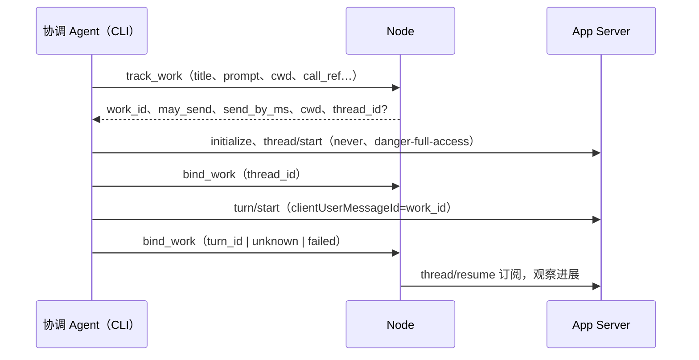

# Agent 直连 App Server 与 Node 分诊

状态为实施中。本文在 `docs/design/unified-network.md` 的 Work 模型上做两处改动。第一处，调度 Agent 直接连本机 Codex App Server 发起工作，默认完全访问，Node 不再替 Agent 发 `turn/start`，也不再转发审批。第二处，Node 先采集本机 Codex 与 Claude Code 会话的状态，由调度层判断是否需要本人，再写进网页的提醒卡片或签名转发给 Grok Bot。网页和 Grok Bot 用同一个“送决定回会话”接口。项目尚未发布正式版，事件、表、RPC 和工具直接改成最终形态。

提醒卡片、`send_decision` 和 matter 合并已由 [聊天里的提问与回答](questions-in-chat.md) 取代：需要本人时，提问写进拥有该会话的 Bot 聊天，回答是那个聊天里的一条消息，由 Bot 执行。下文相应段落已按新形态改写。

用户决定（2026-10-20）：

- Agent 直连 `codex app-server --listen unix://...`，保留 Unix socket，不改 stdio，不加 socket 令牌。
- 默认 `approvalPolicy=never`、`sandbox=danger-full-access`。删除审批转发和审批表单，网页不提示风险。
- Node 继续负责跨设备派活、进展观察、记录和重启对账。跨设备派发要求目标设备配置了调度 Agent。
- 每台设备只有一个完整的协调角色：协调 Agent 加确定性的运行时。没有单独的执行层，也没有 `executor` 角色。
- 协调 Agent 的 Shell 完全访问（`danger-full-access`、`approvalPolicy=never`），能写状态、跑 git 和 gh，直接经 socket 驱动本机 Codex。Node 不替它包装方法、不限制路径。
- App Server 客户端覆盖全部方法。执行的命令、命令输出、diff 和改动文件列表只进状态，不在网页显示。
- 分诊在 Node 完成，目的是节省 Grok Bot 额度。网页和 Grok Bot 可以互相替代。
- 删除会话自主度（`AutonomySet`、`off/report/continue`、只读汇报轮和只读 sidecar 配置）。协调 Agent 总是完全权限。
- Codex 发起的服务端请求没有固定策略：Node 挂起请求，交给协调 Agent 处理；需要本人拍板时，Agent 在负责该会话的 Bot 聊天里提问，也可转发 Grok Bot。
- 网页不再透传 App Server 方法，只读状态摘要；本人的决定是对提问的回答。

## 1. App Server 客户端

`vibeface-bridge` 的 Codex 客户端按一张方法表工作。方法名单来自 `crates/bridge/schema/app-server-methods.json`，由 `scripts/codex-schema.py` 从已安装的 Codex 生成（当前 0.163.0：105 个客户端请求、1 个客户端通知、10 个服务端请求、85 个服务端通知）。逐方法的处理方式见 `docs/codex-app-server.md`。测试比较三者，名单里有而表里或文档里没有的方法会让 CI 失败。

| 方向 | 表中的分类 | 含义 |
|---|---|---|
| 客户端请求 | `read` | 只读，可重试，失败不算结果不明 |
| | `write` | 有副作用，连接中断时结果不明，不自动重发 |
| | `hidden` | 客户端能发，但不经 Node 暴露给网页（文件读写、任意命令执行、凭证刷新） |
| 服务端通知 | 归约类别 | 每个通知归入一个类别（线程、回合、条目、计划、推理摘要、用量、额度、账户、配置、技能、插件、MCP、应用、文件监视、进程、实时、警告等），由观察状态的归约函数处理 |
| 服务端请求 | 交给协调 Agent | Node 挂起请求并唤醒协调 Agent，由它回答或提问，见 1.2 |

### 1.1 观察状态

客户端把每条通知归约进 `Observed`：每个线程的状态、名称、模型和推理强度、进行中的回合、最近回合的结果、最后一段回答、计划步骤、推理摘要、token 用量、目标和归档状态，以及全局的账户类型、额度、模型列表、技能、插件、MCP 状态和最近的警告。账户状态只保留类型、套餐和登录与否，不保留任何 token。

送往网页之前，Node 用 `sanitize` 去掉执行内容：`commandExecution` 只留 `id`、`type`、`status`；`fileChange` 去掉 `changes`；`turn/diff/updated`、命令输出和进程输出的增量不送出。状态里保留原始内容，供对账和 Agent 使用。

### 1.2 服务端请求

工作线程用 `approvalPolicy=never` 启动，正常不会收到审批。仍可能到达的请求（Node 订阅的线程上的，或不属于任何线程的）由 bridge 交给 Node，Node 不按方法自动回复：

1. Node 给请求分配 `request_id`，挂起并记入 `node.log`（方法和线程，不含命令文本），然后作为 `needs_input` 事件（带 `request_id`）立即唤醒本机协调 Agent。事件只含方法、原因和问题，命令、补丁和路径不进事件。
2. Agent 用 `vibeface codex requests` 查看挂起的请求（含完整参数），用 `vibeface codex respond <request_id> '<result-json>'` 回答。同一 `request_id` 只回答一次，重复调用返回第一次的结果。
3. 需要本人决定时，Agent 用 `vibeface triage raise --request-id <ID> --question <问题> --choice 批准 --choice 拒绝` 在负责该线程的 Bot 聊天里提问。提问挂住请求直到有回答，不设超时；回答后该 Bot 有 120 秒用 `vibeface codex respond <ID> '<result-json>' --node <设备>` 应答。线程不属于任何 Bot 时立即兜底。
4. 没有配置协调 Agent、唤醒失败，或 Agent 120 秒内既没回答也没提问时，Node 按方法给出确定的拒绝并记录：

| 请求 | 兜底回复 |
|---|---|
| `item/commandExecution/requestApproval`、`item/fileChange/requestApproval` | `decline` |
| `execCommandApproval`、`applyPatchApproval` | `denied` |
| `item/permissions/requestApproval` | 不授予任何权限 |
| `item/tool/requestUserInput` | 空回答 |
| `mcpServer/elicitation/request` | `cancel` |
| `item/tool/call` | 返回失败 |
| `account/chatgptAuthTokens/refresh`、`attestation/generate` | JSON-RPC 错误，Node 不持有凭证 |

挂起的请求只在内存里，随 App Server 连接断开而作废。终端里打开的会话、别的客户端发起的回合，Node 没有订阅时留给原客户端回答。

## 2. 协调 Agent 直连

### 2.1 分工

| 归属 | 内容 |
|---|---|
| 协调 Agent（Shell 完全访问） | 经 `vibeface codex` 直接调用 App Server 的任意方法；本机派发时自己开线程、发回合 |
| 运行时（Node 进程，`runtime/codex_server.rs`） | App Server 进程与 socket 的生命周期；工作登记与绑定；`thread/resume` 订阅并把进展写成事件；重启和超时对账；跨设备派发；同步、身份与网页；webhook 发件箱（第 4 节）；送决定（第 5 节） |

Node 不再有执行层：删除 `executor` 命名、Node 发 `turn/start` 的路径、审批转发和逐方法包装。工作只分两类，记在 `WorkDispatched.kind`：`codex` 是本机协调 Agent 发出、Node 观察的 Codex 回合；`task` 是交给某台设备协调 Agent 的一轮任务。

### 2.1a 用哪个 App Server

用户决定（2026-10-21）：默认用这台电脑上已经运行的 App Server，会话与本人的 Codex 共用；Node 自己启动一个只作为本人可选的后备。设置在 `config.json` 的 `providers.codex_app_server`：`{"mode":"system"|"spawn","socket":null|"<路径>"}`，网页在“设备 → AI → Codex → 设置”里切换并测试连接。

- `system`（默认）：Node 不启动也不结束它。`socket` 为空时按 Codex 自己的约定找控制 socket：先 Node 环境里的 `$CODEX_HOME`，再 `~/.codex`，路径是 `<home>/app-server-control/app-server-control.sock`。`codex app-server proxy` 和 `codex app-server daemon version` 用的就是它；桌面应用的 daemon 把它做成指向 `/tmp/codex-daemon-<uid>/<hash>` 中活着那个 socket 的软链。`/tmp/codex-daemon-<uid>/` 里留着很多旧 socket，Node 不扫描那个目录。每个候选都做一次真实的 `initialize` 握手：不存在、拒绝连接或路径过长的跳过，握手失败的报 `handshake_failed`，都不通时报 `not_found`。连上后断开 5 秒就重新查找，按 1 至 30 秒退避；App Server 被重启或换了 socket 时自动跟过去。
- `spawn`：沿用原来的托管方式，`codex_bin` 和 `provider-env.json` 里的 Codex 变量只在这个模式传给 App Server。
- Agent 的 `VIBEFACE_CODEX_SOCKET` 固定是 `/tmp/vibeface-<identity>/app-server.sock`，Node 把它软链到正在用的 socket，切换模式或 App Server 换位置时 Agent 的环境不用变。
- 线程被另一个进程写着时（Codex 报 `already has an active writer`），写请求按“没有发出”报错，不自动重发；观察改为读取 turn，不再反复 `thread/resume`。
- 网页的 `test_codex_app_server` 做一次独立握手，返回与状态相同的 `{state, socket, user_agent | reason | candidates}`。

### 2.2 薄 CLI

`vibeface codex` 直接连 `VIBEFACE_CODEX_SOCKET`（Node 把 App Server socket 放进协调 Agent 的工具环境），不经 Node：

| 命令 | 作用 |
|---|---|
| `vibeface codex call <method> [json]` | 调用名单里的任意方法，原样打印结果；写方法结果不明时报错并提示先回读 |
| `vibeface codex send <thread> <text> --id ID [--model M] [--effort E] [--image PATH]...` | 带 `thread` 的 `dispatch_work`：登记工作后 `thread/resume`，回合进行中时 `turn/steer`，否则 `turn/start`；输出与 `dispatch_work` 相同 |
| `vibeface codex watch <thread>` | `thread/resume` 后逐行打印通知 |

`send` 是一项工作，`--id` 即 `call_ref`。同一轮同一 `--id` 再次执行只拿回原工作，不会发第二次；结果不明时由 Node 按 `clientUserMessageId` 对账。Bot 转达本人的回答时以回答消息的 `message_id` 作 `--id`。

### 2.3 派发流程

`vibeface tool dispatch_work` 在本机派发时由 CLI 进程自己连 App Server：



- `track_work` 在发送前登记。Node 校验授权，写入 `WorkDispatched` 和本机日志。只有第一次登记返回 `may_send=true`；同一 `call_ref` 的重试拿到原工作的状态，CLI 不再发送。
- `continues` 指向原工作时，`track_work` 返回原 thread，CLI 跳过 `thread/start`。
- CLI 在 `send_by_ms`（登记后 60 秒）之后不再发送。线程在发 `turn/start` 之前绑定，绑定失败就不发送。
- `turn/start` 带 `clientUserMessageId=work_id`。回合里的 `userMessage.clientId` 证明这次发送，对账靠它，不靠“最后一个回合”。
- 可选参数 `model`、`effort`、`images`（本机图片路径或 URL）原样进入 `turn/start`。
- `target_node` 是另一台设备时，Node 把任务作为签名的 `WorkDispatched`（`kind=task`）交给那台设备的协调 Agent，由它在本机直连派发。目标设备必须启用协调 Agent。
- Cursor SDK 没有 Shell CLI 路径，它的 `dispatch_work` 回调在 Node 进程里执行同一个 `agent_cli::dispatch`。

### 2.4 状态机

`WorkState` 删除 `WaitingApproval`。状态为 `accepted`、`starting`、`running`、`interrupting`、`finished`、`unverified`。

| 情况 | 结果 |
|---|---|
| `send_by_ms` 加 30 秒后仍是 `accepted` 或没有线程的 `starting` | `rejected`，没有回合可能开始 |
| 窗口结束后线程里找不到 `clientId=work_id` 的回合 | `rejected` |
| 找到该回合 | 按回合状态进入 `running` 或结束 |
| CLI 报告 `turn/start` 结果不明 | 立即按 `clientId` 对账一次；窗口内找不到时保持 `starting`，窗口结束再定 |
| App Server 重连 | 新 epoch，按线程和回合对账，不重发 |

### 2.5 观察和记录

Node 对每个未结束工作的线程保持 `thread/resume` 订阅（重连后自动恢复），这些线程上的服务端请求交给协调 Agent（1.2）。进展写成 `WorkProgress` 事件，手机离线后也能看到：计划更新和阶段性说明写入，同一工作两次写入至少间隔 5 秒，摘要不变时不写。事件只含计划和说明文字，不含命令、输出和 diff。

`interrupt_work` 由 Node 发 `turn/interrupt`，停止按钮不变。

### 2.6 工具

| 工具 | 运行位置 | 作用 |
|---|---|---|
| `dispatch_work` | CLI（Cursor 为 Node 回调） | 本机：登记、开线程、发回合、绑定；其他设备：交给那台设备的协调 Agent |
| `track_work`、`bind_work` | Node | `dispatch_work` 内部使用的登记和绑定 |
| `nodes`、`context`、`work_status`、`interrupt_work`、`call_lookup` | Node | 不变 |

其余 App Server 操作（插话、读线程、模型列表、review、fork 等）都用 `vibeface codex`，Node 不再提供 `codex`、`steer_work` 这类包装工具。

Codex Bot 在 App Server 上的协调回合总是用 `sandboxMode=danger-full-access`、`approvalPolicy=never`，没有只读回合和 `vibeface_manager` 权限配置。

## 3. 网页的会话控制

网页不调用 App Server 方法，只读状态摘要。`node` 参数指向另一台设备时，Node 经成员连接转发（对方要求 `human=true`），只接受本人令牌。本人的决定经 `answer` 回答提问，见 [聊天里的提问与回答](questions-in-chat.md)。

| RPC | 作用 |
|---|---|
| `codex_state {node?}` | 返回 `{connection, threads: [{thread_id, name, status, cwd, plan, reasoning, token_usage}], rate_limits}`，不含命令、输出和 diff |

续接会话、review、fork、模型和技能管理等操作交给协调 Agent 用 `vibeface codex` 完成。

## 4. 分诊

### 4.1 采集

| 来源 | 方式 |
|---|---|
| Codex hook | `Stop`、`PermissionRequest` 调用 `vibeface hook codex` |
| Claude Code hook | `Stop`、`StopFailure`、`Notification` 调用 `vibeface hook claude` |
| App Server | 本机 App Server 报告的所有线程的 `turn/completed`（完成、失败、中断） |
| 会话扫描 | 每 5 分钟扫 `$CODEX_HOME/sessions` 下 24 小时内修改的 `rollout-*.jsonl`，按文件记录已读偏移，读 `task_complete`、`turn_aborted` |

`vibeface hook` 从 stdin 读 hook 输入，补上 git 分支和提交，POST 到本机 Node 的 `/api/hooks`。该路由只在本机监听器上，只接受回环地址、没有 `Origin` 头的 JSON 请求，浏览器跨站请求一律拒绝。Node 不在线时写入数据目录的 `hook-spool/`，Node 每次扫描（启动 5 秒后，之后每 5 分钟）时读入。Node 第一次见到启动前就存在的 rollout 文件时从文件末尾开始读，不把历史当新事件。hook 总是以 0 退出，连接超时 2 秒，总超时 5 秒。

统一事件格式（schema_version 1）：

```text
{ schema_version, event_id, source, host, node, agent, event, status, session_id, turn_id,
  cwd, repo, git_branch, git_head, last_message, detail, ts_ms, test }
```

- `agent`：`codex` 或 `claude`。`event`：`turn_end`、`needs_input`、`notification`。`status`：`completed`、`failed`、`interrupted` 或空。
- `event_id = sha256(node, agent, session_id, turn_key, event)` 的前 32 个十六进制字符。`turn_key` 是回合编号；Claude 没有回合编号，用 transcript 的字节长度。同一回合从 hook、App Server 和扫描进来得到同一个 `event_id`，只处理一次。
- `last_message` 最多 4000 字，`detail` 最多 2000 字。

### 4.2 判断

判断留在协调 Agent 里，Node 不写规则。Node 只做不花 token 的确定性工作：收事件、去重、排队、按 Agent 的决定路由和投递。

- 新事件进入本机待处理队列。每 20 秒唤醒一次本机协调 Agent（有挂起的服务端请求时立即唤醒），把待处理事件（最多 20 条）交给它，新会话，带完整 Shell。这一轮结束后，它没处理的事件直接丢弃，没回答也没提问的请求按兜底回复。不属于任何 Bot 的交互会话先由运行它的设备归给主 Bot 再入队；不再关注的和 `codex exec`、子代理等后台会话的事件不入队。`test=true` 的事件只确认收到，不入队。
- Agent 用 Shell 命令回答：
  - `vibeface triage events [--since <毫秒>]`：列出待处理事件（JSON）。
  - `vibeface triage raise --event-id <ID> --severity info|attention|urgent --question <问题> [--choice <标签>]... [--request-id <ID>]`：需要本人看，在拥有该会话的 Bot 聊天里提问。`--choice` 可重复，最多 8 个，文字回答总是可用；`--request-id` 让提问挂住该请求。
  - `vibeface codex requests`、`vibeface codex respond <request_id> '<result-json>'`：查看和回答挂起的服务端请求（1.2），也走 `/api/triage`。
  - `vibeface triage dismiss --event-id <ID>`：静默处理。
- 命令走本机监听器的 `/api/triage`，边界与 `/api/hooks` 相同。唤醒时 Node 把本机监听器地址放进 `VIBEFACE_TRIAGE_URL`。
- 没有配置协调 Agent 时，事件直接丢弃，不排队也不过期；服务端请求立即按兜底回复。

`raise` 和 `dismiss` 按 `event_id` 幂等，重复调用返回第一次的结果。同一 session 同一请求已有未回答的提问时，`raise` 返回原提问，这是确定性去重，不是判断。

### 4.3 出口

出口按项目选择：`config.json` 的 `triage.projects` 按 `cwd` 前缀匹配，最长前缀优先，没有匹配时用 `triage.default_outlet`。取值为 `record`（默认）和 `both`，提问总会写进聊天。

- **record**：写一条 `QuestionAsked` 事件，作用域为拥有该会话的 Bot 会话，随 DAG 同步；网页在聊天和“待处理”里显示。
- **both**：另外 HMAC 签名 POST 到 `triage.webhook_url`。请求头 `X-Vibeface-Event-Id`、`X-Vibeface-Timestamp`（Unix 秒）、`X-Vibeface-Signature: v1=<hex>`，签名为 `HMAC-SHA256(key, timestamp + "." + body)`。正文为 `{"type":"question", question_id, severity, text, choices: [{index, label}], about, bot, answer: {url, device_id, question_id}}`，`event_id` 为提问 ID；任一侧回答后，提问方 Node 再发 `{"type":"answered", question_id, text}`，`event_id` 为 `answered-<提问 ID>-<回答事件哈希前 16 位>`；并发回答被同步换成胜者时，按胜者再发一次。`schema_version` 为 1。接收方应拒绝 5 分钟以外的时间戳，并按 `event_id` 去重。发件箱存在本机 SQLite（不同步）：2xx 记为已送达；408、429 和 5xx 退避重试（10 秒起翻倍），最多 8 次后进入死信；其他 4xx 直接死信。同一 `event_id` 只入队一次。

密钥只存在数据目录的 `triage-webhook.key`（0600），不进 `config.json`、DAG、日志和诊断包。网页只能设置或清除，读不回来。

设置是本机的，只有管理设备或本机会话能改，经浏览器会话的方法调用：

| 方法 | 参数 | 返回 |
|---|---|---|
| `triage_settings` | 无 | `{default_outlet, projects, webhook_url, scan_codex_sessions, webhook_secret_set, decision_url, device_id, decision_tokens: [{token_id, label, created_ms}], outbox: {pending, delivered, dead}}` |
| `configure_triage` | `{default_outlet, projects: [{prefix, outlet}], webhook_url, scan_codex_sessions, webhook_secret?}`；`webhook_secret` 为字符串时设置，`null` 时清除，缺省时保留 | 同 `triage_settings` |
| `test_webhook` | 无 | `{ok, status, error}`，立即发一条签名的测试事件，不进发件箱 |
| `create_decision_token` | `{label}` | `{token_id, token, label, created_ms}`，`token` 只在这里出现一次 |
| `revoke_decision_token` | `{token_id}` | `{revoked}` |

提问经 `rpc` 读写：`questions` 返回全网未回答的提问；`answer {question_id, text, attestation}` 写该提问唯一的回答消息。形状见 [聊天里的提问与回答](questions-in-chat.md)。

## 5. 回答回到会话

回答是 Bot 聊天里的一条消息 `a-<question_id>`，每个提问只有一个。网页、Grok Bot 和重试写的都是这一条，已有不同回答时返回已有回答。回答作为 `answer` 轮交给该 Bot，它用 `vibeface codex send <线程> <文字> --id a-<question_id>` 转达，或用 `vibeface codex respond <请求> '<json>' --node <设备>` 应答挂起的请求，重试只回读。

Grok Bot 用 HTTPS 调公共入口：`POST https://<入口>/api/decision`，`Authorization: Bearer <决定令牌>`，正文 `{device_id, question_id, choice?, text?}`，`choice`（选项序号）与 `text` 二选一，返回 `{question_id, answer_id, status, text}`。公共入口不校验令牌，经 iroh 的 `vibeface/decision/1` 转给目标设备（目标设备通过 `--entry` 连在入口的 relay 上）。目标 Node 用本机保存的令牌哈希校验，令牌只能调用这一个接口，不能读会话、改设置或做别的操作。令牌在网页设置里生成，只显示一次，可撤销。成员 Node 自己有公网 HTTPS 时，同一路由直接处理本机的提问，其他设备的转给目标。令牌错误返回 401。

这替代了 Leo 方案里的 `codex-ws-proxy` 和 frpc。原方案把 App Server 的控制 socket 以明文 `ws://` 暴露在公网，持有 Bearer 的一方能调用 App Server 的全部方法。现在公网只有 TLS 之后的一个窄接口，令牌只能回答提问；上行改为 Node 签名推送，Grok Bot 不再需要本机 Shell 读 jsonl 和每 3 小时巡检。

## 6. 安装 hook

```sh
vibeface hooks install --data-dir <数据目录> [--home <目录>] [--dry-run]
vibeface hooks status --data-dir <数据目录> [--home <目录>]
vibeface hooks test --data-dir <数据目录>
vibeface hooks uninstall --data-dir <数据目录> [--home <目录>] [--dry-run]
```

`install` 修改 `~/.codex/hooks.json` 和 `~/.claude/settings.json`。先把原文件备份为 `<文件>.bak-vibeface-<时间>`，只追加本工具的条目，不改动其他 hook（如 orca、paseo），重复执行不会重复添加；写回时 JSON 键按字母排序，内容不变。`uninstall` 只删本工具的条目。未给 `--home` 时 Codex 的目录取 `$CODEX_HOME`。`--dry-run` 只打印将要追加的内容。`test` 发送一条 `test=true` 的事件，确认 Node 收到。Codex 还要求 `config.toml` 的 `[features] hooks = true`，未开启时 `install` 只提示，不改该文件；新 hook 第一次运行前 Codex 会请求信任。已经在跑的会话要重启或 resume 后才会触发 hook。

## 7. 删除清单

- `WorkState::WaitingApproval`、`PendingApproval`、`Signal::Approval*`、`work::request_id`。
- 事件 `ApprovalRequested`、`ApprovalAnswered`，`approvals` 表，`ApprovalDecision`，`WorkProjection.open_approvals` 与 `answered_approvals`。
- RPC `answer_approval`、`approval_forms`，`executor::validate_response`、`request_text`、`request_form`。
- 执行层：`Executor` trait、`CodexExecutor`、`ExecutorHost`（改为 `runtime/codex_server.rs` 的 `CodexServer`）、Node 的 `start_work`、`start_thread`、`start_turn`、`answer`、路径限制。
- `model::Executor` 改为 `WorkKind { codex, task }`，工作字段 `executor` 改为 `kind`；节点能力里的 `executor` 改为 `codex`。
- 网页的审批卡片和表单（网页另行处理）。
- 自主度：`AutonomySet` 事件、`autonomy` 表与投影、`set_autonomy` RPC、`off/report/continue`、只读汇报轮、`ManagerAttempt.read_only`、sidecar 的只读配置与只读工具集。
- 服务端请求的固定回复策略（`methods::reply`、`bridge.codex_replied`）。
- 网页的 `codex` 透传 RPC，`codex_state` 改为状态摘要。
- 分诊的 `offered` 记录和待处理事件的 7 天过期。
- 到“执行层”的跨设备派发：跨设备只有协调 Agent 之间的 `task`。

## 8. 验证

- Rust：方法表覆盖测试、归约函数对每类通知的测试、服务端请求的兜底回复、Agent 回答挂起请求、无 Agent 时拒绝并记录、提问挂住请求到回答为止、自主度已删除、`sanitize`、`track_work` 只允许发送一次、`clientId` 对账、回答只写一次、HMAC 签名、发件箱重试和死信、`event_id` 去重、hook 安装只追加。
- 夹具：`scripts/verify-node.py` 的 App Server 夹具按方法名单实现全部客户端请求，启动时核对名单。`--chat-agent` 覆盖直连派发、插话、对账、分诊与 webhook、提问与回答、外来会话认领；`--public-entry` 覆盖经入口回答提问；`--phase4` 覆盖跨设备 Agent 任务。CI 不调用真实 Provider。
