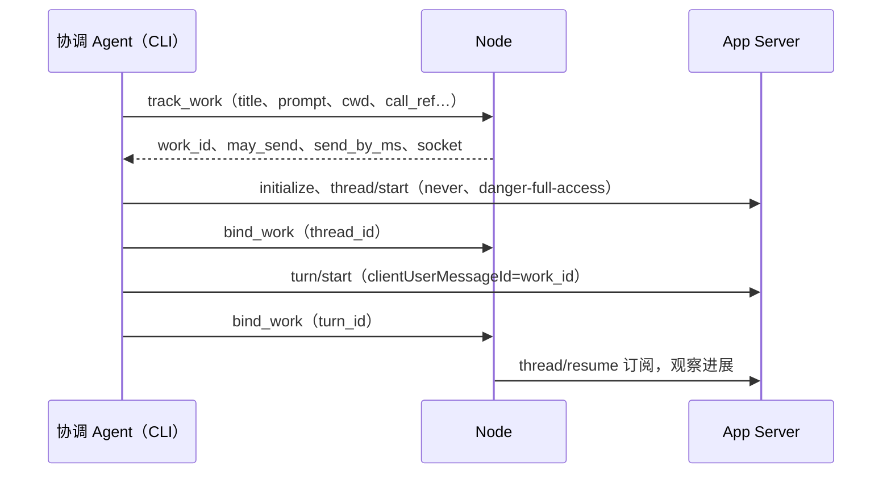

# Agent 直连 App Server 与 Node 分诊

状态为实施中。本文在 `docs/design/unified-network.md` 的 Work 模型上做两处改动。第一处，调度 Agent 直接连本机 Codex App Server 发起工作，默认完全访问，Node 不再替 Agent 发 `turn/start`，也不再转发审批。第二处，Node 先采集本机 Codex 与 Claude Code 会话的状态，由调度层判断是否需要本人，再写进网页的提醒卡片或签名转发给 Grok Bot。网页和 Grok Bot 用同一个“送决定回会话”接口。项目尚未发布正式版，事件、表、RPC 和工具直接改成最终形态。

用户决定（2026-10-20）：

- Agent 直连 `codex app-server --listen unix://...`，保留 Unix socket，不改 stdio，不加 socket 令牌。
- 默认 `approvalPolicy=never`、`sandbox=danger-full-access`。删除审批转发和审批表单，网页不提示风险。
- Node 继续负责跨设备派活、进展观察、记录和重启对账。跨设备派发要求目标设备配置了调度 Agent。
- 执行层客户端覆盖 App Server 的全部方法。执行的命令、命令输出、diff 和改动文件列表只进状态，不在网页显示。
- 分诊在 Node 完成，目的是节省 Grok Bot 额度。网页和 Grok Bot 可以互相替代。

## 1. 执行层：App Server 客户端

`vibeface-bridge` 的 Codex 客户端按一张方法表工作。方法名单来自 `crates/bridge/schema/app-server-methods.json`，由 `scripts/codex-schema.py` 从已安装的 Codex 生成（当前 0.163.0：105 个客户端请求、1 个客户端通知、10 个服务端请求、85 个服务端通知）。逐方法的处理方式见 `docs/codex-app-server.md`。测试比较三者，名单里有而表里或文档里没有的方法会让 CI 失败。

| 方向 | 表中的分类 | 含义 |
|---|---|---|
| 客户端请求 | `read` | 只读，可重试，失败不算结果不明 |
| | `write` | 有副作用，连接中断时结果不明，不自动重发 |
| | `hidden` | 客户端能发，但不经 Node 暴露给网页（文件读写、任意命令执行、凭证刷新） |
| 服务端通知 | 归约类别 | 每个通知归入一个类别（线程、回合、条目、计划、推理摘要、用量、额度、账户、配置、技能、插件、MCP、应用、文件监视、进程、实时、警告等），由观察状态的归约函数处理 |
| 服务端请求 | 回复策略 | 只回复本 Node 负责的工作线程上的请求，按策略立即回复并记录，见 1.2 |

### 1.1 观察状态

客户端把每条通知归约进 `Observed`：每个线程的状态、名称、模型和推理强度、进行中的回合、最近回合的结果、最后一段回答、计划步骤、推理摘要、token 用量、目标和归档状态，以及全局的账户类型、额度、模型列表、技能、插件、MCP 状态和最近的警告。账户状态只保留类型、套餐和登录与否，不保留任何 token。

送往网页之前，Node 用 `sanitize` 去掉执行内容：`commandExecution` 只留 `id`、`type`、`status`；`fileChange` 去掉 `changes`；`turn/diff/updated`、命令输出和进程输出的增量不送出。状态里保留原始内容，供对账和 Agent 使用。

### 1.2 服务端请求

工作线程用 `approvalPolicy=never` 启动，正常不会收到审批。仍可能到达的请求都要有确定的回复，避免回合挂起：

| 请求 | 回复 |
|---|---|
| `item/commandExecution/requestApproval`、`item/fileChange/requestApproval`、`item/permissions/requestApproval`、`execCommandApproval`、`applyPatchApproval` | 批准。线程本来就是完全访问，批准不扩大权限 |
| `item/tool/requestUserInput`、`mcpServer/elicitation/request` | 取消（没有人在场回答） |
| `item/tool/call` | 返回失败，Node 不提供动态工具 |
| `account/chatgptAuthTokens/refresh`、`attestation/generate` | JSON-RPC 错误，Node 不持有凭证 |

Node 只回复自己工作线程上的请求。终端里打开的会话、别的客户端发起的回合，即使 Node 订阅了观察，也留给原客户端回答。每次回复写入 `node.log` 一行（方法和决定，不含命令文本）。

## 2. 调度 Agent 直连

### 2.1 派发流程

协调 Agent 通过 `vibeface tool` 命令使用工具。`dispatch_work` 在本机派发时由 CLI 进程自己连 App Server：



- `track_work` 在发送前登记。Node 校验授权（与原 `authorize_dispatch` 相同），写入 `WorkDispatched` 和本机日志。只有第一次登记返回 `may_send=true`；同一 `call_ref` 的重试拿到原工作的状态，CLI 不再发送。
- `continues` 指向原工作时，`track_work` 直接返回原 thread，CLI 先 `thread/resume` 再 `turn/start`。
- CLI 在 `send_by_ms`（登记后 60 秒）之后不再发送。线程在发 `turn/start` 之前绑定，绑定失败就不发送。
- `turn/start` 带 `clientUserMessageId=work_id`。回合里的 `userMessage.clientId` 因此能证明这次发送，对账靠它，不靠“最后一个回合”。
- 可选参数 `model`、`effort`、`images`（本机图片路径）原样进入 `turn/start`。

### 2.2 状态机

`WorkState` 删除 `WaitingApproval`。状态为 `accepted`、`starting`、`running`、`interrupting`、`finished`、`unverified`。

| 情况 | 结果 |
|---|---|
| `send_by_ms` 加 30 秒后仍是 `accepted`（没有绑定线程） | `rejected`，没有回合可能开始 |
| `starting` 超时，线程里找不到 `clientId=work_id` 的回合 | `rejected` |
| 找到该回合 | 按回合状态进入 `running` 或结束 |
| CLI 报告 `turn/start` 结果不明 | 立即按 `clientId` 对账一次，读不到线程时 `unverified` 并等下次对账 |
| App Server 重连 | 与原来相同：新 epoch，按线程和回合对账，不重发 |

### 2.3 Node 的观察和记录

Node 对每个未结束工作的线程保持 `thread/resume` 订阅（重连后自动恢复）。进展写成 `WorkProgress` 事件，手机离线后也能看到：计划更新、阶段性说明和回合结束时写入，同一工作两次写入至少间隔 5 秒，摘要不变时不写。事件只含计划和说明文字，不含命令、输出和 diff。

`interrupt_work` 仍由 Node 发 `turn/interrupt`，停止按钮不变。

### 2.4 其他工具

| 工具 | 运行位置 | 作用 |
|---|---|---|
| `dispatch_work` | CLI | 本机直连派发；`target_node` 是另一台设备时，交给 Node 发成那台设备的 Agent 任务 |
| `steer_work` | CLI | 给本会话正在运行的工作插话：`turn/steer`，带 `expectedTurnId` 和 `clientUserMessageId` |
| `codex` | CLI | 直接调用 App Server 的任意方法；`thread/start`、`turn/start`、`turn/steer` 必须走上面两个工具，以便 Node 先登记 |
| `nodes`、`context`、`work_status`、`interrupt_work`、`call_lookup` | Node | 不变 |

跨设备只剩 Agent 任务一种形式：目标设备必须启用调度 Agent，由它在本机直连派发。只装了 App Server 的设备不再接收工作。Cursor SDK 的工具走 Node 回调，回调在 Node 进程里执行同一套直连流程。

Codex SDK sidecar 的权限配置加入对 App Server socket 的 Unix socket 授权，`VIBEFACE_CODEX_SOCKET` 进入工具环境。协调 Agent 自身的 Shell 仍是只读文件系统。

## 3. 网页的会话控制

网页通过所连 Node 的 RPC 操作任一设备上的 Codex，`node` 参数指向另一台设备时，Node 经成员连接转发。

| RPC | 作用 |
|---|---|
| `codex {node?, method, params}` | 调用表中非 `hidden` 的客户端请求，结果经 `sanitize` |
| `codex_state {node?, thread_id?}` | 观察状态快照，经 `sanitize` |
| `send_decision {node?, thread_id, text, decision_id, model?, effort?, images?}` | 见第 5 节 |

页面提供：续接已有会话（`thread/list`、`thread/read`）、插话、选模型和推理强度、附图片、计划和推理摘要、token 用量与额度、review、fork、回退、压缩、重命名、归档，以及技能、插件、MCP 的状态与管理。

## 4. 分诊

### 4.1 采集

| 来源 | 方式 |
|---|---|
| Codex hook | `Stop`、`PermissionRequest` 调用 `vibeface hook codex` |
| Claude Code hook | `Stop`、`StopFailure`、`Notification` 调用 `vibeface hook claude` |
| App Server | 本机 App Server 报告的所有线程的 `turn/completed`（完成、失败、中断） |
| 会话扫描 | 每 5 分钟扫 `$CODEX_HOME/sessions` 下 24 小时内修改的 `rollout-*.jsonl`，按文件记录已读偏移，读 `task_complete`、`turn_aborted` |

`vibeface hook` 从 stdin 读 hook 输入，补上 git 分支和提交，POST 到本机 Node 的 `/api/hooks`。该路由只在本机监听器上，只接受回环地址、没有 `Origin` 头的 JSON 请求，浏览器跨站请求一律拒绝。Node 不在线时写入数据目录的 `hook-spool/`，Node 每次扫描（启动 5 秒后，之后每 5 分钟）时读入。Node 第一次见到启动前就存在的 rollout 文件时从文件末尾开始读，不把历史当新事件。hook 总是以 0 退出，连接超时 2 秒，总超时 5 秒。

统一事件格式（schema_version 1）：

```text
{ schema_version, event_id, source, host, node, agent, event, status, session_id, turn_id,
  cwd, repo, git_branch, git_head, last_message, detail, ts_ms, test }
```

- `agent`：`codex` 或 `claude`。`event`：`turn_end`、`needs_input`、`notification`。`status`：`completed`、`failed`、`interrupted` 或空。
- `event_id = sha256(node, agent, session_id, turn_key, event)` 的前 32 个十六进制字符。`turn_key` 是回合编号；Claude 没有回合编号，用 transcript 的字节长度。同一回合从 hook、App Server 和扫描进来得到同一个 `event_id`，只处理一次。
- `last_message` 最多 4000 字，`detail` 最多 2000 字。

### 4.2 判断

判断留在协调 Agent 里，Node 不写规则。Node 只做不花 token 的确定性工作：收事件、去重、排队、按 Agent 的决定路由和投递。

- 新事件进入本机待处理队列。每 20 秒最多唤醒一次本机协调 Agent，把它还没见过的事件（最多 20 条）交给它，新会话，带完整 Shell。`test=true` 的事件只确认收到，不入队。
- Agent 用 Shell 命令回答：
  - `vibeface triage events [--since <毫秒>]`：列出待处理事件（JSON）。
  - `vibeface triage raise --event-id <ID> --severity info|attention|urgent --summary <一句话> --matter <键>`：需要本人看。
  - `vibeface triage dismiss --event-id <ID>`：静默处理。
- 命令走本机监听器的 `/api/triage`，边界与 `/api/hooks` 相同。唤醒时 Node 把本机监听器地址放进 `VIBEFACE_TRIAGE_URL`。
- 没有配置协调 Agent 时，事件留在本机队列，不转发；7 天后与去重记录一起过期。

`raise` 和 `dismiss` 按 `event_id` 幂等，重复调用返回第一次的结果。同一 `matter` 在 30 分钟内再次 `raise` 时只把计数加一，严重度升高才再次送出，这是确定性去重，不是判断。

### 4.3 出口

出口按项目选择：`config.json` 的 `triage.projects` 按 `cwd` 前缀匹配，最长前缀优先，没有匹配时用 `triage.default_outlet`。取值为 `record`、`webhook`、`both`、`off`。

- **record**：写一条 `AttentionRaised` 事件，作用域为 `attention`，随 DAG 同步到所有设备，网页的“待处理”显示成卡片。本人发送决定或忽略后，浏览器签名写 `AttentionResolved`。
- **webhook**：HMAC 签名 POST 到 `triage.webhook_url`。请求头 `X-Vibeface-Event-Id`、`X-Vibeface-Timestamp`（Unix 秒）、`X-Vibeface-Signature: v1=<hex>`，签名为 `HMAC-SHA256(key, timestamp + "." + body)`。正文含 `event_id`、`alert_id`、`matter`、`severity`、`summary`、`count`、完整事件，以及 Codex 会话的 `decision: {url, device_id, thread_id}`。接收方应拒绝 5 分钟以外的时间戳，并按 `event_id` 去重。发件箱存在本机 SQLite（不同步）：2xx 记为已送达；408、429 和 5xx 退避重试（10 秒起翻倍），最多 8 次后进入死信；其他 4xx 直接死信。同一 `event_id` 只入队一次。

密钥只存在数据目录的 `triage-webhook.key`（0600），不进 `config.json`、DAG、日志和诊断包。网页只能设置或清除，读不回来。

设置是本机的，只有管理设备或本机会话能改，经浏览器会话的方法调用：

| 方法 | 参数 | 返回 |
|---|---|---|
| `triage_settings` | 无 | `{default_outlet, projects, webhook_url, scan_codex_sessions, webhook_secret_set, decision_url, device_id, decision_tokens: [{token_id, label, created_ms}], outbox: {pending, delivered, dead}}` |
| `configure_triage` | `{default_outlet, projects: [{prefix, outlet}], webhook_url, scan_codex_sessions, webhook_secret?}`；`webhook_secret` 为字符串时设置，`null` 时清除，缺省时保留 | 同 `triage_settings` |
| `test_webhook` | 无 | `{ok, status, error}`，立即发一条签名的测试事件，不进发件箱 |
| `create_decision_token` | `{label}` | `{token_id, token, label, created_ms}`，`token` 只在这里出现一次 |
| `revoke_decision_token` | `{token_id}` | `{revoked}` |

卡片经 `rpc` 读写：`alerts` 返回 `{alerts: [{alert_id, matter, agent, session_id, turn_id?, cwd, severity, summary, count, node, created_at_ms, resolution}]}`，未处理的在前；`resolve_alert {alert_id, resolution: decided|dismissed, attestation}` 写 `AttentionResolved`，签名的作用域是 `attention`。

## 5. 送决定回会话

一个接口，网页和 Grok Bot 共用。`send_decision` 的步骤：

1. 按 `decision_id` 查本机日志。已送达直接返回原结果；文本不同则拒绝。
2. 记为发送中，`thread/resume`。
3. 有进行中的回合时 `turn/steer`（`expectedTurnId`），否则 `turn/start`。两者都带 `clientUserMessageId=decision_id`。
4. 回读线程，找到 `clientId=decision_id` 的用户消息才算送达。

发送结果不明时返回 `unknown`，再次调用同一 `decision_id` 只回读，不重发。

Grok Bot 用 HTTPS 调公共入口：`POST https://<入口>/api/decision`，`Authorization: Bearer <决定令牌>`，正文 `{device_id, thread_id, text, decision_id}`。公共入口不校验令牌，经 iroh 的 `vibeface/decision/1` 转给目标设备（目标设备通过 `--entry` 连在入口的 relay 上）。目标 Node 用本机保存的令牌哈希校验，令牌只能调用这一个接口，不能读会话、改设置或做别的操作。令牌在网页设置里生成，只显示一次，可撤销。成员 Node 自己有公网 HTTPS 时，同一路由直接处理本机会话，其他设备的转给目标。令牌错误返回 401。

这替代了 Leo 方案里的 `codex-ws-proxy` 和 frpc。原方案把 App Server 的控制 socket 以明文 `ws://` 暴露在公网，持有 Bearer 的一方能调用 App Server 的全部方法。现在公网只有 TLS 之后的一个窄接口，令牌只能送决定；上行改为 Node 签名推送，Grok Bot 不再需要本机 Shell 读 jsonl 和每 3 小时巡检。

## 6. 安装 hook

```sh
vibeface hooks install --data-dir <数据目录> [--home <目录>] [--dry-run]
vibeface hooks status --data-dir <数据目录> [--home <目录>]
vibeface hooks test --data-dir <数据目录>
vibeface hooks uninstall --data-dir <数据目录> [--home <目录>] [--dry-run]
```

`install` 修改 `~/.codex/hooks.json` 和 `~/.claude/settings.json`。先把原文件备份为 `<文件>.bak-vibeface-<时间>`，只追加本工具的条目，不改动其他 hook（如 orca、paseo），重复执行不会重复添加；写回时 JSON 键按字母排序，内容不变。`uninstall` 只删本工具的条目。未给 `--home` 时 Codex 的目录取 `$CODEX_HOME`。`--dry-run` 只打印将要追加的内容。`test` 发送一条 `test=true` 的事件，确认 Node 收到。Codex 还要求 `config.toml` 的 `[features] hooks = true`，未开启时 `install` 只提示，不改该文件；新 hook 第一次运行前 Codex 会请求信任。已经在跑的会话要重启或 resume 后才会触发 hook。

## 7. 删除清单

- `WorkState::WaitingApproval`、`PendingApproval`、`Signal::Approval*`、`work::request_id`。
- 事件 `ApprovalRequested`、`ApprovalAnswered`，`approvals` 表，`ApprovalDecision`，`WorkProjection.open_approvals` 与 `answered_approvals`。
- RPC `answer_approval`、`approval_forms`，`executor::validate_response`、`request_text`、`request_form`。
- Node 的 `start_work`、`Executor::start_thread`、`start_turn`、`answer`。
- 网页的审批卡片和表单。
- `executor=codex` 的跨设备派发。

## 8. 验证

- Rust：方法表覆盖测试、归约函数对每类通知的测试、服务端请求策略、`sanitize`、`track_work` 只允许发送一次、`clientId` 对账、决定日志幂等、HMAC 签名、发件箱重试和死信、`event_id` 去重、hook 安装只追加。
- 夹具：`scripts/verify-node.py` 的 App Server 夹具按方法名单实现全部客户端请求，启动时核对名单。`--chat-agent` 覆盖直连派发、插话、对账、分诊与 webhook、决定回送；`--public-entry` 覆盖经入口送决定；`--phase4` 覆盖跨设备 Agent 任务。CI 不调用真实 Provider。
