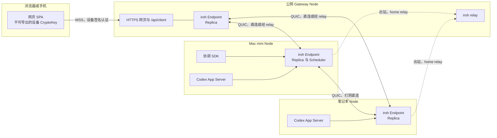
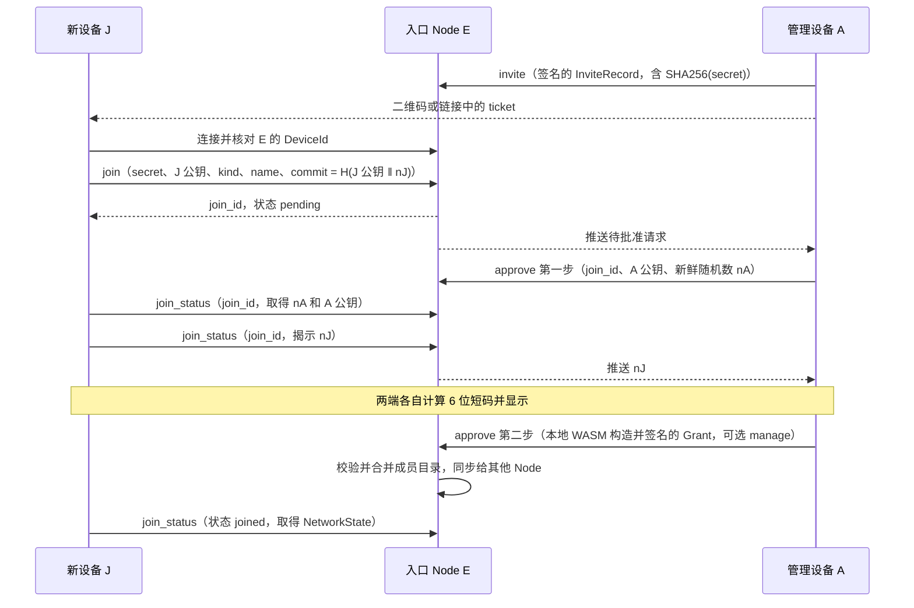

# 统一网络、同步与身份设计

状态为草案，供审阅。本文以 `origin/main` 的 `62f52f0` 为现状，并假定四项改动已经合入。它们是 #54 删除向后兼容，#55 删除 Task 并新增会话级 `set_autonomy`，#56 修复审批旁路，以及统一待核对（调度 job 不再有 `unknown` 和写冻结，只保留本机待核对记录）。文中的行数用 `wc -l` 在该提交上统计，标为“约”的数字是按函数范围估算的生产代码行数。

## 1. 目标与非目标

Vibeface 现在用自研的 WebSocket 会合目录、relay 预约、Presence 多跳转发和 Noise 通道连接设备，用按会话 heads 的闭包拉取同步 DAG，每次写入都全量验签并重建投影，加入一台设备要两端核对多个 64 位编号。本设计把传输换成 iroh，把同步改成每设备一条签名日志加版本向量，把 DAG 收窄为本人能看到的对话和工作记录，并把所有设备的加入统一成一种 ticket 加 6 位短码。项目尚未发布正式版，协议、数据格式、API 和数据目录直接改成最终形态。

目标：

- 节点身份、打洞、relay 和加密传输全部由 iroh 提供，删除 `network.rs`、`peer.rs` 和 Noise 通道。
- 设备编号就是设备的 Ed25519 公钥，Node 的设备编号等于 iroh `EndpointId`。
- 同步只交换 `{设备: 最大序号}`，按 `(作者, 起始序号)` 批量拉取，事件入库时验签一次，投影增量更新。
- 任何 Web 入口和任何调度节点看到同一份会话上下文，协调层每轮上下文只从 DAG 构造。
- 浏览器、手机和 Node 用同一种 ticket 加入，用户只核对一次 6 位短码。

非目标：

- 不迁移旧数据目录、旧邀请、旧浏览器密钥或旧协议，不做版本探测和回退。
- 不把执行层内部内容（命令、diff、推理、工具输出）写进 DAG。
- 不设计组织共享设备池，不做跨个人网络的数据共享。
- 本期不实现 Passkey，只在第 3 节末尾说明后续方向。

## 2. 总体架构



每台 Node 运行一个 iroh `Endpoint`，用自己的设备密钥作为 `SecretKey`。Node 之间只走 iroh QUIC，连接优先打洞直连，失败时经 relay 转发密文。启用 `relay` 的 Node 同时运行 iroh relay 服务，个人网络的其他 Node 把它作为 home relay。

浏览器不运行 iroh。它通过 HTTPS 页面所在的 Gateway Node 的 `/api/client` WebSocket 接入，用设备 CryptoKey 签名认证。Gateway 用本机副本回答读请求，把需要其他节点处理的控制请求经 iroh 转给目标 Node。第 4 节说明这个选择。

执行层是各 Node 本机的 Codex App Server。执行层的内部事件只在本机观察和实时展示，DAG 只记录派发、阶段变化、审批和结果。

## 3. 身份与加入

### 3.1 编号

| 名称 | 定义 | 编码 |
|---|---|---|
| `DeviceId` | 设备 Ed25519 公钥原始 32 字节 | 64 个小写十六进制字符，与 iroh `PublicKey` 的 `Display` 一致 |
| `NetworkId` | 个人网络根 Ed25519 公钥原始 32 字节 | 同上 |
| 短显示 | `DeviceId` 前 5 字节 | 10 个十六进制字符，只用于界面区分，不用于核对 |

现在的 `peer_id` 是公钥的 SHA256（`crates/node/src/crypto.rs:159`，`crates/secure/src/lib.rs:57`），`network_id` 是根公钥的 SHA256（`membership.rs:20`）。改造后不再取哈希，编号本身就是公钥，验签时不需要另查 `node_certificates` 表把编号换成公钥。Node 的 `DeviceId` 等于它的 iroh `EndpointId`，因此 iroh 连接的 `Connection::remote_id()` 直接给出已经由 TLS 证明的设备编号。

浏览器的设备密钥是不可导出的 WebCrypto Ed25519 `CryptoKey`，它只用于签名，不参与传输加密。内部类型统一为 `DeviceId`，JSON 字段统一为 `device_id`，`peer_id`、`subject_id` 和 `PeerId` 全部删除。`target_node`、`scheduler_node` 这类表示角色用途的字段名保留，类型改为 `DeviceId`。

### 3.2 成员目录

```text
Member {
	device_id: DeviceId,
	kind: node | client,
	name: String,
	manage: bool,
}

Genesis {
	version, network_id, root_public_key,
	first_client: Member,   // manage = true
	first_node: Member,
	signature,              // 根私钥
}

GovernanceEvent {
	version, network_id, epoch, parents: Vec<Hash>,
	issuer: DeviceId,
	action: Grant { member } | Revoke { device_id, cutoff_seq },
	signature,              // issuer 的设备密钥
}

RootCheckpoint {
	version, network_id, epoch,
	members: Vec<Member>,
	signature,              // 根私钥
}

NetworkState { genesis, checkpoint: Option<RootCheckpoint>, events: Vec<GovernanceEvent> }
```

成员目录仍是独立的小 DAG，与业务日志分开同步，上限仍为 1024 个成员。与现状相比有三处变化。`Member` 删除 `node_roles`，Node 的角色只取它自己的 `config.json`，加入时不选，由 Node 在连接后用设备密钥签名声明。`subject_id` 改为 `device_id`。`Revoke` 增加 `cutoff_seq`，表示签发者当时已知的该设备最大日志序号。

授权规则如下：

- 只有 `manage=true` 且未撤销的 `client` 成员能签发 `GovernanceEvent`。
- `Grant` 可以授予 `manage=true`。现在 `membership.rs:466-469` 只允许根 checkpoint 建立管理客户端，改造后删除这条限制。
- `node` 成员不能持有 `manage`。Node 常驻无人值守的机器，不签成员变更。
- 管理设备可以撤销任何设备，包括其他管理设备和自己。并发的 `Grant` 与 `Revoke` 冲突时撤销优先。
- 撤销后，接收方只接受该设备 `seq <= cutoff_seq` 的日志条目。正在路上的合法事件仍能入库，之后的写入一律拒绝，各副本结果一致。
- 根私钥只用于签 `Genesis` 和 `RootCheckpoint`。`RootCheckpoint.epoch` 严格递增，较低 epoch 的目录和事件被拒绝，较高 epoch 替换当前目录并丢弃旧 epoch 的 `GovernanceEvent`。
- 每台设备的私钥只在本设备生成和保存。Node 不持有根私钥。

### 3.3 Ticket

```text
Ticket {
	version: 1,
	entry: EndpointAddr {   // 入口 Node
		id: DeviceId,
		relay_url: Option<Url>,
		direct_addrs: Vec<SocketAddr>,
	},
	secret: [u8; 32],       // 一次性密钥
}
```

字符串形式为 `vibeface1` 加 Ticket postcard 编码的小写 base32，与 iroh `EndpointTicket` 的编码方式相同。浏览器使用 `https://<入口 origin>/join#<ticket>`，二维码编码这个 URL。`invite_id` 为 `SHA256(secret)` 的前 16 字节，入口只保存 `SHA256(secret)`。Ticket 默认 10 分钟过期，只能被一个加入请求消耗。Ticket 不包含设备类型、角色和管理权，也不需要单独的签名邀请信封。

### 3.4 加入流程

所有设备走同一个流程。新设备 J 可以是浏览器、手机或 Node，入口 E 是 ticket 中的 Node，A 是批准加入的管理设备。浏览器 J 经 E 的 `/api/client` 连接，Node J 经 iroh `vibeface/join/1` 连接。两种连接都先核对 E 的设备编号等于 ticket 中的 `entry.id`。



短码为：

```text
code = u32_be(SHA256("vibeface:sas:v1" ‖ network_id ‖ invite_id ‖ J 公钥 ‖ A 公钥 ‖ nA ‖ nJ)[0..4]) mod 1_000_000
```

两端都显示 6 位数字，用户确认相同后在 A 上批准。

短码配合承诺防中间人的原理如下。J 先提交 `commit = H(J 公钥 ‖ nJ)`，此时还不知道 nA。A 收到承诺后才生成新鲜的 nA，J 看到 nA 后只能揭示已经承诺的 nJ，E 会核对承诺。假设攻击者控制 E 或拿到 ticket，并分别冒充 J 与 A，它要让两段会话算出同一个短码。在与 A 的会话中，它必须在看到 nA 之前固定自己的承诺，nA 又是 A 收到承诺后新生成的，所以 A 一侧的短码对攻击者是均匀随机的。一次成功的概率为百万分之一。Ticket 只能用一次，失败的请求作废，攻击者无法反复尝试。用户在 A 上看到的短码与 J 屏幕不一致时拒绝即可。

批准时 A 只多一个选择，是否授予管理权，默认不授予，只对 `kind=client` 可选。Node J 的 `kind` 由 J 自己声明，角色取 J 的 `config.json`。

### 3.5 身份 RPC

身份 RPC 从 17 个合并为 6 个。签名内容由客户端本地 WASM 构造，Node 不再提供 `prepare_*` 方法。

| method | 调用方 | params | 结果 |
|---|---|---|---|
| `invite` | 管理设备 | 签名的 `InviteRecord { network_id, invite_hash, issuer, expires_at_ms }` | 已登记，客户端在本地拼出 ticket |
| `join` | 新设备 | `secret`、`public_key`、`kind`、`name`、`commit` | `join_id`，同一 ticket 重试返回同一 `join_id` |
| `join_status` | 新设备或管理设备 | 新设备带 `join_id`，可带 `reveal`；管理设备不带参数时列出待批准请求 | 状态 `pending`、`confirming`、`joined`、`rejected` 或 `expired`，以及当前可见的随机数和公钥 |
| `approve` | 管理设备 | `join_id`，加 `admin_nonce` 或签名的 `Grant`，拒绝时带 `reject=true` | 新状态 |
| `revoke` | 管理设备 | 签名的 `Revoke` | 合并后的成员目录 |
| `recover` | 持有恢复包的客户端 | 根私钥签名的 `RootCheckpoint`，以及首次建网时的 `Genesis` 和本机一次性 capability | 新的成员目录 |

建网复用 `recover`。未初始化的 Node 只接受带本机一次性 capability 的 `Genesis`，已初始化的 Node 只接受同一 `network_id` 且 epoch 更高的 `RootCheckpoint`。全部请求都可重试，重复提交同一内容返回原结果，同一 `join_id` 换内容被拒绝。

`/api/local/join/request`、`/api/local/join/accept` 和 `/api/local/join/status` 删除。新 Node 的本机网页调用本机 Node，由本机 Node 经 iroh 对入口执行 `join` 和 `join_status`。CLI 为 `vibeface join <ticket> --name <名称>`，在终端显示短码并等待批准。

### 3.6 本机会话与浏览器密钥

本机会话改用固定端口。`config.json` 新增 `local_listen`，默认 `127.0.0.1:4791`。现在的本机会话每次启动绑定 `127.0.0.1:0` 随机端口（`crates/node/src/api.rs:115-124`），origin 每次不同，浏览器按 origin 隔离的存储随之丢失。固定端口后 origin 稳定，cookie 和本机的 CryptoKey 可以长期保留。本机会话的其他约束不变，仍只接受实际 loopback 来源、字面 Host 和精确 Origin，仍不授予成员资格和管理权。本机会话不再执行 Noise 握手，loopback 连接不需要传输加密。

浏览器设备密钥改为 `crypto.subtle.generateKey({ name: "Ed25519" }, false, ["sign"])` 生成的不可导出 `CryptoKey`，存入 IndexedDB。现在的实现把十六进制明文种子存在 IndexedDB `vibeface-device` 库（`crates/node/web/transport.js:45-101`），页面脚本可以读出。改造后脚本只能请求签名，不能读出私钥。WASM 只负责构造规范签名字节，签名调用 WebCrypto。恢复包解锁出的根私钥只在 WASM 内存中使用一次，签完 `RootCheckpoint` 后清零。

### 3.7 步骤与核对次数对比

现状按 `crates/node/web/src/features/identity/` 的当前界面统计，步骤数为两端用户操作合计。

| 场景 | 现状步骤 | 现状核对 64 位编号 | 改造后步骤 | 改造后核对 |
|---|---|---|---|---|
| 首台设备建网 | 约 5 | 0 | 4（打开本机页面、填名称和口令、下载恢复包、确认已保存） | 0 |
| 新浏览器 | 约 12 | 3 个编号，界面共显示 7 处 | 4（管理端添加设备和批准，新设备打开链接和填名称） | 1 次 6 位短码 |
| 手机 | 约 12，另需输入或钉住 Node 编号 | 3 个编号加 1 次输入 | 4（扫码代替打开链接） | 1 次 6 位短码 |
| 新 Node | 约 13 | 3 个编号，界面共显示 7 处 | 5（新机器运行 `vibeface`、打开本机页面、粘贴 ticket 和名称，管理端添加设备和批准） | 1 次 6 位短码 |
| 新增管理设备 | 约 8 以上，必须使用恢复包 | 1 次输入加成员列表 | 4，批准时勾选授予管理权 | 1 次 6 位短码 |
| 根恢复 | 约 8 以上 | 1 次输入加成员列表 | 4（选恢复包、输入口令、勾选保留的设备、确认） | 0，设备按名称和短显示列出 |

### 3.8 后续阶段：Passkey

后续可以让浏览器设备用 Passkey 代替 IndexedDB 中的 CryptoKey，设备编号取 Passkey 公钥，签名经 WebAuthn assertion 完成。这需要 Node 验证 WebAuthn 的 authenticatorData 和 clientDataJSON 格式，并处理 Passkey 跨设备同步导致的“同一编号多台设备”。本期不做。

## 4. 传输

### 4.1 iroh 的使用方式

依赖固定 `iroh` 1.x（调研时最新为 1.3.0）。每台 Node 启动一个 `Endpoint`：

- `secret_key` 为本机设备密钥，与事件签名共用同一把 Ed25519 密钥。事件签名带 `vibeface:event:v1:` 域前缀，与 TLS 用途隔离。
- `relay_mode` 为 `RelayMode::Custom`，内容来自 `config.json` 的 `network.relays`，默认是个人网络中启用 `relay` 的 Node。
- 地址查找使用 `MemoryLookup`。地址来源是 ticket 中的 `entry`、成员 Node 之间交换的签名地址簿和可选的 mDNS（`iroh-mdns-address-lookup`）。默认不向 n0 的 DNS 或 pkarr 发布地址，公共目录不会出现个人设备。
- `Router` 按 ALPN 分发连接，每个 ALPN 一个 `ProtocolHandler`。

启用 `relay` 的 Node 运行 `iroh-relay` 服务，访问控制实现 `AccessControl`。允许接入的 `EndpointId` 是当前成员 Node，以及带有效 ticket 派生令牌 `SHA256("vibeface:relay:v1" ‖ secret)` 的加入方。Relay 只转发端到端加密的 QUIC 包，不能解密。

| 删除的自研机制 | iroh 中的对应 |
|---|---|
| 会合目录、`Reachability` 签名记录、`lookup`/`publish` | `EndpointAddr`、`MemoryLookup`、成员间地址簿 |
| relay 预约、attach 通道、电路额度 | `iroh-relay` 及其 `AccessControl` |
| 拨号竞速、`PathQueue`、250 毫秒直连领先 | QUIC multipath，打洞与 relay 是同一连接的不同 path |
| Noise XX、`Channel` 分片 | QUIC TLS 1.3，`remote_id()` 即对端 `DeviceId` |
| Presence 多跳转发、探索邻居 | 删除。任意两台 Node 直接连接，连不上时经 relay |
| 按 IP 的 socket 准入 `network/admission.rs` | relay 与 QUIC 自带限流，客户端网关只保留连接数上限 |

### 4.2 ALPN 划分

| ALPN | 用途 | 接受的对端 |
|---|---|---|
| `vibeface/sync/1` | 交换版本向量，按 `(作者, 起始序号)` 拉取事件，推送新事件通知，同步成员目录 | 未撤销的成员 Node |
| `vibeface/blob/1` | 按内容哈希和偏移读取附件 | 未撤销的成员 Node |
| `vibeface/rpc/1` | 调度投递、工作派发、中断、审批回答转发、状态查询、实时进度订阅、地址簿交换 | 未撤销的成员 Node |
| `vibeface/join/1` | `join` 和 `join_status` | 任意对端，每个连接只能调用这两个方法，按 ticket 限流 |

每个 ALPN 内部使用 QUIC 双向流，一次请求一条流，帧为长度前缀的 JSON。请求 ID 只用于匹配响应，写操作的去重仍依靠业务 ID。

### 4.3 浏览器接入

可选方案有三种。浏览器可以经 iroh relay 的 WebSocket 直接连目标 Node，可以连 Node 提供的 WebSocket 网关，也可以在浏览器中运行 iroh 的 wasm 构建。第一种和第三种实际是同一条路径，iroh 的浏览器构建只能经 relay 的 WebSocket 通信，不能打洞。

推荐 Node 提供 WebSocket 网关。浏览器打开 Gateway Node 的 HTTPS 页面，连接同源的 `/api/client`，流程如下：

1. 网关发送随机 `challenge` 和自己的 `DeviceId`，并用设备密钥签名 `challenge ‖ origin`。
2. 浏览器核对网关编号等于已保存的入口编号，再用 CryptoKey 签名 `challenge ‖ 网关 DeviceId ‖ origin`，发送自己的 `device_id`。
3. 网关核对成员目录，建立会话。之后的 RPC 和 `changed` 推送都在这个 WebSocket 上传输。

选择网关的理由有四条：

- 浏览器上的 iroh 只能走 relay，相比网关没有穿透优势，Gateway 本身就是 iroh 节点。
- 不可导出的 CryptoKey 不能作为 iroh 的 TLS 密钥，浏览器的设备认证无论如何都要在应用层再做一次。
- 网页必须来自安全上下文的 origin，这个 origin 就是 Gateway Node，所以用户本来就依赖它。
- Gateway 是本人的 Replica，已经保存全部明文副本。浏览器到它之间再加一层端到端加密，不会给已同步的数据增加保密性。审批回答、用户消息等写操作带浏览器设备签名，网关不能伪造。

网关方案的代价是 Gateway 之前的 TLS 终止方能看到明文。例如把 Gateway 放在第三方 CDN 或隧道之后，该第三方能读取浏览器流量。现在的 Noise 通道能防住这种情况。第 9 节把这一点列为待决定项。

需要其他 Node 处理的请求，例如回答某台 Node 上的审批或中断某个工作，由网关经 `vibeface/rpc/1` 转给目标 Node。目标 Node 自行验证请求中的设备签名。

### 4.4 个人网络隔离

一个数据目录只属于一个个人网络，一个 Node 进程只服务一个网络。在同一台主机上为多个网络服务时运行多个进程和多个数据目录。iroh relay 不属于任何网络，只转发密文。

隔离在以下三处检查：

1. 连接接受时，`ProtocolHandler` 读取 `remote_id()`，核对它是当前成员目录中未撤销的 Node，不是则直接关闭连接。`vibeface/join/1` 例外，但只开放两个方法。
2. 每条 `vibeface/sync/1` 流的首帧携带 `network_id`，与本机不一致时关闭连接。
3. 事件入库时核对 `network_id`、作者成员资格和撤销 `cutoff_seq`。

SQLite 表不再需要 `network_id` 列，跨网络读取在结构上不可能发生。本节以第 9 节第 2 项采纳为前提，不采纳时所有表恢复 `network_id` 分区。

## 5. 同步与 DAG

### 5.1 事件结构

```text
Event {
	version: 1,
	network_id: NetworkId,
	author: DeviceId,          // 写入该事件的 Node
	seq: u64,                  // 作者日志序号，从 1 开始连续递增
	prev: Option<Hash>,        // 作者 seq - 1 的事件 hash，seq = 1 时为空
	deps: Vec<Hash>,           // 写入时依据的其他作者事件，按 hash 排序去重
	scope_id: ScopeId,         // 会话 ID
	created_at_ms: i64,        // 只用于展示，不决定顺序
	body: EventBody,
	blobs: Vec<BlobRef { hash, size }>,
}

SignedEvent {
	hash: Hash,                // SHA256(canonical_body)
	canonical_body: String,    // 规范 JSON 原始字节
	signature: Signature,      // 作者对 "vibeface:event:v1:" ‖ hash 的 Ed25519 签名
}

Attestation {
	device_id: DeviceId,       // 本人的浏览器或手机
	signature: Signature,      // 对 body 中除 attestation 外内容的签名
}
```

每台 Node 在整个网络中只有一条日志，不再按会话分链。现在的 `sequence` 和 `previous` 按 `(network, scope, author)` 分别递增（`crates/node/src/store.rs:2301-2306`），版本向量会随会话数增长。改为每设备一条后，版本向量的大小等于 Node 数。`deps` 只引用作者写入时已知的其他作者事件，通常是同一会话中最新的几条，不再取整个会话的全部 heads。

浏览器不写日志，它发起的写操作由所连 Node 作为作者写入，并在 `body` 中携带 `Attestation`。需要本人授权的事件必须带有效的客户端设备签名，Node 和协调 Agent 不能代写。

### 5.2 事件类型

写入 DAG 的事件：

| 类型 | 字段 | 作者 | 说明 |
|---|---|---|---|
| `ConversationCreated` | `title` | 入口 Node | |
| `BotCreated` | `bot_id`、`name`、`instructions`、`project?: { target_node, cwd }` | 入口 Node | 带 `Attestation`，删除 `membership_role_proof` |
| `MessagePosted`（user） | `message_id`、`role: user`、`text`、`scheduler_node`、`report_results`、`attestation` | 入口 Node | 本人发的内容 |
| `MessagePosted`（assistant） | `message_id`、`role: assistant`、`text`、`in_reply_to: message_id` | 调度 Node | 协调层给本人的每条回复，包括“已开始：…”这类即时回复 |
| `WorkDispatched` | `work_id`、`trigger: message_id`、`target_node`、`executor: codex`、`cwd`、`thread_id`、`turn_id`、`continues?: work_id` | 调度 Node | 目标 Node 确认已启动后写入 |
| `WorkProgress` | `work_id`、`phase`、`summary` | 目标 Node | 只在阶段变化时写一条，附一句摘要，不逐 token 写 |
| `ApprovalRequested` | `work_id`、`request_id`、`kind`、`summary` | 目标 Node | |
| `ApprovalAnswered` | `work_id`、`request_id`、`decision`、`attestation` | 入口 Node | 必须带本人设备签名 |
| `WorkFinished` | `work_id`、`outcome`、`result_text`、`failure_reason?`，结果正文过长时放入 `blobs` | 目标 Node，`unverified` 的复核由入口 Node 写 | `outcome` 为 `completed`、`failed`、`interrupted` 或 `unverified` |
| `AutonomySet` | `mode: off \| report \| continue`、`version`、`attestation` | 入口 Node | 会话级自主授权决策，取代 #55 中的 `DecisionRecorded` 编码 |
| `NotificationAcked` | `notification_id`、`attestation` | 入口 Node | 通知 ID 即产生通知的事件 hash |
| `ContextCheckpoint` | `summary`、`covers: VersionVector` | 调度 Node | 保留现有类型，用于长会话的上下文压缩，`covered_heads` 改为版本向量 |

`WorkProgress.phase` 取值为 `started`、`running`、`waiting_approval`、`interrupting` 和 `finishing`。`WorkFinished` 的 `unverified` 表示目标 Node 无法证明执行层的真实结果，证据保存在目标 Node 的本机待核对记录中。本人核对后，入口 Node 可以为同一 `work_id` 再写一条带 `Attestation` 的 `WorkFinished`。只有 `unverified` 可以被后续的 `WorkFinished` 取代。

不写入 DAG 的内容：

- 执行层内部的命令、diff、推理和工具输出。
- 协调层流式中间文字和逐个工具调用，只经 `vibeface/rpc/1` 实时展示。
- 本机调度 job 队列、outbox、待核对记录、SDK 原生会话缓存、附件暂存进度、模型密钥和设备私钥。

删除的事件类型为 `AgentMessage`、`TaskCreated`、`TaskChanged`、`DecisionRecorded` 和 `NotificationRaised`。`AgentMessage` 的派发、进度和终态分别由 `WorkDispatched`、`WorkProgress` 和 `WorkFinished` 表达。`DecisionRecorded` 中的 `followup_intent_v1` 改为 `MessagePosted.report_results`，`conversation_autonomy_v1` 改为 `AutonomySet`。通知由 `WorkFinished` 和 `ApprovalRequested` 等事件派生，不再单独写 `NotificationRaised`。

### 5.3 存储

```sql
events(
	author TEXT, seq INTEGER, hash TEXT UNIQUE, scope_id TEXT,
	envelope TEXT,
	PRIMARY KEY (author, seq)
)
event_deps(hash TEXT, dep TEXT)                   -- 用于展示因果顺序
event_blobs(hash TEXT, blob TEXT)                 -- 附件授权读取的依据
log_heads(author TEXT PRIMARY KEY, max_seq INTEGER, head_hash TEXT)
pending_events(hash TEXT PRIMARY KEY, envelope TEXT, missing TEXT)
log_conflicts(author TEXT, seq INTEGER, hash TEXT, envelope TEXT, kept_hash TEXT, detected_at_ms INTEGER)
```

`log_heads` 就是本机的版本向量。本机存储保持一个不变量，`events` 中每个事件的 `prev` 和 `deps` 也都在 `events` 中。因此 `{author: max_seq}` 精确描述本机拥有的事件集合。

### 5.4 版本向量同步流程

两台 Node 在 `vibeface/sync/1` 上同步：

1. 双方发送 `Hello { network_id, vector: { author: (max_seq, head_hash) }, membership_epoch, membership_heads }`。成员目录不一致时先交换 `NetworkState`。
2. 对每个作者，若对方的 `max_seq` 大于本机，发送 `Pull { author, from_seq: 本机 max_seq + 1, limit }`。
3. 对方按 `seq` 升序返回 `Events { author, events }`，每批最多 1024 条、正文合计 8 MiB。
4. 接收方按 5.5 节入库。缺少其他作者的 `deps` 时，事件进入 `pending_events`，并对缺失作者追加 `Pull`。
5. 本机追加事件后，向已连接的成员 Node 发送 `Have { author, seq, hash }`，对方据此拉取。连接空闲时每 60 秒重新交换一次 `Hello`，补上丢失的通知。

现在的同步每 3 秒向最多 4 个副本请求所有会话的 heads（`crates/node/src/runtime.rs:3330-3338`），再沿 `parents` 和 `previous` 逐个或分批取闭包。改造后一次往返就知道缺什么，拉取按序号区间进行，不需要沿 hash 回溯。

### 5.5 入库与投影

每批事件在一个 SQLite 事务中处理，每个事件依次检查：

1. 解析规范 JSON，核对 `hash` 和 `network_id`。
2. 作者是成员 Node，且 `seq` 不超过撤销的 `cutoff_seq`。
3. `seq == log_heads[author].max_seq + 1` 且 `prev == head_hash`。序号已存在且内容不同时按 5.7 节处理，序号跳过时丢弃该事件并从缺口处重新拉取。
4. 验证作者签名和 `Attestation` 签名。这是该事件唯一一次验签。
5. `deps` 全部已入库，否则放入 `pending_events`。
6. 写入 `events`，更新 `log_heads`，调用投影 reducer，再检查 `pending_events` 中是否有事件因此满足条件。

入库后的事件不再验签。现在的 `load_events_from`（`crates/node/src/store.rs:2515`）在每次追加、每次重建以及 bots 和 followup 的读取中，都对全网每个事件查证书并完整验签。该函数删除，读取直接查表。数据目录的完整性属于本机信任边界，需要时用维护命令 `vibeface store verify` 离线重新验签。

投影 reducer 对每个事件只执行一次，不再全量重建。现在的 `rebuild_projections_from`（`crates/node/src/store.rs:2330-2478`）在每次入库或追加时删除并重写全部投影表。为了让增量结果与到达顺序无关，每个投影都满足交换律：

| 投影 | 合并规则 |
|---|---|
| 会话与消息 | 按 `(因果顺序, created_at_ms, hash)` 在读取时排序，不在入库时分配 `ordinal` |
| Bot | 同一 `bot_id` 取因果最早的 `BotCreated`，并发时取 hash 较小者 |
| 工作 | 每个 `work_id` 的状态只前进，`WorkFinished` 为终态，只有 `unverified` 可被取代 |
| 审批 | 同一 `request_id` 首个有效 `ApprovalAnswered` 生效，执行层拒绝过期回答 |
| 自主授权 | `version` 最大者生效，相同版本取 hash 较小者 |
| 通知确认 | 集合并集 |

只有数据格式本身变化时才需要全量重建。项目不保留兼容，格式变化时直接使用新数据目录。

### 5.6 附件

附件改为按内容哈希命名的文件，路径为 `<data-dir>/blobs/sha256/<前两位>/<hash>`，不再存入 SQLite 的 `blobs` 表。传输使用 `vibeface/blob/1`：

1. 接收方发送 `Get { hash, size, offset }`。
2. 来源核对请求方是成员 Node，且该 hash 被本机至少一个事件的 `blobs` 引用，然后从 `offset` 起顺序发送字节。
3. 接收方写入 `<data-dir>/blobs/partial/<hash>.part`，每块 `fsync` 后在 SQLite 中提交已确认偏移。断线或重启后截去未提交的尾部，从已提交偏移继续。
4. 收齐后核对大小和 SHA256，一致时原子重命名到正式路径，不一致时删除暂存并换来源重试。

单件上限仍为 64 MiB，暂存额度保持 256 MiB、64 个对象。来源直接读文件，`store/blob_reader.rs` 的只读 SQLite 读取者池删除。本期不使用 `iroh-blobs`，原因是它仍为 0.x，2026-10-08 还发布过任意对端可写入 store 的安全公告。

### 5.7 冲突处理

同一作者同一序号出现两条不同事件，只会在数据目录被复制或从备份恢复后继续写入时发生。处理规则如下：

- 接收方保留先到的一条。后到的一条和依赖它的同作者后续事件写入 `log_conflicts`，不进入 `events`。
- `Hello` 中的 `head_hash` 用于发现分叉。序号相同而 hash 不同，或拉到的第一条 `prev` 不等于本机 `head_hash` 时，接收方向前逐条比对到分叉点，并记录冲突。
- 其他作者的事件若在 `deps` 中引用了被拒绝的事件，仍然入库。被拒绝的 hash 视为“已知但处于冲突中”，满足依赖检查，界面在该事件旁标出它依据了冲突内容。
- 冲突不锁住会话，也不阻止其他作者和其他会话继续写入。
- 发生分叉的作者 Node 在得知冲突后停止写入，进入 `forked` 状态，并向本人发出通知。
- 本人在网页上查看两条分叉内容，然后撤销该设备编号，并让该 Node 用新密钥重新加入。需要保留的分叉内容由本人重新发送。

现在的实现把重复序号标为 `conflict`，并让整个会话拒绝追加（`crates/node/src/store.rs:2292`、`2346-2376`），本设计删除这个锁定。

### 5.8 备份恢复后的写入保护

Node 启动后进入 `aligning` 状态，满足以下任一条件才进入 `writable`：

- 至少一台其他成员 Node 完成 `Hello`，对方记录的本机作者 `max_seq` 不大于本机。如果对方更大，先拉回本机自己的日志再进入 `writable`。
- 成员目录中没有其他 Node。

`aligning` 期间可以读取和同步，不能追加事件。调度 job 保持排队，入口收到的用户消息保存在本机 outbox，写入后再投递。是否允许本人在所有其他 Node 都不可达时手动解除保护，见第 9 节。

### 5.9 三设备示例

设备为 Mac mini Node `P`（Scheduler，运行 Codex）、公网 Gateway Node `G`（Relay）和笔记本 Node `L`（运行 Codex）。本人用手机经 `G` 访问。开始时三台的版本向量一致：

| 时刻 | P 的向量 | G 的向量 | L 的向量 |
|---|---|---|---|
| t0 | P:10 G:4 L:7 | P:10 G:4 L:7 | P:10 G:4 L:7 |

1. 手机发送“在笔记本上跑测试”。`G` 写入 `G#5 MessagePosted(user, scheduler_node=P, attestation=手机)`，`deps` 为该会话最新的 `P#10`。`G` 向 `P` 和 `L` 发送 `Have(G, 5)`，两者各拉取 `G 5..5`。
2. `P` 的调度器领取 job，写入 `P#11 MessagePosted(assistant, "已开始：…")`。它经 `vibeface/rpc/1` 请求 `L` 在指定 `cwd` 启动 Codex turn，`L` 返回 `thread_id=t1`、`turn_id=u1` 后，`P` 写入 `P#12 WorkDispatched(work_id=w1, target_node=L, thread_id=t1, turn_id=u1)`。
3. `L` 写入 `L#8 WorkProgress(w1, running, "正在运行 cargo test")`，随后 Codex 请求执行网络命令，`L` 写入 `L#9 ApprovalRequested(w1, r1)`。这时 `L` 的网络中断。

| 时刻 | P 的向量 | G 的向量 | L 的向量 |
|---|---|---|---|
| t1 | P:12 G:5 L:8 | P:12 G:5 L:8 | P:12 G:5 L:9 |

4. `L` 恢复连接，与 `G` 交换 `Hello`。`G` 发现 `L` 的 `max_seq` 为 9，拉取 `L 9..9`，并据此通知手机有待批准请求。
5. 本人在手机上批准。`G` 写入 `G#6 ApprovalAnswered(w1, r1, approve, attestation=手机)`，并经 `vibeface/rpc/1` 把回答转给 `L`。`L` 验证手机设备签名后回复 Codex。
6. Codex 完成，`L` 写入 `L#10 WorkFinished(w1, completed, 结果摘要, blobs=[测试日志])`。`P` 拉取后调度只读收尾，写入 `P#13 MessagePosted(assistant, 测试结果总结)`。
7. 期间 `P` 与 `L` 之间曾短暂断开。重新连接后双方交换 `Hello`。

| 时刻 | P 的向量 | G 的向量 | L 的向量 |
|---|---|---|---|
| t2，交换前 | P:13 G:6 L:10 | P:13 G:6 L:10 | P:12 G:6 L:10 |
| t2，交换后 | P:13 G:6 L:10 | P:13 G:6 L:10 | P:13 G:6 L:10 |

`L` 只需要拉取 `P 13..13` 一个区间。测试日志附件由 `P` 和 `G` 在入库后从 `L` 按哈希拉取。之后本人在笔记本的浏览器打开同一会话，看到的消息、派发、审批和结果与手机上相同。

如果 `L` 之后从 t0 的备份恢复，启动时处于 `aligning`。`G` 在 `Hello` 中报告 `L:10`，大于本机的 7，`L` 先拉回自己的 `L 8..10`，再进入 `writable` 并写入 `L#11`，不会产生分叉。

## 6. 协调层与上下文

协调层每轮的上下文只从 DAG 构造。调度器领取 job 时固定一个 `basis: VersionVector`，取代现在的 `basis_heads`。`materialize` 读取该依据下的会话视图（现在的实现见 `crates/node/src/scheduler.rs:452-519`），按以下顺序填入：

1. Bot 定义和当前 `AutonomySet`。
2. 最新 `ContextCheckpoint` 的摘要及其 `covers` 之后的消息，包括本人消息和协调层回复。
3. 每个工作的摘要，包括 `WorkDispatched` 的目标与 `cwd`、最新 `WorkProgress` 摘要、待回答的 `ApprovalRequested` 和 `WorkFinished` 结果。
4. 触发本轮的事件。

SDK 原生会话只是本机缓存，按 `(conversation_id, 本机 DeviceId)` 保存，并记录它已覆盖的版本向量。新 `basis` 包含该向量且缓存来自本机时，只发送增量。否则开启新的原生会话并发送完整上下文。所以换入口、换调度节点或换浏览器后，协调层得到的上下文相同，差别只在缓存能否复用。

协调工具改为 `nodes`、`context`、`dispatch_work`、`work_status`、`continue_work` 和 `interrupt_work`。`dispatch_work(target_node, cwd, prompt)` 在目标 Node 启动执行层 turn，同时覆盖 #56 中本机 `codex` 工具的 `thread/start` 和 `turn/start`，以及 `observe_session` 的登记。目标 Node 继续强制 #56 规定的审批策略和沙箱，协调层不能覆盖，也不能回答审批。跨节点工作只派发给目标 Node 的执行层，不再调用目标 Node 的协调 Agent。

“继续上次的任务”由 `continue_work(work_id)` 处理。调度器从 `WorkDispatched` 取得原 `target_node` 和 `thread_id`，在同一 thread 上启动新 turn，并写入一条 `continues=work_id` 的新 `WorkDispatched`。原目标不可达时返回错误，不改派到其他 Node。

只在本机保存的内容：

| 内容 | 位置 |
|---|---|
| 调度 job 队列和投递 outbox | 调度 Node 与入口 Node 的 SQLite 本机表 |
| 待核对记录及其证据 | 产生不确定结果的 Node |
| SDK 原生会话 ID 和已覆盖向量 | 调度 Node |
| 执行层 thread 的实时状态、待回答请求的 RPC ID | 目标 Node 的 Codex 观察记录 |
| 流式文字、工具调用进度 | 内存，经 `vibeface/rpc/1` 推送 |
| 附件暂存进度、每日预算 | 本机 |
| 设备私钥、模型凭证 | 本机，不进入任何同步数据 |

## 7. 删除清单

行数取自 `62f52f0`。“生产”指 `#[cfg(test)]` 之前的代码，测试随对应代码一起删除或重写。#54、#55、#56 合入后部分数字会小幅变化。

| 模块 | 删除内容 | 规模 |
|---|---|---|
| `crates/node/src/network.rs` | 整个文件，`Control`、`Reachability`、`NetworkHub`、mDNS 来源表、`Reservation`、`Attachment`、`PathQueue`、`dial_authenticated`、`race_paths`、relay 预约与电路转发 | 7375 行，生产约 2556 |
| `crates/node/src/network/admission.rs` | 整个文件，`SocketClass`、按 IP 准入与电路额度 | 1096 行 |
| `crates/node/src/peer.rs` | 整个文件，`PeerHub`、`Hello`、`Packet`、`Kind`、Presence、多跳转发、Noise 握手 | 2291 行，生产约 1262 |
| `crates/secure/src/lib.rs` | `Handshake`、`Channel`、`NOISE` 常量，依赖 `snow` | 约 280 行 |
| `crates/node/src/crypto.rs` | `fingerprint` 作为身份编号的用法、证书查找式验签 | 约 60 行 |
| `crates/node/src/runtime.rs` | `capabilities`、`inventory`、`event`、`history_batch` 处理，`sync_step_core`、`history_events`、`verify_history_batch`、闭包进度保存、`route_flight` | 约 800 行 |
| `crates/node/src/runtime/sync.rs` | 按会话 heads 的作业协调和预算，重写为版本向量会话 | 1735 行，生产约 1150 |
| `crates/node/src/store.rs` | `rebuild_projections_from`、`load_events_from`、`heads_from_events`、`missing_dependencies`、`inventory_heads`，按会话的 `sequence` 分配 | 约 450 行 |
| `crates/node/src/store/blob_reader.rs` | 整个文件，只读 SQLite 读取者池 | 524 行 |
| `crates/node/src/store/blob_transfer.rs`、`runtime/blob_transfer.rs` | SQLite 正文发布、hex 分块协议，重写为文件加 `vibeface/blob/1` | 2344 行，保留续传逻辑约 400 |
| `crates/node/src/store/agent_messages.rs` | `AgentMessage` 任务的校验、投递、取消和结果发布，改为 Work 投影 | 1940 行，生产约 576 |
| `crates/node/src/store/followup.rs` | #55 后剩余的 `followup_intent_v1` 与自主授权编码，改为 `report_results` 和 `AutonomySet` | 1626 行，生产约 793 |
| `crates/node/src/model.rs` | `AgentMessage`、`AgentMessageKind`、`DecisionRecorded`、`NotificationRaised`、`BotCreated.membership_role_proof`，`MissingDependencies` | 约 80 行 |
| `crates/node/src/pairing.rs` | 整个文件，邀请、配对申请、review、本机加入状态机 | 1155 行，生产约 685 |
| `crates/node/src/identity/local.rs` | `InvitePayload`、`InviteEnvelope`、`PairReview`、配对存储操作，改为 `join_requests` | 689 行，保留约 200 |
| `crates/node/src/client.rs` | 17 个身份 RPC 合并为 6 个，删除 Noise 客户端通道 | 1868 行，删除约 700 |
| `crates/secure/src/membership.rs` | `node_roles`、`NodeCertificate.roles`、“管理权只能由根 checkpoint 授予”规则（约 468 行处） | 约 150 行 |
| `crates/node/src/local_access.rs`、`api.rs` | 随机端口发布，`/api/network/ws`、`/peer`、`/api/local/join/*` 三个路由 | 约 200 行 |
| `crates/node/web/transport.js` | lookup、候选竞速、Noise 握手、明文种子存储，重写为 WebSocket 加 CryptoKey | 361 行，重写后约 120 |
| `crates/node/web/src/features/identity/` | 邀请类型和角色选择、三方编号核对、review 勾选、恢复建立管理客户端 | 生产 1330 行，重写 |
| SQLite 表 | `identity_invites`、`identity_pair_reviews`、`identity_pair_requests`、`identity_requests`、`node_certificates`、`blobs`、`tasks`（#55）、`notification_outbox` 的 `derived` 列 | 8 处 |
| RPC | `prepare_genesis`、`bootstrap`、`prepare_invite`、`commit_invite`、`prepare_pair_request`、`pair_request`、`pair_accept`、`pair_requests`、`prepare_pair`、`pair_confirm`、`pair_status`、`prepare_revoke`、`recovery_challenge`、`recovery_context`、`prepare_recovery`，协调工具 `send_task`、`task_status`、`call_lookup`、`cancel_task`、`observe_session` | 20 个 |
| 依赖 | `snow`、`mdns-sd`。`tokio-tungstenite` 仍用于 Codex App Server 连接，只删除对等连接中的用法 | 2 个 |

删除或重写的生产代码合计约 1.4 万行，测试约 1 万行。新增代码集中在 iroh 接入、版本向量同步、join 流程和 Work 投影，规模在第一期实现后再统计。

## 8. 实施分期

按先删后建排序。每期结束时都能独立验证。第一期到第三期之间多 Node 同步暂时不可用，这是计划内的中间状态，不为此保留兼容代码。

**第一期：单 Node 的事件模型与存储。** 事件改为每设备一条日志，新增 `log_heads`、`pending_events` 和 `log_conflicts`。入库时验签一次，投影改为增量 reducer。用 `Work*`、`AutonomySet` 和 `NotificationAcked` 取代 `AgentMessage`、`DecisionRecorded` 和 `NotificationRaised`，附件改为文件。删除 `rebuild_projections_from` 和 `load_events_from`。验收标准如下：

- Store 测试覆盖乱序入库后投影一致。
- 重复和越序事件被拒绝。
- 同序号不同内容进入 `log_conflicts` 且会话仍可追加。
- 单 Node 真实进程能完成本人消息、本机 Codex 派发、审批和结果，DAG 中出现对应事件且不含执行层内部内容。
- 在 10 万事件的数据目录上追加一条事件不触发全表读取，用 SQLite 查询计数核对。

**第二期：身份与浏览器接入。** `DeviceId` 改为公钥本身，成员目录删除角色并放开管理授权。实现 6 个身份 RPC、承诺加短码流程、浏览器 CryptoKey、`/api/client` 网关和固定端口本机会话。删除 `pairing.rs`、Noise 客户端通道和旧身份表。验收标准如下：

- 浏览器端到端测试完成建网、浏览器加入、授予管理权、撤销和根恢复。
- 承诺不匹配或短码被拒绝时请求作废。
- 页面脚本无法导出设备私钥。
- 本机会话重启后 origin 不变。

**第三期：iroh 传输与版本向量同步。** 接入 `iroh` Endpoint、`Router`、4 个 ALPN 和 relay 访问控制，实现 `Hello`、`Pull`、`Have` 和附件续传。Node 经 `vibeface/join/1` 加入。删除 `network.rs`、`network/admission.rs`、`peer.rs` 和 `snow`。验收标准如下：

- `scripts/verify-node.py` 用三个真实 Node 进程，覆盖 NAT 后两台经自建 relay 互通。
- 非成员 `EndpointId` 连接被拒绝。
- 中断后按区间续拉。
- 64 MiB 附件在传输中途重启后续传并通过哈希校验。
- 按 `docs/ci.md` 补跑同步与恢复专项并记录结果。

**第四期：协调层与跨入口上下文。** 调度依据改为版本向量，原生会话缓存记录已覆盖向量。实现 `dispatch_work`、`continue_work` 和 `interrupt_work`，审批回答经网关转发并验证设备签名。验收标准如下：

- 受控 SDK 和 App Server 夹具下，从入口 A 发起的工作在入口 B 上能看到同一上下文并继续同一 thread。
- 协调 Agent 调用审批回答被拒绝。
- 换调度节点后协调层收到完整 DAG 上下文。

**第五期：写入保护、文档与扩展验收。** 实现 `aligning`、`writable` 和 `forked` 三个状态及冲突处理界面，重写 `docs/node.md`、`docs/node-protocol.md` 和 README 中的相关章节。删除 `docs/peer-id-migration.md`，`data_epoch` 加一。验收标准如下：

- 从备份恢复的 Node 在对齐前拒绝写入，对齐后无分叉。
- 人为复制数据目录造成分叉后，其他会话照常写入，分叉设备停止写入并通知本人。
- 手动触发扩展 CI，三平台制品通过多进程验收。

## 9. 风险与待用户决定的问题

### 风险

- iroh relay 服务能否挂在 Gateway 现有的 axum 监听器上尚未验证，可能需要单独端口。第三期第一步先做这个实验。
- WebCrypto 的 Ed25519 需要较新的浏览器，旧版 Safari 不支持。不支持的浏览器无法成为设备，页面会明确提示。
- 用户可能不看短码直接批准。批准按钮在短码显示后才可用，但不能强制用户比对。
- 恢复备份后若绕过写入保护，仍会产生分叉。5.7 节的处理保证不锁死会话，但分叉设备需要重新加入。
- iroh 1.x 承诺协议稳定，`iroh-blobs` 等上层库仍为 0.x，本设计只依赖 `iroh` 和 `iroh-relay`。

### 待用户决定

1. **浏览器接入方式。** 推荐 Node 提供 WebSocket 网关（4.3 节）。代价是 Gateway 前的第三方 TLS 终止方能看到浏览器流量。若要求浏览器到目标 Node 端到端加密，改用浏览器内 iroh wasm 经 relay 连接。这需要额外设计浏览器临时 `EndpointId` 的 relay 准入，网页包体积也会增大。
2. **一个数据目录只属于一个个人网络。** 推荐是。这样能删除所有表的 `network_id` 分区，隔离在连接层完成。代价是同一主机服务多个网络时要运行多个进程。
3. **其他 Node 都不可达时的写入保护。** 推荐保持只读，并允许本人在网页上明确确认“此数据目录没有从备份恢复”后解除，确认记录只保存在本机。不允许解除则离线笔记本无法接收新消息。
4. **默认 relay。** 推荐只使用个人网络中启用 `relay` 的 Node，n0 公共 relay 需要在配置中显式开启。默认开启 n0 能免去自建 Gateway，但设备会连接第三方服务，而 n0 的 relay 现在要求按 endpoint 签发的令牌。
5. **跨节点工作只交给目标 Node 的执行层。** 推荐是。目标 Node 不再运行自己的协调 Agent 处理远端任务，派发、审批和结果都落在 `Work*` 事件上。代价是不能再让另一台 Node 的 Cursor 协调 Agent 用宿主 Shell 工具执行远端任务。
