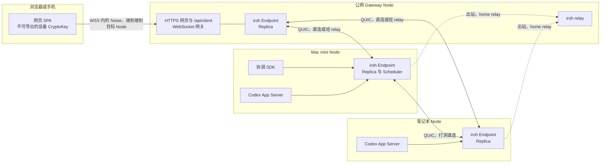
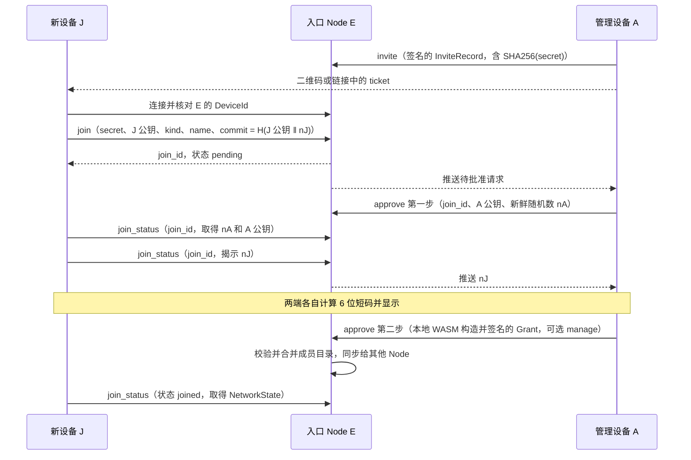

# 统一网络、同步与身份设计

状态为已实施。五期都在 PR #63 中完成，各期与本文的差异见第 8 节各期的实施记录，最终协议见 `docs/node-protocol.md`。2026-10-20 的设计审查（基线 `d685b9a`）提出的修订已并入正文和第五期实施记录，留到之后的项目列在第 10 节。本文以 `origin/main` 的 `1bdf6fd` 为现状，该提交已包含 #55（删除 Task，新增会话级 `set_autonomy`）和 #56（Node 的 `codex` 工具取代 `vibeface codex` 命令，并强制原生审批策略）。本文另外假定两项改动会先合入，即 #54 删除向后兼容，以及统一待核对（调度 job 不再有 `unknown` 和写冻结，只保留本机待核对记录）。文中的行数用 `wc -l` 在 `1bdf6fd` 上统计，标为“约”的数字是按函数范围估算的生产代码行数。

之后的直连 PR（`docs/design/agent-direct-app-server.md`）删除了会话自主度：`AutonomySet`、`off/report/continue` 和只读汇报轮都已不存在，协调 Agent 总是完全权限；Codex 的服务端请求交给协调 Agent 处理，需要本人时生成拍板卡片。下文提到自主度的地方是当时的设计。第 9 节记录已经决定的事项。

## 1. 目标与非目标

Vibeface 现在用自研的 WebSocket 会合目录、relay 预约、Presence 多跳转发和 Noise 通道连接所有设备，用按会话 heads 的闭包拉取同步 DAG，每次写入都全量验签并重建投影，加入一台设备要两端核对多个 64 位编号。本设计把 Node 之间的传输换成 iroh，浏览器保留到 Node 的 Noise 端到端加密，把同步改成每设备一条签名日志加版本向量，把 DAG 收窄为本人能看到的对话和工作记录，并把所有设备的加入统一成一种 ticket 加 6 位短码。项目尚未发布正式版，协议、数据格式、API 和数据目录直接改成最终形态。

目标：

- Node 之间的身份、打洞、relay 和加密传输全部由 iroh 提供，删除 `network.rs`、`peer.rs` 和 Node 之间的 Noise 链路。
- 浏览器经 Node 的 WebSocket 网关接入，网关之上仍运行浏览器与 Node 的 Noise 握手，这是唯一保留的 Noise 链路。
- 设备编号就是设备的 Ed25519 公钥，Node 的设备编号等于 iroh `EndpointId`。
- 同步只交换 `{设备: 最大序号}`，按 `(作者, 起始序号)` 批量拉取，事件入库时验签一次，投影增量更新。
- 任何 Web 入口和任何调度节点看到同一份会话上下文，协调层每轮上下文只从 DAG 构造。
- 浏览器、手机和 Node 用同一种 ticket 加入，用户只核对一次 6 位短码。
- 本人的某台 Gateway 离线时，浏览器自动切到同一个人网络中另一台可用的 Gateway，设备身份不变，继续读写同一份会话。入口地址只在个人网络内部传播。

非目标：

- 不迁移旧数据目录、旧邀请、旧浏览器密钥或旧协议，不做版本探测和回退。
- 不把执行层内部内容（命令、diff、推理、工具输出）写进 DAG。
- 不设计组织共享设备池，不做跨个人网络的数据共享。
- 本期不实现 Passkey，只在第 3 节末尾说明后续方向。

## 2. 总体架构



每台 Node 运行一个 iroh `Endpoint`，用自己的设备密钥作为 `SecretKey`。Node 之间只走 iroh QUIC，连接优先打洞直连，失败时经 relay 转发密文。启用 `relay` 的 Node 同时运行 iroh relay 服务，个人网络的其他 Node 把它作为 home relay。

浏览器不运行 iroh。网页应用固定在本人选定的一个客户端 origin 下，由 service worker 缓存应用外壳。浏览器从本机保存的入口列表中选一台 Gateway Node，连接它的 `/api/client` WebSocket，在其上与目标 Node 完成 Noise 握手，当前入口不可达时换下一台（4.5 节）。目标就是 Gateway 时，Noise 在 Gateway 终止。目标是另一台 Node 时，Gateway 经 iroh 的 `vibeface/client/1` 原样转发 Noise 密文，Gateway 和它前面的 TLS 终止方都看不到明文。第 4.3 节说明这条链路。

跨设备工作有两条路径。一条是委派目标 Node 上的 Codex App Server，另一条是把任务发给目标 Node 的协调 Agent，由它用本机工具执行。两条路径的内部事件都只在本机观察和实时展示，DAG 只记录派发、阶段变化、审批和结果。第 6 节说明两条路径的授权和审批边界。

## 3. 身份与加入

### 3.1 编号

| 名称 | 定义 | 编码 |
|---|---|---|
| `DeviceId` | 设备 Ed25519 公钥原始 32 字节 | 64 个小写十六进制字符，与 iroh `PublicKey` 的 `Display` 一致 |
| `NetworkId` | 个人网络根 Ed25519 公钥原始 32 字节 | 同上 |
| 短显示 | `DeviceId` 前 5 字节 | 10 个十六进制字符，只用于界面区分，不用于核对 |

现在的 `peer_id` 是公钥的 SHA256（`crates/node/src/crypto.rs:159`，`crates/secure/src/lib.rs:57`），`network_id` 是根公钥的 SHA256（`membership.rs:20`）。改造后不再取哈希，编号本身就是公钥，验签时不需要另查 `node_certificates` 表把编号换成公钥。Node 的 `DeviceId` 等于它的 iroh `EndpointId`，因此 iroh 连接的 `Connection::remote_id()` 直接给出已经由 TLS 证明的设备编号。

浏览器的设备密钥是不可导出的 WebCrypto Ed25519 `CryptoKey`。它只用于签名，包括对每次会话的 Noise 临时静态密钥签名，自身不参与加密运算。内部类型统一为 `DeviceId`，JSON 字段统一为 `device_id`，`peer_id`、`subject_id` 和 `PeerId` 全部删除。`target_node`、`scheduler_node` 这类表示角色用途的字段名保留，类型改为 `DeviceId`。

### 3.2 成员目录

```text
Member {
	device_id: DeviceId,
	kind: node | client,
	name: String,
	manage: bool,
}

Genesis {
	version, network_id, root_public_key,
	first_client: Member,   // manage = true
	first_node: Member,
	signature,              // 根私钥
}

GovernanceEvent {
	version, network_id, epoch, parents: Vec<Hash>,
	issuer: DeviceId,
	action: Grant { member } | Revoke(Revocation),
	signature,              // issuer 的设备密钥
}

Revocation { device_id, cutoff_seq, cutoff_hash: Option<Hash> }

RootCheckpoint {
	version, network_id, epoch,
	members: Vec<Member>,
	retired: Vec<Revocation>,   // 不再保留的设备和它们最终的写入上限
	signature,              // 根私钥
}

NetworkState { genesis, checkpoints: Vec<RootCheckpoint>, events: Vec<GovernanceEvent> }
```

成员目录仍是独立的小 DAG，与业务日志分开同步，上限仍为 1024 个成员。与现状相比有三处变化。`Member` 删除 `node_roles`，成员 Node 不分角色，是否运行 relay 只取它自己的 `config.json`。`subject_id` 改为 `device_id`。`Revoke` 带写入上限 `Revocation`：`cutoff_seq` 和 `cutoff_hash` 是发起撤销时所连 Node 上该设备主分支的头，设备没写过时为 `0` 和空。

授权规则如下：

- 只有 `manage=true` 且未撤销的 `client` 成员能签发 `GovernanceEvent`。
- `Grant` 可以授予 `manage=true`。现在 `membership.rs:466-469` 只允许根 checkpoint 建立管理客户端，改造后删除这条限制。
- `node` 成员不能持有 `manage`。Node 常驻无人值守的机器，不签成员变更。
- 管理设备可以撤销任何设备，包括其他管理设备和自己。并发的 `Grant` 与 `Revoke` 冲突时撤销优先。
- 撤销后，该设备只有不超过上限的日志条目计入投影，规则见 5.5 节。超过上限的事件仍可入库，但不计入，所以各副本不论先收到撤销还是先收到事件，结果都一致。同一设备有多条撤销时取序号最大的一条，序号相同时取 hash 较大的一条。
- 根私钥只用于签 `Genesis` 和 `RootCheckpoint`。`RootCheckpoint.epoch` 严格递增，最多 64 个。新 checkpoint 只追加，不丢弃历史：`NetworkState` 保留所有 checkpoint 和各 epoch 的 `GovernanceEvent`，两份 `NetworkState` 的合并是并集，与合并顺序无关。同一 epoch 的 checkpoint 必须完全相同。每个 epoch 从自己的 checkpoint 成员出发投影，当前目录取最高 epoch。
- 根恢复时，没有保留的 Node 连同本机记录的日志头写入新 checkpoint 的 `retired`，此前撤销或退役的设备保留原上限，`retired` 与 `members` 不重叠。旧 epoch 的治理事件以后仍可同步入库，但不能放宽当前的上限。
- 业务事件的 `Attestation` 要求签名设备在任一 epoch 中做过客户端，即 `Genesis.first_client`、各 checkpoint 中的客户端和被授予的客户端。根恢复后，历史请求的签名仍能验证。本机新追加的事件仍要求当前客户端签名。
- 每台设备的私钥只在本设备生成和保存。Node 不持有根私钥。

### 3.3 Ticket

```text
Ticket {
	version: 1,
	entry: EndpointAddr {   // 入口 Node
		id: DeviceId,
		relay_url: Option<Url>,
		direct_addrs: Vec<SocketAddr>,
	},
	secret: [u8; 32],       // 一次性密钥
}
```

字符串形式为 `vibeface1` 加 Ticket postcard 编码的小写 base32，与 iroh `EndpointTicket` 的编码方式相同。浏览器使用 `https://<客户端 origin>/join#<ticket>`，二维码编码这个 URL。客户端 origin 默认取发起邀请的管理浏览器自己的客户端 origin（4.5 节），新浏览器的设备 CryptoKey 因此生成在这个 origin 下。`invite_id` 为 `SHA256(secret)` 的前 16 字节，入口只保存 `SHA256(secret)`。Ticket 默认 10 分钟过期，只能被一个加入请求消耗。Ticket 不包含设备类型、角色和管理权，也不需要单独的签名邀请信封。

### 3.4 加入流程

所有设备走同一个流程。新设备 J 可以是浏览器、手机或 Node，入口 E 是 ticket 中的 Node，A 是批准加入的管理设备。浏览器 J 经客户端 origin 所在 Gateway 的 `/api/client` 与 E 完成 Noise 握手（这台 Gateway 不是 E 时经 iroh 转发，见 4.5 节），Node J 经 iroh `vibeface/join/1` 连接。两种连接都先核对 E 的设备编号等于 ticket 中的 `entry.id`，浏览器依据 E 的 Noise `Proof`，Node 依据 iroh 的 `remote_id()`。



短码为：

```text
code = u32_be(SHA256("vibeface:sas:v1" ‖ network_id ‖ invite_id ‖ J 公钥 ‖ A 公钥 ‖ nA ‖ nJ)[0..4]) mod 1_000_000
```

两端都显示 6 位数字，用户确认相同后在 A 上批准。

短码配合承诺防中间人的原理如下。J 先提交 `commit = H(J 公钥 ‖ nJ)`，此时还不知道 nA。A 收到承诺后才生成新鲜的 nA，J 看到 nA 后只能揭示已经承诺的 nJ，A 自己核对承诺。假设攻击者控制 E 或拿到 ticket，并分别冒充 J 与 A，它要让两段会话算出同一个短码。在与 A 的会话中，它必须在看到 nA 之前固定自己的承诺，nA 又是 A 收到承诺后新生成的，所以 A 一侧的短码对攻击者是均匀随机的。一次成功的概率为百万分之一。Ticket 只能用一次，失败的请求作废，攻击者无法反复尝试。用户在 A 上看到的短码与 J 屏幕不一致时拒绝即可。

这个论证要求短码的每个输入都由计算它的一方自己固定，不采信入口事后的回答：

- A 在发出 nA 之前记下它看到的 J 公钥、`invite_id` 和 `commit`，与 nA 一起保存在本机。浏览器存在 localStorage，刷新或重试“显示安全码”时复用同一个 nA。nJ 揭示后，A 自己核对 `H(J 公钥 ‖ nJ) = commit`，`network_id` 和 A 公钥取 A 自己的值。任何一项与入口后来的回答不同，A 不显示短码，也就无法批准。
- J 在揭示 nJ 之前记下 `network_id`、A 公钥和 nA。浏览器存在 localStorage 的待加入记录里，CLI 写入数据目录的 `join.json`。短码只用这些值和 J 自己的 nJ 计算。揭示后入口改动其中任何一项，J 停止加入；`joined` 时的网络也必须是计算短码时的网络。
- E 也核对承诺，揭示值不符时作废请求，这只是为了尽早结束，安全性不依赖 E。

批准时 A 只多一个选择，是否授予管理权，默认不授予，只对 `kind=client` 可选。Node J 的 `kind` 由 J 自己声明，角色取 J 的 `config.json`。

### 3.5 身份 RPC

身份 RPC 从 17 个合并为 6 个。签名内容由客户端本地 WASM 构造，Node 不再提供 `prepare_*` 方法。

| method | 调用方 | params | 结果 |
|---|---|---|---|
| `invite` | 管理设备 | 签名的 `InviteRecord { network_id, invite_hash, issuer, expires_at_ms }` | 已登记，客户端在本地拼出 ticket |
| `join` | 新设备 | `secret`、`public_key`、`kind`、`name`、`commit` | `join_id`，同一 ticket 重试返回同一 `join_id` |
| `join_status` | 新设备或管理设备 | 新设备带 `join_id`，可带 `reveal`；管理设备不带参数时列出待批准请求 | 状态 `pending`、`confirming`、`joined`、`rejected` 或 `expired`，以及当前可见的随机数和公钥 |
| `approve` | 管理设备 | `join_id`，加 `admin_nonce` 或签名的 `Grant`，拒绝时带 `reject=true` | 新状态 |
| `revoke` | 管理设备 | 签名的 `Revoke` | 合并后的成员目录 |
| `recover` | 持有恢复包的客户端，可以不是成员 | 根私钥签名的 `RootCheckpoint`，以及首次建网时的 `Genesis` 和本机一次性 capability | 新的成员目录 |

建网复用 `recover`。未初始化的 Node 只接受带本机一次性 capability 的 `Genesis`，已初始化的 Node 只接受同一 `network_id` 且 epoch 更高的 `RootCheckpoint`。全部请求都可重试，重复提交同一内容返回原结果，同一 `join_id` 换内容被拒绝。

根恢复有专用准入，不要求调用方是成员。只读的 `recovery_state` 要求根私钥对 `{device_id, expires_at_ms, network_id}` 的签名，`device_id` 必须是本通道的设备，有效期最长两分钟。`recover` 先用 `Genesis` 中的根公钥验证 `RootCheckpoint` 的签名并要求 epoch 更高，验证通过之前不产生任何副作用。所以所有管理浏览器都丢失时，持恢复文件的新浏览器仍可在连接页选“用恢复文件找回”，签出的新目录把它列为管理设备。

`/api/local/join/request`、`/api/local/join/accept` 和 `/api/local/join/status` 删除。新 Node 的本机网页调用本机 Node，由本机 Node 经 iroh 对入口执行 `join` 和 `join_status`。CLI 为 `vibeface join <ticket> --name <名称>`，在终端显示短码并等待批准。

### 3.6 本机会话与浏览器密钥

本机会话改用固定端口。`config.json` 新增 `local_listen`，默认 `127.0.0.1:4791`。现在的本机会话每次启动绑定 `127.0.0.1:0` 随机端口（`crates/node/src/api.rs:115-124`），origin 每次不同，浏览器按 origin 隔离的存储随之丢失。固定端口后 origin 稳定，cookie 和本机的 CryptoKey 可以长期保留。本机会话的其他约束不变，仍只接受实际 loopback 来源、字面 Host 和精确 Origin，仍不授予成员资格和管理权。本机会话仍在 `/api/local/ws` 上执行与 4.3 节相同的 Noise 握手，cookie 绑定浏览器的设备编号。

浏览器设备密钥改为 `crypto.subtle.generateKey({ name: "Ed25519" }, false, ["sign"])` 生成的不可导出 `CryptoKey`，存入 IndexedDB。现在的实现把十六进制明文种子存在 IndexedDB `vibeface-device` 库（`crates/node/web/transport.js:45-101`），页面脚本可以读出。改造后脚本只能请求签名，不能读出私钥。WASM 只负责构造规范签名字节和 Noise 握手，签名调用 WebCrypto。恢复包解锁出的根私钥只在 WASM 内存中使用一次，签完 `RootCheckpoint` 后清零。

### 3.7 步骤与核对次数对比

现状按 `crates/node/web/src/features/identity/` 的当前界面统计，步骤数为两端用户操作合计。

| 场景 | 现状步骤 | 现状核对 64 位编号 | 改造后步骤 | 改造后核对 |
|---|---|---|---|---|
| 首台设备建网 | 约 5 | 0 | 4（打开本机页面、填名称和口令、下载恢复包、确认已保存） | 0 |
| 新浏览器 | 约 12 | 3 个编号，界面共显示 7 处 | 4（管理端添加设备和批准，新设备打开链接和填名称） | 1 次 6 位短码 |
| 手机 | 约 12，另需输入或钉住 Node 编号 | 3 个编号加 1 次输入 | 4（扫码代替打开链接） | 1 次 6 位短码 |
| 新 Node | 约 13 | 3 个编号，界面共显示 7 处 | 5（新机器运行 `vibeface`、打开本机页面、粘贴 ticket 和名称，管理端添加设备和批准） | 1 次 6 位短码 |
| 新增管理设备 | 约 8 以上，必须使用恢复包 | 1 次输入加成员列表 | 4，批准时勾选授予管理权 | 1 次 6 位短码 |
| 根恢复 | 约 8 以上 | 1 次输入加成员列表 | 4（选恢复包、输入口令、勾选保留的设备、确认） | 0，设备按名称和短显示列出 |

### 3.8 后续阶段：Passkey

后续可以让浏览器设备用 Passkey 代替 IndexedDB 中的 CryptoKey，设备编号取 Passkey 公钥，签名经 WebAuthn assertion 完成。这需要 Node 验证 WebAuthn 的 authenticatorData 和 clientDataJSON 格式，并处理 Passkey 跨设备同步导致的“同一编号多台设备”。本期不做。

## 4. 传输

### 4.1 iroh 的使用方式

依赖固定 `iroh` 1.x（调研时最新为 1.3.0）。每台 Node 启动一个 `Endpoint`：

- `secret_key` 为本机设备密钥，与事件签名共用同一把 Ed25519 密钥。事件签名带 `vibeface:event:v1:` 域前缀，与 TLS 用途隔离。
- `relay_mode` 为 `RelayMode::Custom`，内容来自 `config.json` 的 `network.relays`，默认只包含个人网络中启用 `relay` 的 Node。n0 公共 relay 只有在配置中手动打开 `network.n0_relays` 后才加入。
- 地址查找使用 `MemoryLookup`。地址来源是 ticket 中的 `entry`、成员 Node 之间交换的签名地址簿和可选的 mDNS（`iroh-mdns-address-lookup`）。默认不向 n0 的 DNS 或 pkarr 发布地址，公共目录不会出现个人设备。
- `Router` 按 ALPN 分发连接，每个 ALPN 一个 `ProtocolHandler`。

启用 `relay` 的 Node 运行 `iroh-relay` 服务，访问控制实现 `AccessControl`。允许接入的 `EndpointId` 是当前成员 Node，以及带有效邀请令牌 `SHA256("vibeface:relay:v1" ‖ invite_hash)` 的加入方。`invite_hash = SHA256(secret)` 正是发出邀请的 Node 登记的值，所以这台 Node 自己的 relay 能直接核对令牌；ticket 写明的是发邀请 Node 自己的 relay，其他 Node 的 relay 不认这个令牌。Relay 只转发端到端加密的 QUIC 包，不能解密。

| 删除的自研机制 | iroh 中的对应 |
|---|---|
| 会合目录、`Reachability` 签名记录、`lookup`/`publish` | `EndpointAddr`、`MemoryLookup`、成员间地址簿 |
| relay 预约、attach 通道、电路额度 | `iroh-relay` 及其 `AccessControl` |
| 拨号竞速、`PathQueue`、250 毫秒直连领先 | QUIC multipath，打洞与 relay 是同一连接的不同 path |
| Node 之间的 Noise XX 与 `PeerHub` 握手 | QUIC TLS 1.3，`remote_id()` 即对端 `DeviceId`。浏览器与 Node 之间的 Noise 保留，见 4.3 节 |
| Presence 多跳转发、探索邻居 | 删除。任意两台 Node 直接连接，连不上时经 relay |
| 按 IP 的 socket 准入 `network/admission.rs` | relay 与 QUIC 自带限流，客户端网关只保留连接数上限 |

### 4.2 ALPN 划分

| ALPN | 用途 | 接受的对端 |
|---|---|---|
| `vibeface/sync/1` | 交换版本向量，按 `(作者, 起始序号)` 拉取事件，推送新事件通知，同步成员目录 | 未撤销的成员 Node |
| `vibeface/blob/1` | 按内容哈希和偏移读取附件 | 未撤销的成员 Node |
| `vibeface/rpc/1` | 调度投递、工作派发、中断、审批回答转发、状态查询、实时进度订阅、地址簿交换 | 未撤销的成员 Node |
| `vibeface/client/1` | Gateway 转发浏览器与目标 Node 之间的 Noise 密文 | 未撤销的成员 Node |
| `vibeface/join/1` | `join` 和 `join_status` | 任意对端，每个连接只能调用这两个方法，按 ticket 限流 |

每个 ALPN 内部使用 QUIC 双向流，一次请求一条流，帧为长度前缀的 JSON。请求 ID 只用于匹配响应，写操作的去重仍依靠业务 ID。

### 4.3 浏览器接入

浏览器经 Node 的 WebSocket 网关接入，网关之上运行浏览器与目标 Node 的 Noise 握手。这是设计决定，记录在第 9 节。Noise 只保留在浏览器与 Node 之间，Node 与 Node 之间只用 iroh。

连接过程如下：

1. 浏览器在客户端 origin 下打开网页应用，从入口列表中选一台 Gateway Node，连接它的 `/api/client` WebSocket（与页面同源或跨源，见 4.5 节），首帧为 `{ "type": "connect", "target": "DEVICE_ID" }`。
2. `target` 等于 Gateway 自己时，Noise 在 Gateway 终止。`target` 是另一台成员 Node 时，Gateway 经 iroh 的 `vibeface/client/1` 打开一条流，双向原样转发二进制帧，不解析内容。
3. 浏览器与目标 Node 执行 Noise XX 握手，协议仍为 `Noise_XX_25519_ChaChaPoly_SHA256`，prologue 为 `vibeface:client:v1`。
4. 握手完成后，RPC 和 `changed` 推送都是 Noise 加密记录，大消息仍按现有 `Channel` 分片重组。

设备签名密钥与 Noise 静态密钥的关系如下：

- 双方每次会话都新生成一对 X25519 Noise 静态密钥，会话结束即丢弃。浏览器的这对密钥只存在 WASM 内存中。
- 双方在握手 payload 中携带 `Proof { device_id, signature }`。`signature` 是设备 Ed25519 签名密钥对 `"vibeface:noise-static:v1" ‖ prologue ‖ 本次 Noise 静态公钥` 的签名。
- 浏览器的签名由不可导出的 `CryptoKey` 经 `crypto.subtle.sign("Ed25519", ...)` 产生，WASM 只提供待签字节。Node 的签名使用它的设备密钥，也就是 iroh 的 `SecretKey`。
- 浏览器用钉住的目标 `DeviceId` 验证 Node 的 `Proof`，不一致时关闭连接。目标 Node 验证浏览器的 `Proof`，再按成员目录授权。未加入的设备只能调用 `info`、`authenticate`、`join`、`join_status`、`recovery_state` 和 `recover`，后两个的准入见 3.5 节。

这样设备私钥从不参与加密运算，也从不离开 `CryptoKey`，泄露一次会话的 Noise 密钥不影响其他会话。`crates/secure/src/lib.rs` 的 `Handshake` 和 `Channel` 保留给这条链路。`Handshake` 改为先输出本次静态公钥，再接收外部签名的 `Proof`，不再持有设备私钥（现在由 `Identity` 在 crate 内签名，`lib.rs:109-284`）。

这条链路对转发者和被动观察者保持现在的安全性质。Gateway 不是目标时只转发密文，转发 Gateway 前面的 TLS 终止方、relay 和网络上的观察者也只能看到 Noise 密文。

这一保证不覆盖能控制客户端代码的一方。网页应用（HTML、脚本、WASM 和 service worker）由客户端 origin 提供和更新，控制这个 origin、它前面能改写响应的 TLS 终止方或应用的发布链路的一方，可以换掉脚本，调用不可导出的 CryptoKey 签名，读取加密前后的明文。客户端 origin 和应用分发因此是信任前提：客户端 origin 必须是本人自己的 Gateway，或本人自己服务器上的公共入口（第五期实施记录），不使用第三方托管的页面。

与现状相比，删除的是会合目录 `lookup`、签名 `Reachability` 记录、`direct` 与 `dial` 控制消息、候选路径竞速和 relay 预约。浏览器连接入口列表中当前可用的一台 Gateway，由它经 iroh 到达任意成员 Node。

未授权连接有预算和期限。`/api/client` 的 `connect` 首帧和 Noise 握手各须在 10 秒内完成。每台 Gateway 同时最多转发 256 个会话，Gateway 看不到会话内容，所以这个上限对所有转发会话生效，超出时回 `gateway_busy` 并关闭。每台 Node 同时最多保留 32 个未加入设备的会话，超出时拒绝新的未加入会话；未加入设备的会话最长 15 分钟，长于邀请的 10 分钟有效期，加入成功后不再计入。所有会话每 20 秒心跳，90 秒无数据关闭。成员会话和本机会话不受未加入上限影响。

浏览器只在需要读写某台 Node 本机设置时直接把它作为 `target`。业务操作默认以当前所连的 Gateway 为目标。需要其他 Node 处理的控制请求，例如回答某台 Node 上的审批或中断某个工作，由会话所在 Node 经 `vibeface/rpc/1` 转给目标 Node，请求带浏览器的设备签名，目标 Node 自行验证。

### 4.4 个人网络隔离

一个数据目录只属于一个个人网络，一个 Node 进程只服务一个网络。在同一台主机上为多个网络服务时运行多个进程和多个数据目录。iroh relay 不属于任何网络，只转发密文。

隔离在以下三处检查：

1. 连接接受时，`ProtocolHandler` 读取 `remote_id()`，核对它是当前成员目录中未撤销的 Node，不是则直接关闭连接。`vibeface/join/1` 例外，但只开放两个方法。
2. 每条 `vibeface/sync/1` 流的首帧携带 `network_id`，与本机不一致时关闭连接。
3. 事件入库时核对 `network_id` 和作者成员资格，撤销后按 5.5 节的上限计入。

成员目录变化立即作用于已有连接，不等重连。撤销后本机关闭到被撤销 Node 的出站连接并删除它的地址。每条已接受的入站 iroh 连接在目录变化时重新核对对端，对端不再是成员就关闭连接，其上的 `sync`、`rpc`、`blob` 和 `client` 流随之中断。浏览器会话的每个请求都重新查成员目录；已订阅 `changed` 或正在观察进度的会话在目录变化时也重新核对，设备被移除后会话关闭，推送随之停止。根恢复没有保留的 Node 记入 `retired`，与撤销一样关闭连接并删除地址。

SQLite 表不再需要 `network_id` 列，跨网络读取在结构上不可能发生。一个数据目录只属于一个个人网络是已决定事项，见第 9 节。

### 4.5 固定客户端 origin 与入口切换

本人的某台 Gateway 离线时，浏览器要能自动换到同一个人网络中另一台成员 Node，设备身份不变，继续读写同一份会话。浏览器设备的 CryptoKey 按 origin 隔离，换一个 origin 就是另一台设备。所以网页应用固定在一个客户端 origin 下，切换的只是 WebSocket 连接的入口。

**客户端 origin。** 每台 Gateway 仍内嵌并提供完整网页，任何成员 Gateway 的 `public_url` 都可以作为客户端 origin，不需要另外的静态托管。浏览器设备的客户端 origin 就是它加入时打开的 ticket 链接的 origin（3.3 节）。管理端生成邀请链接时从入口列表中选一个 `gateway_url`，默认取上次选用的那个。加入时页面连接同源 Gateway 的 `/api/client`，以 ticket 中的 `entry.id` 为目标，入口不是这台 Gateway 时由它经 iroh 转发。加入后，这个浏览器只在这个 origin 下使用，CryptoKey、入口列表和待确认写入都存在这个 origin 的 IndexedDB 中。直接打开另一台 Gateway 的 origin 得到的是一台没有密钥的新浏览器，需要重新加入。本机会话（3.6 节）的 origin 是 loopback 地址，只连接本机 Node，不参与入口切换。

网页应用注册 service worker，缓存应用外壳，包括 HTML、脚本、样式和 WASM。客户端 origin 所在的 Gateway 离线时，service worker 从缓存打开应用，应用再连接其他入口。外壳只在这台 Gateway 在线时按 service worker 的常规更新检查升级。

**入口列表。** 4.1 节的成员间地址簿由每台 Node 自己签名的记录组成：

```text
AddressRecord {
	version: 1,
	network_id: NetworkId,
	device_id: DeviceId,          // 签名的 Node
	seq: u64,                     // 同一设备严格递增，取较大者
	endpoint: EndpointAddr,       // iroh 地址，供 Node 之间连接
	gateway_url: Option<Url>,     // 启用 gateway 时为该 Node 的 HTTPS public_url
	signature,                    // 该 Node 的设备密钥，对 "vibeface:address:v1:" ‖ 规范字节
}
```

成员 Node 之间经 `vibeface/rpc/1` 交换地址簿，只接受未撤销成员 Node 签名的记录。浏览器连接任一成员 Node 并通过成员授权后，调用 `entrances` 取得所有带 `gateway_url` 的记录，用 `NetworkState` 中的成员目录验证签名，再与本机已有列表合并保存。每项保存 `device_id`、`seq`、`gateway_url` 和最近一次成功连接的时间。`seq` 是已接受记录的高水位，刷新或重启后，`seq` 不高于已保存值的记录被丢弃。撤回网页地址的记录（`gateway_url` 为空）也保存它的 `seq`，所以重放更早的有效记录不能把已撤回的地址找回来。浏览器只保存验签后的字段，不保存签名原文。成员目录撤销某台 Node 后，浏览器从列表中删除它。

入口地址只在个人网络内部传播。`AddressRecord` 只在成员 Node 之间和已授权浏览器的 Noise 通道内传输，不向 n0 的 DNS、pkarr 或任何公共 relay 发布。relay 看不到 `gateway_url` 和内容，但能看到通信元数据：哪些 `EndpointId` 连接它、彼此何时通信、流量大小和来源 IP，并能据此推断哪些设备经常互相通信。本设计不承诺对 relay 隐藏设备之间的关系，只把这些元数据留在本人自己的 relay 上，n0 公共 relay 默认关闭。公共入口同理，它的 relay 和 `/api/client` 能看到浏览器与哪台 Node、在什么时候连接。

**跨源连接。** `/api/client` 接受的 Origin 是本机 `public_url`、`allowed_origins`、本机别名，以及本机地址簿中未撤销成员 Node 的 `gateway_url`。客户端 origin 总是某台成员 Gateway 的 `public_url`，所以不需要在每台 Gateway 上手动配置 `allowed_origins`。其他 HTTP 路径仍要求同源。Origin 检查只限制哪些网页能使用这台 Gateway，访问控制仍由 Noise 握手和成员授权完成。

**宿主 Gateway 被撤销。** 客户端 origin 所在的 Node 被撤销后，其他 Gateway 的地址簿不再有它的记录，不再放行这个 origin 的跨源连接。被撤销的 Node 不能再同步或调用 `rpc`，但它仍提供这个 origin 的网页，也能像公共入口一样经 `vibeface/client/1` 转发密文，所以这个 origin 下仍是成员的浏览器还能经它连到其他成员。这台 Node 控制该 origin 的代码分发（4.3 节的信任前提），因设备丢失或被入侵而撤销 Node 时，应同时撤销以它为 origin 的浏览器，并在另一台成员 Gateway 或本人的公共入口下重新加入。被撤销的 Node 在收到撤销之前，仍可能向浏览器显示撤销前的内容，它之后写入的事件不被其他副本接受。公共入口不是成员，成员撤销不影响以它为 origin 的浏览器。

**自动切换。** 当前入口的 WebSocket 断开，或连接和握手在 5 秒内未完成时，浏览器按最近成功时间从新到旧依次尝试列表中的其他入口。全部失败时按指数退避循环重试，界面显示离线。每次连接都以该入口的 `DeviceId` 为目标完成 Noise 握手，用 `AddressRecord` 中钉住的 `DeviceId` 验证 Node 的 `Proof`，目标 Node 照常验证浏览器的 `Proof` 和成员授权。Gateway 的域名和 TLS 证书只用于传输，浏览器不额外信任它们。冒充 `gateway_url` 的服务器拿不到对应设备密钥，握手会失败。

切换后：

- 读取和订阅自动恢复。浏览器为打开的会话重新订阅，并带上自己已经看到的版本向量。新入口也是副本，它的向量尚未覆盖浏览器已看到的内容时，界面显示“同步中”，等 `changed` 推送补齐，不删除已显示的内容。
- 未确认的写入只核对，不改派，不重签。浏览器在入口确认前保存每个带 `Attestation` 的写入请求原文，包括消息、审批回答、`AutonomySet` 和通知确认。切换后先按业务 ID（`message_id`、`request_id` 等）向新入口查询，已入库则标为已确认。未入库时原样提交同一份已签名请求，`message_id`、`scheduler_node` 和 `Attestation` 都不变。
- 旧入口恢复后可能从自己的 outbox 再写一次同一条消息。5.5 节把同一 `message_id` 且签名内容相同的 `MessagePosted` 合并为一条，调度 Node 按 `message_id` 去重 job，所以消息只被调度一次。这与第 6 节“重试保留原 ID、结果不明时向原目标查询、不改派”的规则一致。

## 5. 同步与 DAG

### 5.1 事件结构

```text
Event {
	version: 1,
	network_id: NetworkId,
	author: DeviceId,          // 写入该事件的 Node
	seq: u64,                  // 作者日志序号，从 1 开始连续递增
	prev: Option<Hash>,        // 作者 seq - 1 的事件 hash，seq = 1 时为空
	deps: Vec<Hash>,           // 写入时依据的其他作者事件，按 hash 排序去重
	scope_id: ScopeId,         // 会话 ID
	created_at_ms: i64,        // 展示用；排序时只在 lamport 相同时作为第二键，见 5.3 节
	body: EventBody,
	blobs: Vec<BlobRef { hash, size }>,
}

SignedEvent {
	hash: Hash,                // SHA256(canonical_body)
	canonical_body: String,    // 规范 JSON 原始字节
	signature: Signature,      // 作者对 "vibeface:event:v1:" ‖ hash 的 Ed25519 签名
}

Attestation {
	device_id: DeviceId,       // 本人的浏览器或手机
	signature: Signature,      // 对 "vibeface:message:v1:attestation:" ‖ hex(SHA256(规范 JSON {network_id, scope_id, body})) 的签名，body 去掉 attestation
}
```

每台 Node 在整个网络中只有一条日志，不再按会话分链。现在的 `sequence` 和 `previous` 按 `(network, scope, author)` 分别递增（`crates/node/src/store.rs:2271-2276`），版本向量会随会话数增长。改为每设备一条后，版本向量的大小等于 Node 数。`deps` 只引用作者写入时已知的其他作者事件，通常是同一会话中最新的几条，不再取整个会话的全部 heads。

浏览器不写日志，它发起的写操作由所连 Node 作为作者写入，并在 `body` 中携带 `Attestation`。签名覆盖 domain `attestation`、`network_id`、`scope_id` 和去掉 `attestation` 的完整 body。body 里有事件类型和业务 ID（`message_id`、`request_id`、`version` 等），所以入口不能把一份签名包装到另一个网络、另一个会话或另一种动作上，换了就验签失败。换入口重试时提交同一份已签名请求，签名不变。需要本人授权的事件必须带有效的客户端设备签名，Node 和协调 Agent 不能代写。这是设计决定，记录在第 9 节。

### 5.2 事件类型

写入 DAG 的事件：

| 类型 | 字段 | 作者 | 说明 |
|---|---|---|---|
| `ConversationCreated` | `title` | 入口 Node | |
| `ConversationOwner` | `scheduler_node`、`epoch`、`attestation` | 入口 Node | 本人为会话选择的调度 Node。`epoch` 最大者生效，相同时按 5.5 节的请求身份仲裁。消息不再各自携带 `scheduler_node` |
| `BotCreated` | `bot_id`、`name`、`instructions`、`project?: { target_node, cwd }` | 入口 Node | 带 `Attestation`，删除 `membership_role_proof` |
| `MessagePosted`（user） | `message_id`、`role: user`、`text`、`report_results`、`attestation` | 入口 Node | 本人发的内容 |
| `MessagePosted`（assistant） | `message_id`、`role: assistant`、`text`、`in_reply_to: message_id`、`status` | 调度 Node | 协调层每一轮的回复。`status` 为 `completed`、`failed`、`stopped` 或 `interrupted`，停止或中断时保留已输出的部分文字 |
| `WorkDispatched` | `work_id`、`trigger`、`dispatcher`、`call_ref`、`kind: codex \| task`、`cwd`、`prompt`、`continues?: work_id`、`parent?: work_id` | 目标 Node | 目标接纳时写入，此后才有进度。作者即目标，不另写 `target_node` |
| `WorkProgress` | `work_id`、`phase`、`summary`、`thread_id?`、`turn_id?` | 目标 Node | 只在阶段变化时写一条，附一句摘要，不逐 token 写。`codex` 的 thread 和 turn 在 `running` 时随进度写入。`task` 路径的摘要由目标协调层给出 |
| `WorkFinished` | `work_id`、`outcome`、`result_text`、`failure_reason?`，结果正文过长时放入 `blobs` | 目标 Node，`unverified` 的复核由入口 Node 写 | `outcome` 为 `completed`、`failed`、`interrupted` 或 `unverified` |
| `AutonomySet` | `mode: off \| report \| continue`、`version`、`attestation` | 入口 Node | 会话级自主授权决策，取代 #55 中的 `DecisionRecorded` 编码；直连 PR 已删除 |
| `NotificationAcked` | `notification_id`、`client_id`、`attestation` | 入口 Node | 通知 ID 即产生通知的事件 hash |
| `AssistantChanged` | `change_id`、`cause`、`change` | 调度 Node | 本人在聊天里要求修改助手名称、说明、共用 skill 或例行任务，见 [在聊天中修改助手](assistant-config.md) |
| `ContextCheckpoint` | `summary`、`covers: VersionVector` | 调度 Node | 保留现有类型，用于长会话的上下文压缩，`covered_heads` 改为版本向量 |

`kind=codex` 表示本机协调 Agent 直连本机 App Server 发出、Node 观察的 Codex 回合，`kind=task` 表示把任务交给目标 Node 的协调 Agent。没有单独的执行层，见 `docs/design/agent-direct-app-server.md`。目标协调 Agent 在执行 `task` 时自己启动的 Codex 工作，记为一条 `parent_work` 指向原任务的新 `WorkDispatched`。

`WorkDispatched` 由目标在接纳时写入，接纳前的派发只存在派发方本机 outbox 中。这样 DAG 中不会出现目标从未收到的派发。目标先写 `WorkDispatched` 并在本机日志记下 thread，再启动 turn，崩溃后能按日志核对，不重启工作。这是设计决定，记录在第 9 节。

审批事件、`approval_forms` 和审批表单已随直连 PR 删除：工作线程以 `approvalPolicy=never`、完全访问运行。

`WorkProgress.phase` 取值为 `started`、`running`、`waiting_approval`、`interrupting` 和 `finishing`。`WorkFinished` 的 `unverified` 表示目标 Node 无法证明执行层的真实结果，证据保存在目标 Node 的本机待核对记录中。本人核对后，入口 Node 可以为同一 `work_id` 再写一条带 `Attestation` 的 `WorkFinished`。只有 `unverified` 可以被后续的 `WorkFinished` 取代。

不写入 DAG 的内容：

- 执行层内部的命令、diff、推理和工具输出。
- 协调层流式中间文字和逐个工具调用，只经 `vibeface/rpc/1` 实时展示。
- 本机调度 job 队列、outbox、待核对记录、SDK 原生会话缓存、附件暂存进度、模型密钥和设备私钥。

删除的事件类型为 `AgentMessage`、`DecisionRecorded` 和 `NotificationRaised`，`TaskCreated` 和 `TaskChanged` 已由 #55 删除。`AgentMessage` 的远端协调任务改为 `executor=agent` 的 Work 事件，其 `task`、`progress` 和终态三类 `kind` 分别由 `WorkDispatched`、`WorkProgress` 和 `WorkFinished` 表达。`DecisionRecorded` 中的 `followup_intent_v1` 改为 `MessagePosted.report_results`，`conversation_autonomy_v1` 改为 `AutonomySet`。通知由 `WorkFinished` 和 `ApprovalRequested` 等事件派生，不再单独写 `NotificationRaised`。

### 5.3 存储

```sql
events(
	hash TEXT PRIMARY KEY, author TEXT, seq INTEGER, scope_id TEXT,
	lamport INTEGER,                              -- 1 + max(prev, deps 的 lamport)
	created_at_ms INTEGER, envelope TEXT,
	main INTEGER,                                 -- 在本机该作者的主分支上
	effective INTEGER,                            -- 计入投影，见 5.5 节
	detected_at_ms INTEGER                        -- 分支外事件被发现的时间
)
UNIQUE (author, seq) WHERE main = 1
event_blobs(hash TEXT, blob TEXT)                 -- 附件授权读取的依据
log_heads(author TEXT PRIMARY KEY, max_seq INTEGER, head_hash TEXT)   -- 主分支的头
pending_events(hash TEXT PRIMARY KEY, envelope TEXT, missing TEXT)
```

所有已入库事件在同一张 `events` 表里。每个作者在本机有一条主分支（`main = 1`），每个序号最多一条；分叉的另一支作为证据也存在这里（`main = 0`，5.7 节）。`main` 取决于本机的到达顺序，各副本可能不同；`effective` 只取决于签名证据，持有相同证据的副本完全相同。

`log_heads` 就是本机的版本向量，记录每个作者主分支的头。本机存储保持一个不变量，`events` 中每个事件（不论在不在主分支上）的 `prev` 和 `deps` 也都在 `events` 中。因此 `{author: max_seq}` 精确描述本机主分支上的事件集合，分支外的证据由 5.4 节的分叉摘要描述。

读取顺序为 `(lamport, created_at_ms, hash)`。`lamport` 只由事件内容决定，与到达顺序无关，并且总大于它的每个因果前项，所以按它排序满足因果顺序。投影保存同样的 `rank` 字符串，增量合并时比较 rank 即可，不需要 `event_deps` 表。

### 5.4 版本向量同步流程

两台 Node 在 `vibeface/sync/1` 上同步：

1. 双方发送 `Hello { network_id, vector: { author: (max_seq, head_hash) }, boot, membership_epoch, membership, forks }`。`membership` 是成员目录的摘要，不一致时交换 `NetworkState`，双方都按 3.2 节取并集，不比较 epoch。
2. 对每个作者，若对方的 `max_seq` 大于本机，发送 `Pull { author, from_seq: 本机 max_seq + 1, limit }`。
3. 对方按 `seq` 升序返回 `Events { author, events }`，每批最多 1024 条、正文合计 8 MiB。
4. 接收方按 5.5 节入库。缺少其他作者的 `deps` 时，事件进入 `pending_events`，并对缺失作者追加 `Pull`。
5. 对每个作者，对方的头 `head_hash` 本机没有时，说明这条日志在对方那里走了另一支。本机从两边较小的 `max_seq` 起向前探测，每次退后的步数加倍，每次只拉一条，直到拉到的事件本机已经有（或到了 #1），再从那里向后分页拉回对方那一支。拉回的事件按 5.5 节入库，成为分叉证据。
6. `forks` 是本机分叉证据的摘要：所有分叉作者从分叉序号起两支全部事件的 hash，没有分叉时为空。两边的主分支可能不同，所以摘要覆盖两支，而不只是本机的分支外事件。摘要不一致时发送 `Forks { after }`，对方按 `(author, seq, hash)` 升序从游标之后返回分叉证据，每页限额与 `Pull` 相同。
7. 本机追加事件后，向已连接的成员 Node 发送 `Have { author, seq, hash }`，对方据此拉取。收到的 `Hello` 中有本机没有的头（对方更多或在另一支上），或分叉摘要、成员目录摘要不一致时，立即与对方同步。同一对不一致的分叉摘要只唤醒一次，避免一方存不下的证据让双方互相唤醒，之后由定时同步补齐。连接空闲时每 60 秒重新交换一次 `Hello`，补上丢失的通知。

现在的同步每 3 秒向最多 4 个副本请求所有会话的 heads（`crates/node/src/runtime.rs:3268-3278`），再沿 `parents` 和 `previous` 逐个或分批取闭包。改造后一次往返就知道缺什么，拉取按序号区间进行，不需要沿 hash 回溯。

### 5.5 入库与投影

每批事件在一个 SQLite 事务中处理，每个事件依次检查：

1. 解析规范 JSON，核对 `hash`、`network_id` 和事件形状。需要本人签名的类型验证 `Attestation`，签名设备须在任一 epoch 做过客户端（3.2 节），不允许带签名的类型带了就拒绝。
2. `hash` 已在 `events` 或 `pending_events` 中时视为重复，忽略。
3. 作者是当前成员 Node，或是带写入上限的已撤销、已退役设备。
4. 验证作者签名。第 1 步和这一步是该事件唯一一次验签。
5. 只有通过前四步的事件才产生副作用。`prev` 不在本机时，序号不超过主分支 `max_seq + 1` 的放入 `pending_events`，再往后的丢弃并从缺口处重新拉取；`prev` 在本机但不是同作者的前一条时拒绝；`deps` 不全时放入 `pending_events`。
6. 写入 `events`。`prev` 是本机主分支的头（#1 则要求本机还没有该作者）时 `main = 1` 并更新 `log_heads`，否则 `main = 0`，作为分叉证据。按下面的有效集合确定 `effective`，再检查 `pending_events` 中是否有事件因此满足条件。

签名无效或作者无权的事件不会入库，也不会让任何 Node 进入 `forked`。Hello 中本机没有的头只触发拉取，拉回的事件同样先经过这些检查。

**有效集合。** 每个作者的 `fork` 是它分支外事件的最小序号，没有分叉时为无穷大。哪些事件计入只看签名证据：

- 当前成员 Node：主分支上 `seq < fork` 的事件。
- 带写入上限 `(cutoff_seq, cutoff_hash)` 的设备：主分支上 `seq <= min(cutoff_seq, fork - 1)` 的事件；`cutoff_hash` 在本机且正是该作者序号 `cutoff_seq` 的事件时，再加上从它沿 `prev` 往回、`seq >= fork` 的那一支。撤销时的 `cutoff_hash` 因此选定分叉后保留哪一支。
- 其他设备：没有。

分叉前的事件在各副本上相同，`fork` 和沿 `prev` 的那一支也只由证据决定，所以结果与哪一支在本机是主分支无关。依赖只决定顺序，不传递有效性：其他作者的事件引用了不计入的事件，自己仍然计入。

入库后的事件不再验签。现在的 `load_events_from`（`crates/node/src/store.rs:2469`）在每次追加、每次重建以及 bots 和 followup 的读取中，都对全网每个事件查证书并完整验签。该函数删除，读取直接查表。数据目录的完整性属于本机信任边界，需要时用维护命令 `vibeface store verify` 离线重新验签。

投影 reducer 平时对每个事件只执行一次。现在的 `rebuild_projections_from`（`crates/node/src/store.rs:2300-2432`）在每次入库或追加时删除并重写全部投影表。为了让增量结果与到达顺序无关，每个投影都满足交换律：

| 投影 | 合并规则 |
|---|---|
| 会话与消息 | 按 `(lamport, created_at_ms, hash)` 在读取时排序，不在入库时分配 `ordinal`。同一 `message_id` 的多条 `MessagePosted(user)` 若 `Attestation` 覆盖的内容相同，视为同一条消息，保留因果最早者，并发时取 hash 较小者，浏览器不会为同一 `message_id` 签两份内容，万一出现，投影只采用最早者并在界面标出另一条。这对应 4.5 节切换入口后的重复提交 |
| Bot | 同一 `bot_id` 取因果最早的 `BotCreated`，并发时取 hash 较小者 |
| 工作 | 每个 `work_id` 的状态只前进，`WorkFinished` 为终态，只有 `unverified` 可被取代 |
| 会话负责人 | `epoch` 最大的 `ConversationOwner` 生效，相同时取请求身份较小者 |
| 通知确认 | 集合并集 |

请求身份是 `SHA256(Attestation 签名内容 ‖ 签名设备编号)`，签名内容即 5.1 节的 `{network_id, scope_id, body}`。同一份已签名请求无论由哪个入口包装、外层事件 hash 是多少，请求身份都相同，所以换入口重试的副本合并为一份，不改变仲裁结果，外层事件 hash 不参与仲裁。Ed25519 签名是确定的，同一设备对同一内容只有一个签名，请求身份不需要包含签名本身。真正不同的决定才按上表仲裁；本人也可以签一个更高的版本或 epoch 来明确结果。

**重算。** 事件在主分支上且作者没有分叉时，按作者的上限决定是否计入，计入的直接增量执行 reducer。成员目录变化（授予、撤销、checkpoint），或新入库的事件不在主分支上、作者已分叉时，在本批事务结束时重算。重算按有效集合重新计算每个事件的 `effective`，有变化时清空 reducer 写的投影表（会话、消息、Bot、助手配置、技能、例行任务、助手变更、工作、通知及确认、提醒及处理），再按 `(lamport, created_at_ms, hash)` 重放所有 `effective = 1` 的事件。调度队列、工作派发与停止、例行运行、outbox、分诊和邀请是本机账本，不在重算范围内，重算也不重放任何副作用。重算后向浏览器推送一条不带会话的 `changed`，网页整体刷新。

数据格式变化时不迁移。项目不保留兼容，直接使用新数据目录。

### 5.6 附件

附件改为按内容哈希命名的文件，路径为 `<data-dir>/blobs/sha256/<前两位>/<hash>`，不再存入 SQLite 的 `blobs` 表。传输使用 `vibeface/blob/1`：

1. 接收方发送 `Get { hash, size, offset }`。
2. 来源核对请求方是成员 Node，且该 hash 被本机至少一个事件的 `blobs` 引用，然后从 `offset` 起顺序发送字节。
3. 接收方写入 `<data-dir>/blobs/partial/<hash>.part`，每块 `fsync` 后在 SQLite 中提交已确认偏移。断线或重启后截去未提交的尾部，从已提交偏移继续。
4. 收齐后核对大小和 SHA256，一致时原子重命名到正式路径，不一致时删除暂存并换来源重试。

单件上限仍为 64 MiB，暂存额度保持 256 MiB、64 个对象。来源直接读文件，`store/blob_reader.rs` 的只读 SQLite 读取者池删除。不使用 `iroh-blobs`，原因是它仍为 0.x，2026-10-08 还发布过任意对端可写入 store 的安全公告。这是设计决定，记录在第 9 节。

### 5.7 冲突处理

同一作者同一序号出现两条不同事件，只会在数据目录被复制或从备份恢复后继续写入时发生。处理规则如下：

- 两支都入库。本机先到的一支是主分支，另一支 `main = 0`，作为证据保存，它的后续事件同样入库。
- 5.4 节的头比对和向前探测发现分叉，分叉摘要和 `Forks` 请求把两支证据传给每台成员 Node。持有相同证据的副本结果相同，与哪一支先到无关。
- 从分叉序号起，该作者两支的事件在所有副本上都不计入，分叉前的照常计入（5.5 节）。其他作者引用了这些事件的事件仍然计入，依赖都在 `events` 中，5.3 节的不变量不变。
- 冲突不锁住会话，也不阻止其他作者和其他会话继续写入。
- 作者 Node 一旦存有自己日志的另一支就进入 `forked`，停止写入，并向本人发出通知。两份副本都会如此。
- 本人在网页上查看两支内容，然后撤销该设备。撤销的 `cutoff_hash` 取发起撤销所连 Node 主分支的头，这一支随即在所有副本上重新计入，另一支仍不计入。该设备用新的数据目录和密钥重新加入，另一支中需要保留的内容由本人重新发送。这是设计决定，记录在第 9 节。

现在的实现把重复序号标为 `conflict`，并让整个会话拒绝追加（`crates/node/src/store.rs:2262`、`2316-2346`），本设计删除这个锁定。

### 5.8 备份恢复后的写入保护

Node 启动后进入 `aligning` 状态。本次启动以来，每台其他当前成员 Node 都确认过本机日志，才进入 `writable`。一次同步结束时，对方记录的本机作者 `max_seq` 不大于本机，本机在该序号上的事件就是对方的头，并且本机日志没有分叉，就算对方确认。对方更多时先拉回本机自己的日志再比对。成员目录中没有其他 Node 时直接进入 `writable`。

`aligning` 期间可以读取和同步，不能追加事件。调度 job 保持排队，入口收到的用户消息保存在本机 outbox，写入后再投递。

还没确认的 Node 都同步失败时，Node 进入 `read_only`。本人可以在网页上确认“此数据目录没有从备份恢复”，Node 随即进入 `writable`。这一确认要求本机会话或带 `Attestation` 的管理设备，只记录在本机，不进入 DAG。这是已决定事项，记录在第 9 节。本人没有确认时，那些 Node 恢复连接并补齐确认后，Node 同样进入 `writable`。

成员目录变化时重新判断。撤销一台离线的 Node 后它不再需要确认，其余 Node 都已确认时随即可写。例如 P 从 #7 的备份恢复，而 P 之前写的 #8 到 #10 只同步给了 L、还没到 G：P 连上 G 后仍要等 L，L 确认前会先把 #8 到 #10 还给 P，所以不会写出另一个 #8。

### 5.9 三设备示例

设备为 Mac mini Node `P`（Scheduler，运行 Codex）、公网 Gateway Node `G`（Relay）和笔记本 Node `L`（运行 Codex）。本人用手机经 `G` 访问。开始时三台的版本向量一致：

| 时刻 | P 的向量 | G 的向量 | L 的向量 |
|---|---|---|---|
| t0 | P:10 G:4 L:7 | P:10 G:4 L:7 | P:10 G:4 L:7 |

1. 手机发送“在笔记本上跑测试”。`G` 写入 `G#5 MessagePosted(user, scheduler_node=P, attestation=手机)`，`deps` 为该会话最新的 `P#10`。`G` 向 `P` 和 `L` 发送 `Have(G, 5)`，两者各拉取 `G 5..5`。
2. `P` 的调度器领取 job，写入 `P#11 MessagePosted(assistant, "已开始：…")`。它经 `vibeface/rpc/1` 请求 `L` 在指定 `cwd` 启动 Codex turn，`L` 返回 `thread_id=t1`、`turn_id=u1` 后，`P` 写入 `P#12 WorkDispatched(work_id=w1, target_node=L, executor=codex, thread_id=t1, turn_id=u1)`。
3. `L` 写入 `L#8 WorkProgress(w1, running, "正在运行 cargo test")`，随后 Codex 请求执行网络命令，`L` 写入 `L#9 ApprovalRequested(w1, r1)`。这时 `L` 的网络中断。

| 时刻 | P 的向量 | G 的向量 | L 的向量 |
|---|---|---|---|
| t1 | P:12 G:5 L:8 | P:12 G:5 L:8 | P:12 G:5 L:9 |

4. `L` 恢复连接，与 `G` 交换 `Hello`。`G` 发现 `L` 的 `max_seq` 为 9，拉取 `L 9..9`，并据此通知手机有待批准请求。
5. 本人在手机上批准。`G` 写入 `G#6 ApprovalAnswered(w1, r1, approve, attestation=手机)`，并经 `vibeface/rpc/1` 把回答转给 `L`。`L` 验证手机设备签名后回复 Codex。
6. Codex 完成，`L` 写入 `L#10 WorkFinished(w1, completed, 结果摘要, blobs=[测试日志])`。`P` 拉取后调度只读收尾，写入 `P#13 MessagePosted(assistant, 测试结果总结)`。
7. 期间 `P` 与 `L` 之间曾短暂断开。重新连接后双方交换 `Hello`。

| 时刻 | P 的向量 | G 的向量 | L 的向量 |
|---|---|---|---|
| t2，交换前 | P:13 G:6 L:10 | P:13 G:6 L:10 | P:12 G:6 L:10 |
| t2，交换后 | P:13 G:6 L:10 | P:13 G:6 L:10 | P:13 G:6 L:10 |

`L` 只需要拉取 `P 13..13` 一个区间。测试日志附件由 `P` 和 `G` 在入库后从 `L` 按哈希拉取。之后本人在笔记本的浏览器打开同一会话，看到的消息、派发、审批和结果与手机上相同。

如果 `L` 之后从 t0 的备份恢复，启动时处于 `aligning`。`G` 在 `Hello` 中报告 `L:10`，大于本机的 7，`L` 先拉回自己的 `L 8..10`，再进入 `writable` 并写入 `L#11`，不会产生分叉。

## 6. 协调层与上下文

协调层每轮的上下文只从 DAG 构造。调度器领取 job 时固定一个 `basis: VersionVector`，取代现在的 `basis_heads`。`materialize` 读取该依据下的会话视图（现在的实现见 `crates/node/src/scheduler.rs:450-516`），按以下顺序填入：

1. Bot 定义和当前 `AutonomySet`。
2. 最新 `ContextCheckpoint` 的摘要及其 `covers` 之后的消息，包括本人消息和协调层回复。
3. 每个工作的摘要，包括 `WorkDispatched` 的目标与 `cwd`、最新 `WorkProgress` 摘要、待回答的 `ApprovalRequested` 和 `WorkFinished` 结果。
4. 触发本轮的事件。

SDK 原生会话只是本机缓存，按 `(conversation_id, 本机 DeviceId)` 保存，并记录它已覆盖的版本向量。新 `basis` 包含该向量且缓存来自本机时，只发送增量。否则开启新的原生会话并发送完整上下文。所以换入口、换调度节点或换浏览器后，协调层得到的上下文相同，差别只在缓存能否复用。

协调工具改为 `nodes`、`context`、`dispatch_work`、`work_status`、`interrupt_work` 和 `call_lookup`。`dispatch_work(target_node, executor, cwd, prompt, call_ref, continues?, parent?)` 取代现在的 `send_task`、`codex` 中启动工作的 `thread/start` 与 `turn/start`，以及 `observe_session`。`work_status` 取代 `task_status` 和 `codex` 的 `thread/read`，`interrupt_work` 取代 `cancel_task` 和 `codex` 的 `turn/interrupt`，并沿 `parent` 一并停止它委派出的工作。`work_id` 由 `(会话, trigger, call_ref)` 派生，同一轮重试同一 `call_ref` 得到同一工作，不会启动第二个 turn；结果不明时用 `call_lookup` 查询原调用。

协调层一轮在派发后即结束，不等待工作。工作结束时目标写入 `WorkFinished`，调度 Node 把它作为新的 trigger（`work:<work_id>`）入队，下一轮向本人汇报结果；`report` 模式下这一轮只读。调度 job 以 `(会话, message_id | work_id)` 为键，重试和同步都不会产生第二个 job。

目标 Node 上的工作由本机状态机驱动，状态为 `accepted`、`starting`、`running`、`waiting_approval`、`interrupting`、`finished` 和 `unverified`。状态转换函数是 Work 事件的唯一来源，同一事务内更新本机日志、追加事件并为结果入队。审批的 `request_id` 为 `hash(work_id, executor_epoch, rpc_id)`；App Server 重启后 epoch 加一，旧请求不能再回答。回答先标记为发送中，确认送达后才清除。

### 6.1 工作路径

原设计的跨设备工作有两条路径：`executor=codex` 委派目标 Node 上的 Codex App Server，`executor=agent` 把任务发给目标 Node 的协调 Agent。直连 PR 删除了前者，只保留协调 Agent 之间的任务（`kind=task`），本机工作为 `kind=codex`。

两类工作共用以下授权规则：

- 派发方必须处于一次正在运行的调度 attempt 中。直连 PR 之后没有自主度，本人消息、工作结果和例行任务触发的轮次都能派发。
- 目标 Node 核对派发方是未撤销的成员 Node，核对 `cwd` 位于目标 Node 自己 `config.json` 的 `roots` 中。
- 重试保留原 `work_id` 和 `call_ref`。结果不明时向原目标查询，不改派到其他 Node。
- 两边的协调 Agent 都不能加入或撤销设备。

直连 PR 之后每台设备只有一个协调角色（协调 Agent 加 Node 运行时），协调 Agent 的 Shell 完全访问本机，不再逐条审批。跨设备只有 `kind=task` 一种：把任务交给目标设备的协调 Agent，由它在本机直连 App Server。下表为现状：

| | 本机工作（`kind=codex`） | 跨设备任务（`kind=task`） |
|---|---|---|
| 谁发起 Codex 回合 | 本机协调 Agent 经 `dispatch_work` 直连 App Server，Node 先登记后观察 | 目标设备的协调 Agent，作为一个 `AgentTask` 调度 job |
| 目标设备需要 | Codex CLI 和允许的 `roots` | 已启用 `manager` 配置，并有剩余的 `daily_decision_limit` 额度 |
| 权限 | `approvalPolicy=never`、`danger-full-access` | 同左；Cursor SDK 协调层使用 Cursor 默认的本机工具集 |
| DAG 中记录 | `WorkDispatched`、进度（thread、turn）和结果 | `WorkDispatched` 不带 thread，目标协调层给出阶段摘要和结果；它启动的 Codex 工作另记一条 `parent_work` 指向原任务的 `WorkDispatched` |
| 不进入 DAG | Codex 的命令、diff 和工具输出 | 目标协调层的推理、shell 命令和输出 |

`kind=task` 沿用现在 `post_agent_task` 的接纳规则（`crates/node/src/store/agent_messages.rs:444` 起）。只有任务可以由 Agent 派发，环形委派被拒绝，目标在同一会话中已有未结束任务时回传 `interrupted`。目标协调层收到的上下文同样只来自 DAG，外加该任务的 `WorkDispatched` 正文。

“继续上次的任务”由 `dispatch_work` 的 `continues=work_id` 表达。目标从原工作取得 `kind` 和 thread。`codex` 在同一 thread 上启动新 turn，`task` 向同一目标协调层发送新任务，两者都写入一条 `continues=work_id` 的新 `WorkDispatched`。原目标不可达时返回错误，不改派到其他 Node。

只在本机保存的内容：

| 内容 | 位置 |
|---|---|
| 调度 job 队列和投递 outbox | 调度 Node 与入口 Node 的 SQLite 本机表 |
| 待核对记录及其证据 | 产生不确定结果的 Node |
| SDK 原生会话 ID 和已覆盖向量 | 调度 Node |
| 工作状态机日志（thread、turn、App Server epoch、发送窗口） | 目标 Node 的 `work_runs` 表（工作定义读 DAG） |
| 流式文字、工具调用进度 | 内存，经 `vibeface/rpc/1` 推送 |
| 附件暂存进度、每日预算 | 本机 |
| 设备私钥、模型凭证 | 本机，不进入任何同步数据 |

## 7. 删除清单

行数取自 `1bdf6fd`。“生产”指 `#[cfg(test)]` 之前的代码，测试随对应代码一起删除或重写。#54 合入后部分数字会小幅变化。

| 模块 | 删除内容 | 规模 |
|---|---|---|
| `crates/node/src/network.rs` | 整个文件，`Control`、`Reachability`、`NetworkHub`、mDNS 来源表、`Reservation`、`Attachment`、`PathQueue`、`dial_authenticated`、`race_paths`、relay 预约与电路转发 | 7375 行，生产约 2556 |
| `crates/node/src/network/admission.rs` | 整个文件，`SocketClass`、按 IP 准入与电路额度 | 1096 行 |
| `crates/node/src/peer.rs` | 整个文件，`PeerHub`、`Hello`、`Packet`、`Kind`、Presence、多跳转发、Node 之间的 Noise 握手 | 2291 行，生产约 1262 |
| `crates/secure/src/lib.rs` | `Handshake` 内用 `Identity` 签 Noise 静态密钥的代码，改为接收外部 `Proof`。`Handshake`、`Channel` 和 `snow` 保留给浏览器链路 | 约 40 行改动 |
| `crates/node/src/crypto.rs` | `fingerprint` 作为身份编号的用法、证书查找式验签 | 约 60 行 |
| `crates/node/src/runtime.rs` | `capabilities`、`inventory`、`event`、`history_batch` 处理，`sync_step_core`、`history_events`、`verify_history_batch`、闭包进度保存、`route_flight` | 约 800 行 |
| `crates/node/src/runtime/sync.rs` | 按会话 heads 的作业协调和预算，重写为版本向量会话 | 1735 行，生产约 1150 |
| `crates/node/src/store.rs` | `rebuild_projections_from`、`load_events_from`、`heads_from_events`、`missing_dependencies`、`inventory_heads`，按会话的 `sequence` 分配 | 约 450 行 |
| `crates/node/src/store/blob_reader.rs` | 整个文件，只读 SQLite 读取者池 | 524 行 |
| `crates/node/src/store/blob_transfer.rs`、`runtime/blob_transfer.rs` | SQLite 正文发布、hex 分块协议，重写为文件加 `vibeface/blob/1` | 2344 行，保留续传逻辑约 400 |
| `crates/node/src/store/agent_messages.rs` | `AgentMessage` 编码、按事件 hash 关联任务与结果的逻辑，改为 `executor=agent` 的 Work 投影。来源校验、环检测和忙时回传 `interrupted` 保留 | 1940 行，生产约 576，删除约 300 |
| `crates/node/src/store/followup.rs` | `followup_intent_v1` 与 `conversation_autonomy_v1` 的 `DecisionRecorded` 编码，改为 `report_results` 和 `AutonomySet` | 1332 行，生产约 580 |
| `crates/node/src/model.rs` | `AgentMessage`、`AgentMessageKind`、`DecisionRecorded`、`NotificationRaised`、`BotCreated.membership_role_proof`，`MissingDependencies` | 约 80 行 |
| `crates/node/src/pairing.rs` | 整个文件，邀请、配对申请、review、本机加入状态机 | 1155 行，生产约 685 |
| `crates/node/src/identity/local.rs` | `InvitePayload`、`InviteEnvelope`、`PairReview`、配对存储操作，改为 `join_requests` | 689 行，保留约 200 |
| `crates/node/src/client.rs` | 17 个身份 RPC 合并为 6 个。Noise 客户端通道保留 | 1868 行，删除约 600 |
| `crates/secure/src/membership.rs` | `node_roles`、`NodeCertificate.roles`、“管理权只能由根 checkpoint 授予”规则（约 468 行处） | 约 150 行 |
| `crates/node/src/local_access.rs`、`api.rs` | 随机端口发布，`/api/network/ws`、`/peer`、`/api/local/join/*` 三个路由 | 约 200 行 |
| `crates/node/web/transport.js` | `lookupPaths` 签名记录查询、`connectDevice` 中的候选竞速与 `direct`/`dial` 控制（176-289 行）、明文种子存储，以及只连接页面同源入口的假设，改为 4.5 节的入口列表和自动切换。Noise 握手和记录分片保留，设备签名改用 CryptoKey | 361 行，删除约 130 |
| `crates/node/web/src/features/identity/` | 邀请类型和角色选择、三方编号核对、review 勾选、恢复建立管理客户端 | 生产 1330 行，重写 |
| SQLite 表 | `identity_invites`、`identity_pair_reviews`、`identity_pair_requests`、`identity_requests`、`node_certificates`、`blobs`、`notification_outbox` 的 `derived` 列 | 7 处 |
| RPC | `prepare_genesis`、`bootstrap`、`prepare_invite`、`commit_invite`、`prepare_pair_request`、`pair_request`、`pair_accept`、`pair_requests`、`prepare_pair`、`pair_confirm`、`pair_status`、`prepare_revoke`、`recovery_challenge`、`recovery_context`、`prepare_recovery`，协调工具 `send_task`、`task_status`、`cancel_task`、`observe_session`、`codex`，后五个合并进 `dispatch_work`、`work_status` 和 `interrupt_work` | 20 个 |
| 依赖 | `mdns-sd`，局域网发现改用可选的 `iroh-mdns-address-lookup`。`snow` 保留给浏览器链路，`tokio-tungstenite` 仍用于 Codex App Server 连接 | 1 个 |

删除或重写的生产代码合计约 1.3 万行，测试约 1 万行。新增代码集中在 iroh 接入、版本向量同步、join 流程和 Work 投影，规模在第一期实现后再统计。

## 8. 实施分期

按先删后建排序。每期结束时都能独立验证。第一期到第三期之间多 Node 同步暂时不可用，这是计划内的中间状态，不为此保留兼容代码。

**第一期：单 Node 的事件模型与存储。** 事件改为每设备一条日志，新增 `log_heads`、`pending_events` 和 `log_conflicts`。入库时验签一次，投影改为增量 reducer。用 `Work*`、`AutonomySet` 和 `NotificationAcked` 取代 `AgentMessage`、`DecisionRecorded` 和 `NotificationRaised`，附件改为文件。删除 `rebuild_projections_from` 和 `load_events_from`。验收标准如下：

- Store 测试覆盖乱序入库后投影一致。
- 重复和越序事件被拒绝。
- 同序号不同内容进入 `log_conflicts` 且会话仍可追加。
- 单 Node 真实进程能完成本人消息、本机 Codex 派发、审批和结果，DAG 中出现对应事件且不含执行层内部内容。
- 在 10 万事件的数据目录上追加一条事件不触发全表读取，用 SQLite 查询计数核对。
- 本人停止回复时，协调层已经输出的部分回复作为一条 `MessagePosted(assistant)` 写入并标记为已停止，不删除。

第一期实施记录（PR #63）。与上文的差异和推迟项如下，后续各期按此为起点：

- 不写 `Attestation`。设备签名依赖第二期的浏览器 CryptoKey，第一期不引入临时签名格式。`ConversationOwner` 也暂不要求本人签名。
- 新增 `ConversationOwner { scheduler_node, epoch }`，`MessagePosted` 删除 `scheduler_node`。建会话时写入本机为负责人。消息的负责人不是本机时，消息留在本机 outbox，调度列表显示为待投递；第一期没有投递循环。
- `WorkDispatched` 由目标在接纳时写入，thread 和 turn 改由 `WorkProgress` 携带，原因见 5.2 节。第一期 `dispatch_work` 只接受本机为目标、`executor=codex`；跨设备派发和 `executor=agent` 在第四期实现。
- 读取顺序使用 `lamport` 列，不建 `event_deps` 表，见 5.3 节。
- 删除历史同步、附件传输和 `send_task` 远端任务，多 Node 同步在第三期按版本向量重建。节点之间的实时进度观察（`progress_read`）保留不变。
- 调度依据已改为版本向量，提前落地第四期的这一部分。原生会话缓存仍按会话保存，不记录已覆盖向量。
- 本机 Codex App Server 由 Node 托管：Node 未配置 `codex_socket` 时自行启动 `codex app-server`，放入独立进程组并写 pidfile；启动时先结束上次遗留的进程组，退出时先 SIGTERM、3 秒后 SIGKILL，异常退出按 1 至 30 秒退避重启，每次重连 executor epoch 加一。重连后对未结束的工作只读复查，读不到原 turn 时进入 `unverified`，由本人附证据结清。
- 未实现 5.7 节的 `forked` 状态与通知和 5.8 节的 `aligning`，按计划在第五期实现。离线复核命令 `vibeface store verify` 也未实现，入库已验签，需要时再加。
- `verify-node.py` 的 `--phase1` 与 `--chat-agent` 改为单 Node 场景；默认的多 Node 全量验收在第三期恢复前不可用。

**第二期：身份与浏览器接入。** `DeviceId` 改为公钥本身，成员目录删除角色并放开管理授权。实现 6 个身份 RPC、承诺加短码流程、浏览器 CryptoKey、`/api/client` 网关和固定端口本机会话。网页应用改为固定客户端 origin，注册 service worker 缓存应用外壳，`/api/client` 接受跨源连接（4.5 节）。浏览器 Noise 握手中的设备签名改由 CryptoKey 产生。删除 `pairing.rs`、`lookupPaths`、候选竞速和旧身份表。验收标准如下：

- 浏览器端到端测试完成建网、浏览器加入、授予管理权、撤销和根恢复。
- 承诺不匹配或短码被拒绝时请求作废。
- 页面脚本无法导出设备私钥，Noise 握手仍验证双方设备编号，编号不符时关闭连接。
- 本机会话重启后 origin 不变。
- 客户端 origin 所在的 Gateway 停止后，浏览器仍能从 service worker 缓存打开应用并显示离线状态，设备编号不变。
- `/api/client` 接受 `allowed_origins` 中的跨源连接并完成 Noise 握手，其他 HTTP 路径仍拒绝跨源请求。
- 设备默认名称取主机名，建网和加入时可以改名，界面不再出现 “This device”。现状是 `client.rs` 在缺少名称时回退为 “This device”，网页从不传 `node_name`。
- 根恢复默认保留现有管理设备，角色名称使用中文。现状是恢复界面默认撤销旧管理员。
- 本机会话的固定端口被占用时，先检测端口再初始化数据目录，并提示“端口 X 被占用，可用 --listen 更换”。现状是先写数据目录，之后 bind 失败。
- 所有 Gateway 都没有公网 HTTPS 地址时，邀请界面不显示二维码，明确提示“只能本机打开”，并引导本人配置公网入口。管理端在 loopback 本机页面生成邀请时，默认选用入口列表中可公网访问的 `gateway_url`，没有则按前述提示。
- 提供面向用户的“配置公网入口（HTTPS 反代加 Gateway）”指引文档和界面入口。

第二期实施记录（PR #63）。分两步：第一步为后端、传输与密码学和不依赖页面的前端状态模块；第二步在 UX PR #64 合入后接入页面并完成浏览器端到端验收。与上文的差异和推迟项如下：

- `DeviceId` 即 Ed25519 公钥，成员目录只有 `device_id`、`kind`、`name` 和 `manage`。Node 的角色只在本机 `config.json` 声明。
- 身份 RPC 为 `invite`、`join`、`join_status`、`approve`、`revoke` 和 `recover`，另有只读的 `recovery_state` 供根身份读取目录。建网也经 `recover`（带 `genesis` 和一次性 capability）。
- `Attestation` 落在 `MessagePosted(user)`、`BotCreated`、`ApprovalAnswered`、`AutonomySet` 和 `NotificationAcked`。`WorkFinished` 的本人结清和 `ConversationOwner` 的本人签名推迟到第四期，与跨设备工作和调度切换一起做。
- `/api/client` 只接通本 Node；目标是其他设备时回文本错误帧。跨入口转发随 iroh 在第三期实现，`verify-node.py --auto-route` 中的跨入口用例同期恢复。`network.rs` 和 `peer.rs` 保留到第三期。
- 本机会话端口被占用时的提示为“端口 X 被占用，可用 --local-listen 更换”，公开端口为 `--listen`。
- service worker 与 manifest 已注册；未带哈希的外壳文件以 `no-cache` 提供。第一步写的链接状态机、IndexedDB outbox 和 Web Locks 主标签页模块没有接入页面，已删除：页面沿用原有的重连退避和“同一 `message_id` 先对账再原样重发”的待确认机制。多标签主从和通用 outbox 随第三期多入口切换再做。
- 公网入口指引写在 `docs/node.md` 的“配置公网入口”。邀请没有公网 HTTPS 地址时不出二维码，提示“只能本机打开”并给“设置访问地址”；设备详情的访问地址项链接到该指引。
- 页面按 `docs/design/web-ux.md` 4.2 节最终形态实现：新设备只确认名字，随后显示 6 位安全码和“等待批准”；管理端卡片显示“X 想加入”、安全码、“设为管理员”（仅浏览器）、“拒绝”和“一致，允许”。加入链接原文只在“详细信息”里。开始核对会把请求锁定给该管理员，所以只有发出链接的“添加设备”面板自动开始，其他管理页面需点“显示安全码”。Node 不经本机网页加入，改用 `vibeface join <链接>`，界面给出这条命令。
- 已回答的审批从 Work 投影的 `answered_approvals` 读取（请求编号、类型、摘要和决定），替代 #64 的本机显示记录。审批表单带结构化的 `command`、`cwd`、`reason` 和 `files`。
- Node 重启后本机会话的 cookie 失效，origin 不变；本机页面点“打开这台电脑”重新兑换。
- 浏览器端到端验收用 Playwright 驱动真实 Chromium 和真实 Node 进程（夹具，无模型调用），覆盖建网、加入并授予管理、拒绝作废、撤销、根恢复、私钥不可导出、错误目标关闭连接、本机 origin 重启不变、Gateway 停止后从 service worker 打开且设备编号不变，以及 `/api/client` 跨源规则。承诺不匹配由 `verify-node.py --auto-route` 覆盖，网页无法构造。脚本未入库。

**第三期：iroh 传输与版本向量同步。** 接入 `iroh` Endpoint、`Router`、5 个 ALPN 和 relay 访问控制，实现 `Hello`、`Pull`、`Have`、附件续传和 `vibeface/client/1` 密文转发。实现签名地址簿、`entrances`、按地址簿放行成员 Gateway 的 Origin，以及浏览器入口列表和自动切换（4.5 节）。入口切换依赖地址簿和多 Node 同步，所以放在本期。Node 经 `vibeface/join/1` 加入。删除 `network.rs`、`network/admission.rs`、`peer.rs` 和 `mdns-sd`。验收标准如下：

- `scripts/verify-node.py` 用三个真实 Node 进程，覆盖 NAT 后两台经自建 relay 互通。
- 非成员 `EndpointId` 连接被拒绝。
- 浏览器经 Gateway 连到 NAT 后的 Node，在 Gateway 上抓取的转发内容只有 Noise 密文。
- 中断后按区间续拉。
- 64 MiB 附件在传输中途重启后续传并通过哈希校验。
- 两台 Gateway 加一台调度 Node。浏览器在一台 Gateway 上发送消息后关闭这台 Gateway，浏览器不重新加入、不刷新设备身份，自动切到另一台，看到同一会话的完整历史并继续发送消息。
- 关闭入口时有一条消息尚未确认，切换后不重签、不改 `scheduler_node`。旧入口恢复后该消息在会话中只出现一次，调度 Node 只执行一次。
- 伪造或由非成员签名的入口记录被浏览器丢弃，冒充 `gateway_url` 的服务器无法完成握手。
- 入口地址在 n0 DNS、pkarr 和自建 relay 中都查不到，用抓包和 relay 日志核对。
- 按 `docs/ci.md` 补跑同步与恢复专项并记录结果。
- 入口列表区分可公网访问的入口与仅本机或局域网可达的入口，第二期的邀请入口选择据此判断。

第三期实施记录（PR #63）。与上文的差异、核对方式和推迟项如下：

- `iroh` 与 `iroh-relay` 锁定 `=1.3.0`，MSRV 1.91。Endpoint 用 Minimal 预设、`MemoryLookup` 和 `RelayMode::Custom`，不启用 n0 DNS、pkarr 和局域网发现，n0 公共 relay 需在 `network.n0_relays` 中打开。QUIC 只绑定配置的 socket：默认在 `listen` 端口上绑定 IPv4 和 IPv6 通配地址（IPv6 失败不阻止启动），`network.bind` 指定单一地址，`relay_paths_only` 不绑定直连 socket。
- 第 9 节第一条风险的结论是 relay 使用单独的 `relay_listen`（明文 HTTP，公网经反代提供 HTTPS），不挂在 Gateway 的 axum 监听器上。relay 只接纳当前成员 Node 和持有本 Node 所登记邀请令牌的加入者，令牌由 `invite_hash` 派生。因此邀请写明发邀请 Node 自己的 relay，只能经 relay 连通的加入者要用运行 relay 的 Node 发出的邀请。
- 删除 `network.rs`、`network/admission.rs`、`peer.rs`、自建会合与中继、`mdns-sd`，以及 `bootstrap_urls`、`--bootstrap-url` 和 `--relay-only`。新增 `net.rs`（Endpoint、5 个 ALPN、长度前缀 JSON 帧、relay）、`runtime/peers.rs`（Hello、Pull、Have、地址簿、投递循环、附件续传）和 `store/sync.rs`（版本向量与按区间读取）。
- 地址记录为 `{ version, network_id, device_id, seq, endpoint, gateway_url }`，以 `address` 域签名，每次同步时交换。同步循环每 5 秒检查本机地址，变化后重签并立即唤醒同步；收到更新的记录也立即唤醒同步，不等 60 秒的 Hello 间隔。浏览器经 `entrances` 取得记录，用 WASM 按记录中的 `device_id` 验签，丢弃非成员、已撤销、其他网络和带路径或凭证的 `gateway_url`。HTTPS 且主机不是回环、私网或单段名称的入口算公网，邀请入口按此选择。
- `/api/client` 的目标不是本 Node 时，经 `vibeface/client/1` 转发浏览器与目标之间的 Noise 帧。目标不是成员时回 `target_not_member`，连不上时回 `target_unreachable`，页面经错误表翻译。成员 Gateway 的 Origin 按地址簿放行。
- `subscribe` 带浏览器已见的版本向量，入口回 `behind`；入口追平前页面保留已显示的消息，不因换入口而闪回旧历史。
- 不是调度 Node 的入口收到消息时回执 `pending_delivery`，在本机 outbox 中每 3 秒投递一次，调度 Node 按触发事件幂等接纳。浏览器收到入口回执即删除自己的 outbox 项，此后投递由入口负责。
- 页面接入第二期删除后重写的 `link.ts`（连接状态机）、`entrances.ts`、`outbox.ts`（IndexedDB）、`tabs.ts`（Web Locks 加 BroadcastChannel）和 `errors.ts`（后端与网关错误集中翻译）。与 4.5 节的差异：每个标签页各自保持 Noise 连接，主标签页负责结清 outbox 和探测入口，其他标签页收到主标签页的新入口后直接切换；建机器人仍用 localStorage 的待确认记录，没有并入 outbox；切换时跳过还不认识这个浏览器的入口；连接胶囊在进入“切换中”前会短暂显示“离线”。
- 页面 origin 所在的 Gateway 停止后刷新，本机发现失败按“无本机设置”处理，页面按最近一次认证的网络经入口列表恢复，不再要求只保存一个地址。
- 第二期遗留项：A-05 核实为截图时机，点击后内容立即显示，箭头经 150 ms 过渡转到 90°，开合的终态都正确，未改代码；A-07 在加入卡片显示时不弹 toast，面板关闭后照常弹出；本机会话按 cookie 摘要保存在 `local-sessions.json`，Node 重启后刷新无需重新兑换，取代第二期“重启后 cookie 失效”的记录。
- `verify-node.py` 默认模式恢复为多 Node 验收，并加入扩展 CI 的 Linux x64；`--auto-route` 增加跨入口转发用例。删除 NET-1（`--network-reliability`、`--net1-lane`）和第一期后已不运行的旧默认模式检查（直接启动、维护、CLI status、本机访问、通道安全、真实 Codex 协议），`--skip-codex` 和 `--codex-bin` 一并删除。
- 未按原标准核对的项：真实 NAT 与公网由 `relay_paths_only` 在回环上模拟；Gateway 上的转发内容没有做进程级抓包，依据是 Gateway 只搬运帧、Noise 在浏览器与目标之间完成并验证目标设备编号；入口地址在 n0 DNS 和 pkarr 中查不到没有抓包，依据是 Endpoint 未配置这两种发布；64 MiB 附件的进程级重启续传未做，目前没有产品路径写附件，Rust 测试覆盖 3 MiB 附件从已提交的 1 MiB 位置续传并校验哈希。
- 转入第四期：加入请求只保存在发出邀请的入口 Node 上，管理页面换入口后看不到原入口上的请求；建机器人并入 outbox；附件写入路径和进程级续传验收；标签页共享一条连接（按需）。

**第四期：协调层与跨入口上下文。** 调度依据改为版本向量，原生会话缓存记录已覆盖向量。实现 `dispatch_work`（含 `continues`）和 `interrupt_work` 的 `codex` 与 `agent` 两种执行器，审批回答经网关转发并验证设备签名。验收标准如下：

- 受控 SDK 和 App Server 夹具下，从入口 A 发起的工作在入口 B 上能看到同一上下文并继续同一 thread。
- 协调 Agent 调用审批回答被拒绝。
- `executor=agent` 的任务由目标 Node 的协调 Agent 执行，DAG 只出现 Work 事件。目标是 Codex SDK 协调层时，它的文件修改经原生审批。
- `cwd` 不在目标 `roots` 内、触发链缺少本人签名或自主授权时，两种执行器都拒绝派发。
- 换调度节点后协调层收到完整 DAG 上下文。
- 撤销设备时，该设备名下尚无结果的工作标记为“已放弃、未执行”，不会永远挂起。向离线目标发出的取消请求在本地显示“已请求、等待设备确认”，并有超时和结果。
- 待核对的说明使用中文，列表状态与详情一致。本人确认改为三选一（已完成、未执行、不确定），备注可选。结果可读时直接展示。

第四期实施记录（PR #63）。与上文的差异、核对方式和推迟项如下：

- 会话负责人由建会话时的本人签名指定，网页选择第一次收到建机器人请求的入口 Node，重试经任何入口都写同一负责人。换负责人用 `set_owner`，写一条本人签名、epoch 加一的 `ConversationOwner`；入口 outbox 在投递时才解析负责人，旧负责人尚未开始的 job 交给新负责人。网页暂无换负责人的入口，第五期补上。浏览器只用本机会话（未成为成员）时不能建会话，因为负责人记录需要成员设备的签名。
- 提示词按 Bot 定义与 `AutonomySet`、最新检查点及其后的消息、各工作摘要、本轮触发的顺序分层。消息超过 20000 字节时，负责人在一轮结束后写 `ContextCheckpoint`：较早的消息压成确定性摘录（每条截断，摘要最多 6000 字节，保留最近 20 条本人要求和 30 条决定），不是模型写的总结。每个入口和之后的负责人读到同一份缩短的历史。生成检查点时每轮读取整个会话，长会话的开销随历史增长；第五期改为只读最新检查点未覆盖的事件。
- 原生会话缓存按 `(会话, 本机 DeviceId)` 保存，记录已覆盖的版本向量和负责人 epoch。SDK 配置或负责人 epoch 变化、或新依据不包含已覆盖向量时，开新的原生会话并发送完整上下文。
- 同一版本的并发 `AutonomySet` 取更严格的模式。目标 Node 接纳 `dispatch_work` 时核对派发方是成员、触发消息带本人签名或会话允许继续，并核对 `cwd` 在目标自己的 `roots` 内，拒绝时页面显示“未接收”。`continues` 在原工作的 thread 上开新 turn，thread 从工作投影读取，原工作已结束也能继续。
- 停止其他设备上的工作时，第一次投递最多等 5 秒，未送达则保存请求、页面显示“已请求、等待设备确认”，入口每 3 秒重试一次（每次最多 5 秒），30 秒仍未确认则显示“设备没有确认停止”。点击后按钮立即显示“正在请求停止…”。浏览器端到端测得：按钮文字 61 ms，通知和任务状态 10.4 秒，未确认 44.2 秒。通知较慢的原因是同一浏览器连接上的请求在 Node 上依次处理，而 `nodes` 对离线设备的探测要等 3 秒，排在它后面的请求随之推迟。
- 撤销设备后，负责人把该设备上尚无结果的工作记为“已放弃、未执行”。工作的执行器连接断开时状态先变为待核对，之后原 turn 查不到时只登记一次待核对。
- 待核对提供“做完了 / 没做完 / 不确定，再查一次”三个选择和可选备注。前两个选择写一条带本人签名的 `WorkFinished`，作为该工作的结果，其他入口看到同一结果。目标上的 AgentTask 轮被打断且进程无法确认退出时，会同时出现管理进程待核对和该工作的待核对两条。
- 第三期转入项：管理页面经任何入口都能看到加入请求，入口向其他成员 Node 汇总，批准转发到保存该请求的 Node；建机器人并入 outbox；网页按 1 MiB 分块把附件上传到当前入口，入口重启后从已落盘的位置继续，上传完成后在存储锁内计算整个文件的哈希。附件只在上传时的入口上，上传后换入口时新入口没有这个附件，需要重新上传。附件经 `read_artifact` 按 UTF-8 文本分页读取，非文本附件在网页上打不开也下载不了，第五期加入二进制下载并让附件随消息同步。标签页共享一条连接仍未做。
- 验收中修复：对端重启后它的 Hello 和 Have 带新的启动编号，本机立即关闭旧连接并重新同步，不再等 QUIC 空闲超时，重启后同步延迟从 30 到 48 秒降到 0.2 到 4.6 秒；配置了 `network.bind` 或 `relay_paths_only` 时关闭 iroh 的端口映射，避免发布未配置的路由器地址；附件分块不再受普通文本字段 64 KiB 的上限限制。两次同步同时下载同一附件时会共用暂存文件，互相截断或改名，导致同步结束后附件仍缺失；现在一次只下载一个附件，PR CI 中间歇失败的成员同步测试即由此引起。
- 核对方式：`verify-node.py --phase4` 用夹具 Cursor/Codex 管理 Agent 和 Codex App Server，启动四台 Node（A、B 带两种夹具，P 是运行 relay 的公网角色，C 只有夹具 App Server），覆盖跨入口加入、经入口重试建机器人、跨入口续聊同一 thread、`executor=agent` 在目标上执行且只出现 Work 事件、协调 Agent 回答审批与越权派发被拒、离线停止与撤销、待核对三选一、换负责人不重放副作用，以及 64 MiB 附件上传与下载的进程级重启续传。真实浏览器从 P 入口完成加入、聊天、附件、离线停止、撤销与待核对，1280 与 375 宽截图。
- 转入第五期：网页换负责人入口；`nodes` 探测离线设备不阻塞同一连接上的其他请求；附件跟随消息同步到新入口，并支持二进制下载；同一工作只保留一条待核对；检查点改为增量读取或由模型生成摘要；`--phase4` 加入扩展 CI。这些都在第五期完成，检查点选了增量读取。

**第五期：写入保护、文档与扩展验收。** 实现 `aligning`、`writable` 和 `forked` 三个状态、本人手动解除只读的确认和冲突处理界面，重写 `docs/node.md`、`docs/node-protocol.md` 和 README 中的相关章节。验收标准如下：

- 从备份恢复的 Node 在对齐前拒绝写入，对齐后无分叉。
- 其他 Node 全部离线时保持只读，本人确认后可以写入。
- 人为复制数据目录造成分叉后，其他会话照常写入，分叉设备停止写入并通知本人。
- 手动触发扩展 CI，三平台制品通过多进程验收。
- 默认日志级别为 info，前台运行也写日志文件。`status` 输出对端连通性和最后同步时间。
- 新增排障文档。

第五期实施记录（PR #63）。与上文的差异、核对方式和推迟项如下：

- 写入状态为 `aligning`、`read_only`、`writable` 和 `forked`，把 5.8 节“其他 Node 都不可达时保持只读”单独列为 `read_only`。闸门放在 `log::append_from`，这是本机追加事件的唯一入口：Node 的存储连接上有一张 TEMP 表 `write_gate`，状态变化在存储锁内写入它，状态不是 `writable` 时追加失败，错误说明对齐中、只读或已分叉。调度和执行在进入 `writable` 后才启动；读取、同步和入库其他作者的事件不受影响。
- 启动时成员目录里还有其他 Node 则进入 `aligning`，已记录本机作者冲突的直接进入 `forked`。每次与对端 Hello 时比较对方记录的本机作者 `max_seq` 和 `head_hash`：对方不多于本机且同序号 hash 相同时进入 `writable`；对方更多时照常拉回自己的日志，下一次 Hello 再判断；同序号 hash 不同时拉回对方那一条，写入 `log_conflicts` 后进入 `forked`，并在 `node.log` 记一条警告。对齐中所有其他 Node 都同步失败时进入 `read_only`。
- 与 5.8 节的差异：对齐期间本人发的消息直接被拒绝并提示稍后再试，没有先放进入口 outbox 再写；“没有从备份恢复”的确认由管理设备的加密会话或本机会话调用 `confirm_writable`，不另带 `Attestation`，只写本机 `identity_meta`，不进入 DAG，对 `forked` 无效。分叉设备按第 9 节决定 9 处理：网页列出两份内容，引导到设备页移除后用新数据目录重新加入。
- 网页：不能写时连接胶囊显示“只读”，弹出框和输入框旁说明是在对齐、等待确认还是已分叉；待处理里出现“这个设备的数据是从备份恢复的吗？”卡片（“是，先同步”和“不是，继续使用”），以及“这台设备的数据有两份副本”或“X 的数据有两份副本”的冲突卡片，两份内容放在详细信息里。
- 日志：默认过滤为 `warn,vibeface=info,vibeface_bridge=info`，`RUST_LOG` 可覆盖。`serve` 把日志追加到数据目录的 `node.log`（0600），启动时超过 16 MiB 轮转为 `node.log.1`（后来改为每行一条 JSON 记录、运行中 8 MiB 轮转并保留 5 个，见 `docs/troubleshooting.md`）；只有标准错误是终端时才同时输出，所以服务的 stderr 文件只剩崩溃信息。日志不写邀请、secret、入口令牌和本机启动 token。`status` 输出 `Writes` 和每台其他成员 Node 的 `Peer` 行（最近一次同步是否连上、完成于多久之前），`--json` 带 `write_state` 和 `peers`。
- 排障：设置页“排障”只有一个“导出诊断包”，管理设备或本机会话可用。诊断包含版本、平台、设备编号、`config.json`、写入状态、冲突数、对端连通、`node.log` 最后 400 行和 `service.stderr.log` 最后 50 行，邀请链接片段替换为 `[invite]`，入口令牌替换为 `[redacted]`。排障说明在 `docs/troubleshooting.md`。
- 执行层：本期一度把 App Server 改为 stdio 子进程，按用户的产品决定撤回，保留 `codex app-server --listen unix://<socket>`。socket 仍在 0700 的 `/tmp/vibeface-<identity>/` 目录，ExecutorHost 继续管理进程组、pidfile 和遗留进程清理，`codex_socket` 保留为外部自管实例的配置；不加会阻止本机 Agent 直连 socket 的令牌机制。用户决定让调度 Agent 直接连接本机 App Server 的 Unix socket 发任务（`thread/start`、`turn/start`），并默认以最高权限运行（`approvalPolicy=never` 加完全访问，等同 Codex 的 bypass permissions）。直连与默认完全访问将在后续 PR 实施；第五期仍按 6.1 节固定 `on-request`、`approvalsReviewer=user` 和限于 `cwd` 的沙箱。工作改动 `cwd` 之外的文件时只在 `node.log` 记一行 info，不拦截，也不在网页告警；原计划的“核对 `thread/start` 返回的策略、拒绝更宽松的策略”没有做，避免把以后的完全访问当作异常。
- 公共入口（用户确认的补充）：`vibeface init --public-entry --relay-listen ADDR` 启动不加入个人网络的入口，只提供网页、iroh relay 和 `/api/client` 密文转发；不接受入站 iroh 连接，不运行调度、执行和同步，不保存事件或附件，本机设置路径返回 404。它的 relay 只接纳持有运营者令牌的设备，令牌在数据目录的 `entry-token`（0600），不进配置、共享记录和网页。成员 Node 用 `--entry URL --relay-token-file PATH` 指向它：入口的 relay 带令牌加为自己的 relay，签名地址记录的 `gateway_url` 写入口 URL，邀请链接和二维码因此打开入口的 origin。入口没有地址簿，把 `connect` 的目标当作挂在自己 relay 上的设备来连接。成员 Node 接受任何设备经 `vibeface/client/1` 转发的会话，理由是会话由 Noise 端到端认证、每个请求都查成员目录，与公开的 `/api/client` 等价。反向代理把 `/relay`、`/ping` 和 `/generate_204` 转给 relay，其余转给网页，步骤写在 `docs/node.md` 的“配置公共入口”。
- 公共入口网页：首页提供“扫码”，用相机读取“添加设备”里的二维码，只取出 ticket，经页面自己的 origin 加入；信任仍来自 ticket 中的设备编号和 6 位安全码。“添加设备”总是显示二维码，入口回复带公共入口时二维码用入口地址。刷新或重新打开页面时先恢复最近认证过的设备，再试其他已保存的设备；不再答复的目标被丢弃，不停在连接页。其他已保存的设备列在连接菜单里。
- 第四期转入项：会话负责人离线、当前设备能运行管理 Agent 时，聊天里出现“X 离线了，这个对话在等它”和“交给这台设备处理”，签下一个 epoch 的 `ConversationOwner` 经 outbox 写入，outbox 把更高 epoch 视为已记录。`nodes` 对同步正在失败的 Node 直接返回离线，不再等 3 秒探测。附件随引用它的消息同步到其他 Node；`read_artifact` 增加 `binary`，每页 512 KiB，只读请求的区间，浏览器拼好后用 SHA-256 核对再保存。`executor=agent` 的工作结果未知时只显示该工作的一条待核对，结清它时一并结清目标那一轮管理进程的记录。写检查点时先找最新检查点，只读取它的 `covers` 没有覆盖的事件，结果与读取整个会话相同，没有改成模型写的摘要。`--phase4` 加入扩展 CI。
- UX：`dispatch_work` 必须带 `title`（最长 120 字符），写进 `WorkDispatched` 和工作投影，任务卡片和抽屉以它为名，执行器的 `prompt` 放进“详细信息”。附件大小显示为 KB 或 MB；375 宽下任务结束原因单独换行；没有名字的设备显示“另一台设备”，不再显示截断的设备编号；回答失败的原因显示中文，原文放在悬停提示里。
- 文档：重写 `docs/node-protocol.md`，README、`docs/install.md`、`docs/node.md`、`docs/releasing.md` 和 `docs/ci.md` 按实现更新，新增 `docs/troubleshooting.md`。
- 核对方式：`verify-node.py --phase5` 用两台真实 Node 进程（A，以及运行 relay 的 B）覆盖：从备份恢复的 A 在对齐前拒绝写入，对齐后拉回自己的日志且没有分叉；B 离线时 A 保持只读，本人确认后才写；复制 A 的数据目录并运行后，副本在 B 处分叉，只有副本停写并列出冲突，原 A 与 B 继续写；`status` 的对端行；`node.log` 的权限与内容；日志和诊断包中没有 capability、恢复口令和邀请。`--public-entry` 覆盖浏览器经入口加入和对话、入口重启后重连、错误令牌被 relay 拒绝，以及入口不存事件和附件。`--phase4` 增加经新入口按二进制下载 64 MiB 附件并核对哈希。扩展 CI 中 Linux x64 运行默认、`--phase1`、`--phase4` 和 `--public-entry`，macOS ARM64 运行 `--chat-agent` 和 `--phase5`。
- 未按原标准核对的项：“三平台制品通过多进程验收”中 Linux ARM64 只启动网页进程，多进程业务验收在 Linux x64 和 macOS ARM64 各跑一部分。备份恢复用停机复制数据目录模拟，没有用文件系统快照工具。
- 验收中修复的网页问题：会话负责人尚未接收的消息（入口回执 `pending_delivery`）让会话页报“设备返回的内容缺少文字”，原因是调度列表的解析器要求 job 带 `kind` 和 `sequence`，这两个字段网页并不使用，已删除；返回会话时视图停在最早的消息，原因是 `MessageScroller` 对齐第一个尚未对齐的锚点，现在只有最新一条本人消息是锚点。任务停止后抽屉的“结果”显示最后一条进度“正在停止”，审批答完后抽屉仍写“等你处理”，两者都来自过时的进度，现在结果只取结果文字或失败原因，没有待答审批时不显示“等你处理”。
- 设计审查（2026-10-20，基线 `d685b9a`）后的修订。本期处理以下各项，其余按用户决定列在第 10 节：
  - R1：代码中 `Attestation` 已覆盖 domain、`network_id`、`scope_id` 和 body（`crates/secure/src/join.rs` 的 `attestation_payload`），5.1 节按代码改写。
  - R7：代码中 relay 令牌由登记的 `invite_hash` 派生，发邀请 Node 自己的 relay 能核对，只是文档写成了由 secret 派生，4.1 节按代码改写。其他 Node 的 relay 仍不认这个令牌，所以 ticket 写明发邀请 Node 自己的 relay。
  - R8：`recovery_state` 与 `recover` 本来就对未加入设备开放，并在根签名验证后才生效，3.5 和 4.3 节补上这一准入；网页连接页一直保留“用恢复文件找回”。浏览器验收删掉所有管理浏览器后，用新浏览器加恢复文件找回了管理权限。
  - R9：审批、自主授权和会话负责人的同级仲裁改用请求身份（5.5 节），投影表的仲裁列改为 `owner_key`、`answer_key` 和 `request_key`。Store 测试把落败的已签请求经另一个入口重试最多 64 次，确认存在外层 hash 更小的副本且结果不变；改回按外层 hash 时该测试失败。
  - R10：4.3 节写明客户端 origin 和应用分发是信任前提，密文保证只针对不控制客户端代码的转发者与被动观察者。
  - R12：浏览器入口列表保存每台 Node 已接受记录的 `seq` 高水位，包括撤回地址的记录，刷新后拒绝更旧的记录。只存验签后的字段，没有保存签名原文。
  - R13：`web-ux.md` 改为普通文本（含 13px 次要文字）至少 4.5:1。浅色 `--muted-foreground` 从 `oklch(0.556 0 0)` 调为 `oklch(0.53 0 0)`，在所有着色表面上最低 4.70:1；浅色 `--destructive` 改为 `oklch(0.5 0.19 27)`，危险按钮文字在悬停底色上 4.66:1。输入框边框和焦点环的 3:1 没有逐项核对。
  - 规格：SAS 各方只用自己固定的值计算短码（3.4 节），这次一并实现：加入请求带 `commit`，管理端保存 nA 与所见请求并自己核对承诺，浏览器和 CLI 的新设备在揭示前固定 `network_id`、A 公钥和 nA。入库先验签再产生冲突或 `forked`（5.5 节），代码原本如此。撤销后断开已有连接和订阅（4.4 节）与匿名转发预算（4.3 节）这次实现：入站 iroh 连接在目录变化时重新核对对端，订阅中的浏览器会话随之重新核对；转发上限 256，未加入会话上限 32、最长 15 分钟。宿主 Gateway 被撤销后的接入（4.5 节）、relay 可见的元数据（4.5 节）、时间戳只作第二排序键（5.1 节）和审批详情（5.2 节）只补文档。
  - R4：5.8 节写明已知限制，完整方案在第 10 节。

## 9. 风险与已决定事项

### 风险

- iroh relay 服务能否挂在 Gateway 现有的 axum 监听器上尚未验证，可能需要单独端口。第三期第一步先做这个实验。
- WebCrypto 的 Ed25519 需要较新的浏览器，旧版 Safari 不支持。设备签名和 Noise 握手的 `Proof` 都依赖它，不支持的浏览器无法成为设备，页面会明确提示。
- 用户可能不看短码直接批准。批准按钮在短码显示后才可用，但不能强制用户比对。
- 恢复备份后若本人误确认解除只读，仍会产生分叉。5.7 节的处理保证不锁死会话，但分叉设备需要重新加入，分叉后的内容在撤销前两支都不计入。
- 一台成员 Node 长期离线时，其他 Node 重启后都要等它或本人确认才能写。离线的 Node 不再使用时应撤销，撤销后不再需要它确认（5.8 节）。
- 成员目录变化或分叉证据到达时，重算清空并重放全部投影，成本随计入的事件数线性增长。治理变化和分叉都很少见，暂不做按作者的局部重算。
- 根恢复后旧 epoch 的客户端签名仍然有效，旧 epoch 的治理事件也仍可同步入库。它们不能放宽当前的写入上限，但每个 epoch 最多可堆积 1024 条治理事件，成员目录随之变大。
- 一方存不下的分叉证据（例如在它那里验证不过的事件）会让两边的分叉摘要一直不一致。同一对摘要只唤醒一次同步，之后靠定时同步重试，双方不会反复互相唤醒。每轮同步最多取 64 页分叉证据，更多的在下一轮补齐。
- 客户端 origin 和它的应用分发是信任前提（4.3 节）。控制这个 origin 的一方能读取明文并以这个浏览器的名义签名，公共入口必须是本人自己的服务器。
- `executor=agent` 发往 Cursor SDK 协调层时没有逐条审批，本机 shell 的权限取决于目标 Node 的 Provider 配置。
- iroh 1.x 承诺协议稳定，`iroh-blobs` 等上层库仍为 0.x，本设计只依赖 `iroh` 和 `iroh-relay`。
- 客户端 origin 所在的 Gateway 离线期间，缓存的应用外壳无法升级。其他 Gateway 已升级到不兼容的协议时握手失败，页面提示等待这台 Gateway 恢复。项目不保留兼容，不做版本协商。
- 客户端 origin 所在的 Gateway 永久下线且浏览器清除了缓存后，这个浏览器设备无法再打开，本人需要撤销它并在另一个 origin 下重新加入。

### 已决定事项

用户确认的决定：

1. **浏览器接入。** 保留浏览器到 Node 的端到端加密。浏览器经 Node 的 WebSocket 网关接入，网关之上继续运行浏览器与 Node 的 Noise 握手，这是唯一保留的 Noise 链路。设备 CryptoKey 对每次会话的 Noise 临时静态密钥签名，见 4.3 节。
2. **跨设备工作两条路径并存。** 保留把任务发给另一台 Node 的协调 Agent、由它在本机执行的远端 shell 能力，与委派目标 Node 上的 Codex 并存。两条路径的授权和审批边界见 6.1 节。
3. **一个数据目录只属于一个个人网络。** SQLite 表不再按 `network_id` 分区，同一主机服务多个网络时运行多个进程，见 4.4 节。
4. **还没确认的 Node 都不可达时默认只读。** 本人在网页上确认“此数据目录没有从备份恢复”后解除，确认只记录在本机，见 5.8 节。
5. **默认 relay。** 只使用个人网络中启用 `relay` 的 Node，n0 公共 relay 需要在配置中手动打开，见 4.1 节。
6. **五期在一个 PR 中完成。** 第 8 节的五期依次在同一分支上追加提交，最终作为一个 PR 合并。第 8 节各期验收中关于停止回复、设备名称、根恢复、端口占用、邀请入口、公网入口指引、入口可达性、撤销后的工作、待核对、日志和排障文档的条目，来自普通用户走查，是用户确认的补充。

设计决定：

7. **浏览器不写日志。** 浏览器发起的写操作由所连 Node 作为作者写入，事件附带浏览器设备签名的 `Attestation`，见 5.1 节。
8. **`WorkDispatched` 在目标确认后才写入。** 确认前的派发只在本机 outbox 中，见 5.2 节。
9. **分叉设备撤销后重新加入。** 分叉的作者 Node 停止写入，本人撤销其设备编号后用新密钥重新加入。撤销的 `cutoff_hash` 选定保留哪一支，见 5.7 节。
10. **附件不用 `iroh-blobs`。** 附件使用按 SHA256 命名的文件和自有的 `vibeface/blob/1`，见 5.6 节。
11. **入口切换并入本设计，替代 #38。** #38（`feat/collaborative-cluster`）要解决的需求成立，即本人的某台入口离线时，浏览器应自动连到同一个人网络中另一台已授权的入口，继续读写同一份会话。本设计用固定客户端 origin、service worker、签名地址簿中的入口列表和跨源 `/api/client` 实现这一需求，见 4.5 节。#38 的实现不保留，原因有三。它依赖的 `Control::LookupCluster` 和签名 `Reachability` 中的 Cluster 声明属于第 7 节删除的自研发现与 relay 目录。它把 cluster 归属发布到公共 relay 目录，等于向公共服务暴露哪些设备属于同一个人，本设计的入口地址只在个人网络内部传播。它把“个人网络”全量改名为 Cluster，牵动签名身份、事件、数据库、恢复和网页，与需求无关。本设计不采纳这次改名，继续使用“个人网络”和 `NetworkId`。

第五期用户确认的决定：

12. **公共入口不加入个人网络。** PVE 等公网主机以 `--public-entry` 运行，只提供网页、令牌准入的 relay 和密文转发，不保存任何个人网络的数据；成员 Node 用 `--entry` 指向它，邀请和二维码打开它的地址，见第 8 节第五期实施记录。
13. **App Server 保留 Unix socket。** 不改为 stdio，不给 socket 加令牌，保证同一用户的进程能直连。调度 Agent 直连 App Server 发 `thread/start`、`turn/start` 并默认完全访问，将在后续 PR 实施；在那之前越界写入只记录，不告警。

设计决定：

14. **写入闸门放在追加入口。** 写入状态在存储锁内同时更新内存和存储连接上的 TEMP 表，`log::append_from` 每次追加前读取，状态变化与追加之间没有窗口，也不需要每个调用方各自检查。只读确认只记在本机，不进入 DAG。

设计审查 R2 到 R5 的决定：

15. **计入哪些事件只由签名证据决定。** 所有已入库事件存在同一张表里，`effective` 由成员目录和全部已知事件按 5.5 节的规则算出，与到达顺序和本机主分支无关。治理或分叉证据变化后确定性重算投影，只动 reducer 写的投影表，不碰本机账本，也不重放副作用。
16. **治理历史不丢弃。** `NetworkState` 保留所有 checkpoint 和治理事件，合并是并集。根恢复把没有保留的 Node 连同日志头写进 `retired`，历史客户端的签名仍可验证，见 3.2 节。
17. **分叉后两支都不计入，撤销时选一支。** 不按到达顺序裁决，所有副本交换两支证据后结果相同，见 5.7 节。
18. **对齐等所有其他成员 Node 确认。** 不再是任一 Node 不更多即可写，见 5.8 节。

## 10. 后续工作

以下各项来自 2026-10-20 的设计审查，用户决定在 #63 合并后另开 PR 处理。R2 到 R5 已在 #74 中实现，见 3.2、5.3 到 5.8 节和第 9 节。

- **R6 审批实际生效的回答。** 随调度 Agent 直连 App Server、默认完全访问的 PR 处理。该 PR 删除逐条审批，记录“哪次回答实际被消费”的问题随之消失；保留审批的部分由目标记录实际消费的回答。
- **R11 选择 Cursor 时的权限告知。** 同样随直连与完全访问的 PR 处理，在切换执行方式时一次说明可修改文件、运行命令和审批差异。
