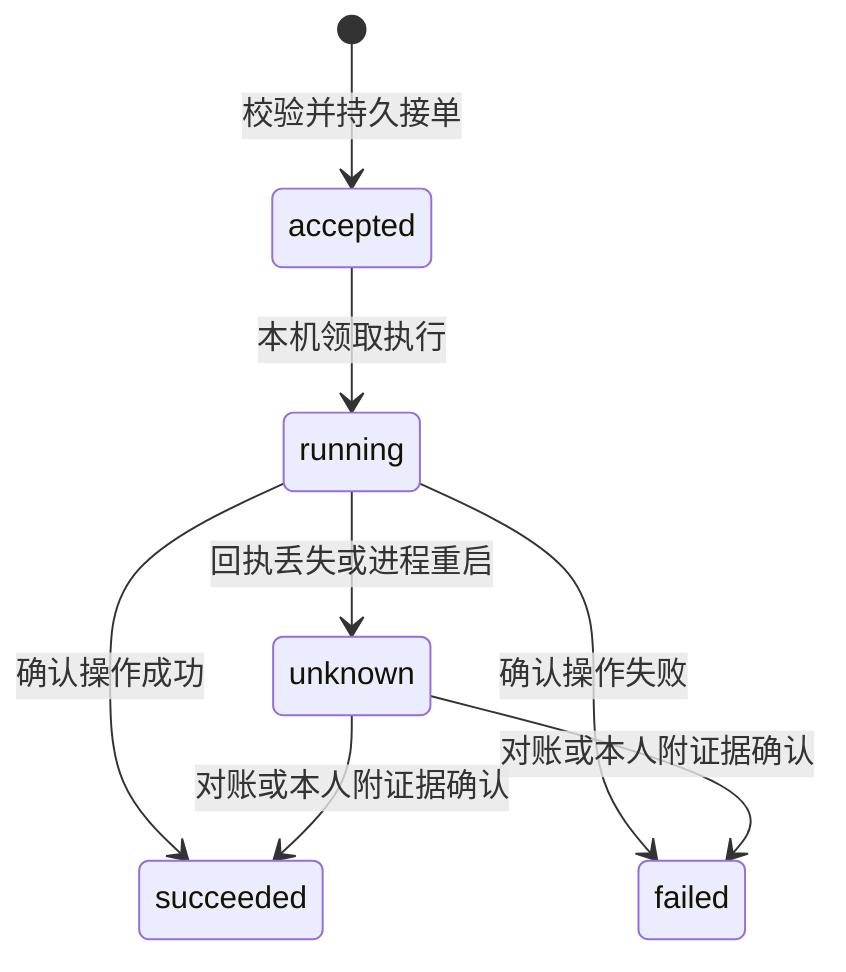

# Node 协议参考

协议版本为 `1`。产品入口为 `vibeface`，共享协议以 `crates/node/src/model.rs` 为准。本文描述 Node HTTP、对等传输、事件和执行账本。

## 身份与数据范围

`network_id` 是个人网络根公钥原始字节的 SHA256，`node_id` 是设备公钥原始字节的 SHA256，均编码为 64 个小写十六进制字符。地址不参与身份计算。

个人网络使用 `NetworkState { genesis, checkpoint, events }`。根身份签署初始 `Genesis`，其中包含根公钥及初始 Node、客户端成员。个人根私钥留在可信客户端和加密恢复包，Node 不持有根私钥。

`Member` 包含 `subject_id`、`public_key`、`kind`、`name`、`node_roles` 和 `manage`。`kind` 为 `node` 或 `client`。Node 成员只能具有本机启用角色，不能持有管理权限。客户端没有 Node 角色，只有明确授权的管理客户端能签署成员变更。

角色为 `gateway`、`relay`、`replica`、`scheduler` 和 `executor`。`config.json` 控制本机能力，个人网络成员授权限制设备在该网络中的权限。公共中继能力独立于私人网络授权。

管理事件含 `version`、`network_id`、`epoch`、`parents`、`issuer`、`action` 和 `signature`。授权动作为 `grant`，撤销动作为 `revoke`。签名目录验证因果授权，不能通过并发事件自行扩大权限，已知撤销优先。管理恢复由根签名的更高 epoch checkpoint 建立新授权，旧 epoch 不能覆盖新授权。

所有共享会话、事件、附件、执行账本及通知按 `network_id` 分区。公网发现目录不发布私人网络成员关系、项目或会话。一个物理 Node 可运行自己的调度执行，同时为其他网络转发密文。

## 本机配置

`config.json` 由 `init` 生成，修改后重启生效。字段名固定，不接受未知字段。

| 字段 | 含义 |
|---|---|
| `listen` | 实际 HTTP 监听地址，默认 `127.0.0.1:4790`，决定可接入的网卡 |
| `public_url` | 配对和展示使用的主入口 origin，公网为 HTTPS |
| `allowed_origins` | 额外允许的浏览器 origin 数组，默认空；`init --allowed-origin` 可重复指定 |
| `allow_insecure_lan` | 明确允许可信 LAN 上的明文 HTTP |
| `roles` | 本机启用的 Node 角色 |
| `roots` | 编码执行允许使用的绝对目录列表 |
| `network` | 公共发现、候选直连地址、mDNS 与公共中继配置 |
| `manager` | 管理 SDK 配置，未启用时为 `null` |
| `codex_socket` | 已有 Codex App Server socket，`null` 时尝试启动私有实例 |
| `codex_bin`、`claude_bin`、`cursor_bin` | 对应 Provider 程序路径 |
| `timeout_secs` | 单次适配器超时，默认 600 秒 |
| `daily_decision_limit` | 本 Node 每个网络的 UTC 每日自主管理调用次数，默认 20；本人主动聊天不受此额度限制 |

`gateway`、`scheduler`、`executor` 依赖 `replica`，配置和配对邀请都会校验此条件。无需 Agent 的入口可启用 `gateway`、`replica` 和可选 `relay`；纯 `relay` 可以只转发消息而不保存业务副本。当前不提供无本地历史的 Gateway 代理模式。

启用管理 Agent 时，`manager` 对象包含以下全部字段。程序路径在后台运行时使用绝对路径。Cursor 模式要求非空 `model`，Codex 模式可用空字符串选择其默认模型。

```json
{
	"provider": "cursor_sdk",
	"workspace": "/absolute/manager-workspace",
	"model": "auto",
	"cursor_sdk_bin": "/absolute/bin/cursor-sdk-bridge",
	"node_bin": "/absolute/bin/node",
	"codex_sdk_script": "/absolute/sidecars/codex-manager.mjs"
}
```

该对象作为 `manager` 的值，保留 `config.json` 的其他字段。`provider` 也可为 `codex_sdk`，Cursor 模式不启动 Node.js sidecar。模型名和程序路径需替换为本机可用配置。

`manager_capabilities` 与执行器能力分别声明。两种 Manager 均支持流式进度、取消请求和本机原生会话延续，均不支持原生 steer 或 Provider run 对账。Cursor 文本支持增量和快照，Codex 文本是按 item 替换的快照。`cancel=true` 表示可请求取消；Codex 的 `cancel_confirmation=false` 表示 CLI 退出不能证明分离的工具进程已退出。`verified=false` 不表示已通过当前环境的真实模型验收。配置存在、进程可达和已验证是不同状态。

## HTTP 与客户端通道

允许的浏览器入口由 `public_url`、`allowed_origins` 和本机 HTTP 别名组成。本机别名为 `127.0.0.1`、`localhost`、`0.0.0.0`，端口使用 `listen` 的端口。允许入口不会改变监听网卡或开放防火墙。

显式入口是不含路径、查询参数或凭证的完整 HTTP 或 HTTPS origin。非本机 HTTP 入口需要 `allow_insecure_lan`。同一主机和端口不能同时配置两个 scheme。HTTP 检查 Host，带 Origin 时必须匹配该 Host 对应的同一入口。普通 HTTP 正文上限为 2 MiB，自定义工具回调上限为 1 MiB。

| 路径 | 方法 | 用途 |
| --- | --- | --- |
| `/`、`/app.js`、`/transport.js`、`/style.css` | GET | 内置可信网页客户端 |
| `/generated/vibeface_secure.js`、`/generated/vibeface_secure_bg.wasm` | GET | 同一 Rust 密码学实现的浏览器构建 |
| `/api/info` | GET | Node 公开身份与能力信息 |
| `/api/network/ws` | GET，WebSocket upgrade | 直连、发现、中继及端到端客户端通道 |
| `/api/tools` | POST | 本地管理 Agent 的受限工具调用 |
| `/sdk.v1.SdkCustomToolCallbackService/CallCustomTool` | POST | Cursor SDK 原生工具回调 |

网站不提供用户名密码注册、登录 cookie 或明文业务 RPC。网页的密钥存储需要安全上下文。localhost 或可信 HTTPS 页面可启动客户端，普通 LAN HTTP 页面不能降级为无密钥认证。

WebSocket 建立后先接收文本 `welcome`。直连客户端发送 `{"type":"direct","service":"client"}`。通过中继时发送 `{"type":"dial","target":"NODE_ID","service":"client"}`。收到 `ready` 后，真实两端执行 Noise XX 握手，协议 context 为 `vibeface:client:v1`。客户端钉住目标 NodeID，服务端在加密通道内验证客户端个人网络授权。

握手后的应用消息均为二进制加密记录。文本应用消息、身份错配、篡改及重放关闭通道。大消息通过 `sealMessage` 和 `openRecord` 分片重组，不能直接把一个超长 JSON 塞入单个 Noise record。

解密后的请求为 `Request { id: string, method, params }`，响应为 `Response { id, result, error? }`。`error` 是错误说明字符串，不包含成功结果。请求 ID 仅用于响应匹配，业务写入仍依靠稳定的 message ID 和 operation ID 去重。

| method | params | 用途 |
| --- | --- | --- |
| `info` | `{}` | 当前 Node 的公开身份、角色、版本和初始化状态 |
| `prepare_genesis` | `owner_public_key`、`client_name` | 构造首个成员目录及待签名内容 |
| `bootstrap` | `capability`、`state` | 一次性本机授权安装根签名目录 |
| `authenticate` | `network_id` | 验证握手客户端的成员授权 |
| `directory` | `{}` | 返回当前签名目录及投影 |
| `rpc` | 下节 RPC 对象 | 执行业务读写 |
| `subscribe` | `{}` | 订阅本网络的 `changed` 消息及其语义 payload |
| `prepare_invite` | `kind`、`node_roles`、`request_id` | 生成邀请正文与管理客户端待签名内容 |
| `commit_invite` | `invite`、`capability` | 验证管理客户端签名并登记一次性邀请 |
| `prepare_pair_request` | `invite`、`capability`、`name`、可选 `request_id` | 构造新设备的持钥证明 |
| `pair_request` | `request` | 提交新设备签名的配对申请 |
| `pair_accept` | `request_id`、`signature` | 新设备签名确认本次 review |
| `pair_requests` | `{}` | 管理客户端查看待确认申请 |
| `prepare_pair` | `request_id` | 返回 review、治理事件及两份待签名内容 |
| `pair_confirm` | `request_id`、`inviter_signature`、`event` | 管理客户端签名后授予设备权限 |
| `pair_status` | `request_id` | 查询当前持钥设备的 pending 或 granted 状态 |
| `prepare_revoke` | `subject_id` | 生成客户端待签名撤销事件 |
| `revoke` | `event` | 验证并同步签名撤销 |
| `recovery_challenge` | `network_id`、`owner_public_key`、可选 `genesis` | 生成根身份持钥挑战 |
| `recovery_context` | `challenge_id`、`signature`、新节点的 `state` 与 `capability` | 验证根签名后读取恢复上下文 |
| `prepare_recovery` | `challenge_id`、`members` | 生成更高 epoch checkpoint 及根待签名内容 |
| `recover` | `challenge_id`、`checkpoint`、新节点的 `state` 与 `capability` | 安装根签 checkpoint 并授权新管理客户端 |

`prepare_genesis` 返回 `state` 和 `signing { domain, payload }`。客户端使用本地根身份签名并写入 `state.genesis.signature`。`bootstrap` 和 `authenticate` 返回 `principal`、`state` 和 `view`。`principal` 包含 `network_id`、`subject_id`、`epoch` 和 `can_manage`，不能由客户端自行声明。

邀请含管理客户端签名的 `InviteEnvelope`，新设备还要签署持钥证明和最终 review。管理客户端分别签署 review 与治理事件。只有一次性邀请，或只取得未确认的申请，都不能成为成员。在线新增成员不授予管理权限，管理客户端由根签初始化或恢复 checkpoint 明确建立。

恢复包外层为 `{ version, network_id, recovery_epoch, envelope }`。加密正文包含 `version`、`network_id`、`root_secret_key`、`genesis`、`recovery_epoch` 和 `decryption_keys`。恢复加密复用 Rust/WASM 的 Argon2id 与 XChaCha20-Poly1305，实现同时验证格式、KDF 参数、身份及完整性。口令和明文根私钥不发给 Node。

恢复流程先验证根签 challenge，再返回可核对的设备目录。客户端明确选择保留成员，生成新的独立管理客户端，并使用本地解锁的根身份签署 checkpoint。已初始化 Node 只能恢复该个人网络。新 Node 另需本机 capability，持有其他网络的根私钥不能抢占公共主机。业务正文和项目文件不在根恢复包中。

本机 `access --json` 输出含 NodeID 与一次性高熵 capability。capability 不放入服务日志、公共目录或 DAG。知道 Node 地址或公开身份不能抢占初始化，也不能取得私人网络权限。

`/api/tools` 只接受本机 SDK 调用期间签发的短期 bearer token，权限固定到一个个人网络和业务会话。它不是供外部 Bot 保存的长期身份，不能添加或撤销设备、回答审批或验收工单。管理 SDK 使用独立随机端口的回环 listener，不依赖公网或 LAN 地址。

HTTP 成功或通道返回结果表示本次请求已处理。消息是否在目标入队以版本化调度回执为准，工作是否完成仍查询执行账本及结果。

## RPC 方法

`rpc` 通道方法的 `params` 使用 JSON 对象，`method` 选择业务方法，其余字段与 `method` 同级。已验证客户端确定 `network_id`，操作请求中的网络必须一致。

| method | 主要字段 | 结果或行为 |
|---|---|---|
| `nodes` | 无 | 已授权 Node、可达性和当前可查能力 |
| `bots` | 无 | 当前个人网络的持久机器人定义 |
| `create_bot` | `bot_id`、`conversation_id`、`name`、`instructions`、可选 `project` | 本人显式创建机器人并绑定独立聊天历史；完整请求精确去重 |
| `conversations` | 无 | 本地已知业务会话 |
| `create_conversation` | `conversation_id`、`title` | 以稳定 ID 创建会话，同 ID 同内容可去重 |
| `conversation` | `conversation_id`、可选 `basis_heads` | 本机已知消息、机器人定义、executions 投影、历史目标、heads、missing、调度队列及事实新鲜度 |
| `message` | `conversation_id`、`message_id`、`text`、可选 `basis_heads`、`scheduler_node`、`report_results` | 原子保存用户消息、汇报意图和本机 inbox 或 outbox，返回调度回执 |
| `create_task` | `conversation_id`、`task_id`、`title`、`goal`、`acceptance` | 创建工单；`auto_followup=true` 被拒绝，授权使用 `set_followup` |
| `update_task` | `conversation_id`、`task_id`、`status`、`detail` | 追加工单状态变化 |
| `set_followup` | `conversation_id`、`task_id`、`mode`、`expected_version`、可选 `scheduler_node` | 本人设置具体任务的后续权限，模式为 `off`、`report` 或 `continue` |
| `cancel_manager` | `conversation_id`、`trigger` | 本人请求停止指定管理轮，返回取消请求状态，不表示后台任务已停止 |
| `resolve_manager_unknown` | `conversation_id`、`trigger`、`evidence` | 本人核对旧管理轮及原操作证据后解除管理写冻结，不重做旧触发 |
| `task_control` | `conversation_id`、`task_id`、`action`，写控制另需 `operation_id`、`expected_operation_id`、`expected_revision` | 读取具体任务状态，或按原绑定执行 `steer`、`interrupt`、`respond_request` |
| `execution_control` | `conversation_id`、`operation_id`、`expected_operation_id`、`expected_revision`、`action` | 从原签名派发解析目标和执行资源，按真实能力控制后台工作，不要求 Task |
| `read_artifact` | `conversation_id`、`blob_hash`、可选 `offset`、`limit` | 分页读取本网络、该会话实际引用的 UTF-8 文本附件 |
| `operate` | `request` | 向指定执行 Node 提交 `OperationRequest` |
| `session` | `target_node`、`session_id` | 查询原执行会话及当前事实 |
| `operation` | `target_node`、`operation_id` | 查询持久执行账本 |
| `notifications` | `client_id` | 该客户端尚未确认的通知 |
| `ack` | `notification_id`、`client_id` | 记录该客户端已读 |
| `export` | `conversation_id` | 导出包含签名事件的快照 |
| `reconcile` | `target_node`、`operation_id` | 查询实际执行结果，已知时更新账本 |
| `resolve_unknown` | `target_node`、`operation_id`、`outcome`、`evidence` | 本人根据证据解决未知结果，不重发操作 |
| `rebind_execution` | `conversation_id`、`task_id`、`target_node`、`session_id`、`executor`、`cwd` | 本人明确封存原绑定后建立新的执行安排 |

工单状态为 `open`、`working`、`blocked`、`needs_review`、`accepted` 或 `cancelled`。`accepted` 和 `cancelled` 只能由本人设置，Agent 不能将它们改回活动状态。`resolve_unknown.outcome` 为 `succeeded` 或 `failed`，证据至少 12 字节。

`bot_id`、`message_id`、`conversation_id`、`task_id` 和 `operation_id` 是业务去重身份。重试保留原 ID 和原内容；同 ID 换内容会被拒绝。聊天 Agent 的工具为 `nodes`、`context`、`command`、`delegate`、`continue_execution`、`execution_status`、`stop_execution` 和只读的 `call_lookup`。只读结果回调只得到查询工具。

Bot 定义包含独立的 `bot_id`、内部 `conversation_id`、`name`、`instructions`、可选 `project` 和来源 `event_hash`。`project` 为 `{ target_node, cwd }`，只表达执行偏好，不授予权限。`BotCreated` 进入对应聊天的签名 DAG，Store 从事件重建投影。创建新机器人时，新聊天与 Bot 定义在同一事务保存。导入或重建同版本定义不启动模型。

Node 的 manager 配置保存本机 SDK adapter 和凭证，Bot 定义保存职责。每个 Bot 的内部聊天 scope 独立，原生 SDK 缓存仍按网络、scope 和本机节点保存。缓存不是共享聊天的事实来源。

写工具在副作用前保存稳定调用引用与已准备的实际请求。程序生成 operation/session ID 并固定目标与 revision；恢复先读取原调用，不能根据同一命令文本猜测是否重复，也不能换目标重派。

`conversation.scheduler` 包含 `jobs`、`provider`、`model`、`capabilities` 和 `write_frozen`。每个 job 保留 `trigger`、`target_node`、`kind`、`sequence`、`state` 及可用的 `message_id`、`read_only`、`reply_message_id`。`kind` 为 `human` 或 `autonomous`。完成消息替换同一调用的临时文字，不把临时文字当成已持久保存的回答。

任务包含 `followup_mode` 和 `followup_version`。已验证的 `binding` 包含目标、会话、原操作、revision、真实 `capabilities` 和 `pending_requests`。远端摘要保留缓存或未知标记，`facts_freshness=local_known_history` 不证明全网最新。

`task_control.action=status` 是只读查询。其他动作返回完整 `OperationRecord`，重试必须保留原控制 `operation_id` 和内容。Node 检查原操作及 revision，解析真实 turn 和审批请求。`steer` 另需 `text`，`respond_request` 另需 `request_id` 和 `response`。过期请求被拒绝，模型不能回答审批。

`execution_control.action` 为互斥对象，支持 `{ type: "interrupt" }`、`{ type: "steer", text }` 或 `{ type: "respond_request", request_id, response }`。Node 从 `expected_operation_id` 找到原派发，不信任客户端传入执行目标。审批仍要求本人和有效原请求；重试保留完整载荷与原控制 ID。无 SDK 会话的短命令只声明实际支持的查询能力，不伪造 SDK 中断。

`read_artifact` 返回 `{ blob_hash, text, offset, next_offset, size }`。偏移与长度按 UTF-8 字节计算，`limit` 范围为 4 至 65536，默认 65536。偏移必须位于字符边界；下一页使用返回的 `next_offset`，为 `null` 时结束。Node 核对签名附件引用、长度和哈希，正文未同步、非 UTF-8 或仅凭其他会话的哈希猜读都会拒绝。

## 可靠调度回执

可靠调度版本为 `1`。入口在同一事务保存消息、不可改写的汇报意图以及 inbox 或 outbox。远端投递前先查询目标的 `reliable_schedule.version`，不向旧版目标发送可能启动执行的旧协议请求。

`message` 返回 `accepted`、`queued`、`state`、`trigger`、`message_id`、`scheduler_node` 和 `receipt`。目标调度节点持久入队后，回执结构为：

```json
{
	"version": 1,
	"network_id": "NETWORK_FINGERPRINT",
	"conversation_id": "conversation-id",
	"trigger": "SIGNED_EVENT_HASH",
	"target_node": "SCHEDULER_NODE_ID",
	"state": "queued"
}
```

入口仅写入 outbox 时，`accepted=true`、`queued=false`、`state=pending_delivery`。只有目标提交 inbox 后的匹配回执才能确认已入队，HTTP 成功或本机已保存不替代这个确认。`queued=true` 表示已经可靠接收，查询时 `state` 可能已推进至运行或终态。

投递以网络、会话、trigger、原目标和版本核对回执。ACK 丢失后向同一目标重投同一 trigger，目标返回原 job。已投递项通过原目标的 `manager_status` 查询进展和结果，不因离线或超时改派另一台。

每个会话的本机管理队列有界，最多保留 256 个待处理触发；本机每个网络的未投递 outbox 也上限为 256。单消费者按持久状态领取，本人待处理消息优先于自主后续。提示通知只负责唤醒，周期扫描补上丢失的唤醒。每轮按持久固定的依据准备上下文，后发消息不会隐式算作已处理。

job 状态为 `queued`、`claimed`、`running`、`cancelling`、`completed`、`failed`、`cancelled` 或 `unknown`。`queued` 和确认尚未跨启动边界的 `claimed` 可恢复首次执行。跨重启的 `running` 与 `cancelling` 进入 `unknown`，不自动重新调用 SDK。最终回答和 job 终态一次提交。导入 DAG 或重建视图不创建 job，也不重放模型、工具或执行操作。

取消先封存旧 attempt 的工具权限并排空已接纳工具，再检查 SDK 取消证据。`cancelling` 不是停止成功，无法证明终止时进入 `unknown`。旧管理轮保持未知，工具权限隔离后可创建新的只读管理轮。`resolve_manager_unknown` 核对原 attempt 关联的业务操作；执行仍未知时须先走 `reconcile` 或 `resolve_unknown`。人工结论不重跑旧 trigger，已有只读 token 不自动获得写权限。

本机版本化队列、outbox、原生 SDK 会话及操作账本不通过 DAG 迁移。维护空闲检查包含待投递、排队、活动和未知项，新进程通过更新健康门后才消费。存在新调度记录时不承诺任意降级旧程序。

## 执行请求

`operate.request` 的结构如下：

```json
{
	"operation_id": "stable-operation-id",
	"network_id": "NETWORK_FINGERPRINT",
	"conversation_id": "conversation-id",
	"task_id": "task-id",
	"target_node": "TARGET_NODE_ID",
	"session_id": "logical-session-id",
	"expected_revision": 0,
	"basis_heads": [],
	"action": {
		"type": "open",
		"executor": "codex",
		"cwd": "/absolute/project"
	},
	"resources": []
}
```

`task_id` 可为 `null`。普通打开和发送操作不创建隐式 Task。`session_id` 可为 `null`，SDK 动作必须指定真实逻辑会话，短命令必须为 `null` 且 `expected_revision=0`。`basis_heads` 标记本次操作依据的已知历史。目标 Node 在接单前拉取并校验其依赖闭包、派发记录和必要附件。空数组不表示全网没有其他历史。

向已关联显式 Task 的执行会话提交新工作时，必须保留活动 Task 的 `task_id`，不能省略编号来绕过验收或取消。普通无 Task 操作使用独立的未绑定会话，接单与领取执行事务都核验会话归属原 conversation。显式 Task 路径仍在派发前取得唯一执行绑定，执行端独立验签。

| action.type | 其他字段 | 执行器支持 |
|---|---|---|
| `open` | `executor`、`cwd` | Codex、Claude Code、Cursor Agent |
| `send` | `text` | Codex、Claude Code、Cursor Agent |
| `read` | 无 | Codex |
| `steer` | `turn_id`、`text` | Codex |
| `interrupt` | `turn_id` | Codex |
| `respond_request` | 原始 `request_id`、`response` | Codex，仅本人 |
| `command` | `command`、`cwd`、`timeout_secs` | Node 受限命令，不调用编码 SDK |

执行器枚举为 `codex`、`claude_code`、`cursor_agent`。逻辑 session ID 与执行器原生 session ID 分开保存。审批回答必须绑定当前仍有效的原请求，Node 不自动批准。

`OperationRequest.binding` 在显式 Task 路径是 Rust 派发时取得的 `SignedBinding`。调用方可省略，由 Node 填写。执行端实际接单时必须验证该凭据，不能只依靠请求中的目标字段。普通无 Task 操作允许无 binding，仍验证签名派发、本人网络、conversation、执行角色、目录、版本及资源互斥。

自主继续派发还包含 Node 生成的 `manager_authority`，固定 `scheduler_node`、结果 `trigger` 和 `followup_version`。它与完整请求一起进入签名派发事件。执行端核对原签名记录，在首次接单事务内重新检查当前授权版本。已经持久接单的原操作仍按原账本继续，撤权后的旧在途请求不能新接单。

绑定正文包含 `network_id`、`conversation_id`、`task_ref`、`task_id`、`authority_node`、`generation`、`target_node`、`session_id`、`open_spec`、`previous_binding_hash` 和 `previous_seal`。`task_ref` 固定到真实 `TaskCreated` 事件 hash。该创建事件的作者 Node 对首个执行位置执行持久 CAS，两个调度器向不同目标并发派发也只能取得一份绑定。这个 Node 只负责该绑定的唯一确认，不是会话调度负责人。

已有绑定的会话可在创建 Node 离线后继续向原执行 Node 提交操作。新绑定无法取得唯一确认时拒绝派发，不能在另一台设备自行建立替代。普通执行不合成内部任务，也不能借无 Task 分支使用已经具有显式绑定的会话。

更换执行位置由本人调用 `rebind_execution`，原执行端先明确封存旧绑定，新代绑定引用前代证明。`unknown` 阻止封存和迁移，不用超时假定原执行已经停止。

`expected_revision` 必须匹配执行 Node 当前会话版本。打开及发送操作将工作目录和额外资源规范化，检查本机父子目录重叠。控制操作不能申请额外资源。此机制不提供跨设备共享文件系统的全局锁。

短命令复用同一操作账本、目录互斥和结果回送，不创建 `ExecutionSession`。输出有界，环境不继承 Node 或 Provider 凭证，实际文件读写受平台沙箱限制。缺少沙箱能力时拒绝执行，不降级为裸 shell。超时或取消后的副作用无法证明时保留 `unknown`。

macOS 使用系统 `sandbox-exec`。Linux 要求支持 Landlock ABI 6 的内核及 seccomp，旧内核明确拒绝该工具；还会拒绝无法按目录约束的文件元数据修改。受限短命令不是完整开发环境，依赖受限进程操作的复杂工具需使用已有编码执行器。

Bot 事件和可空 `session_id` 使用当前版本结构，不提供旧版本兼容。业务数据库直接使用 `user_version=3` 的最终初始 schema，不执行旧库升级。重新部署使用新数据目录及同版本节点，同版本重启仍保留执行账本并核对未知结果，不重放副作用。

操作状态如下：



入账前的非法请求直接拒绝。`rejected` 也属于终态。导入 DAG 历史不创建执行队列；重启仅恢复本机已持久接单而尚未开始的操作。运行中操作重启后变为 `unknown`，不自动重新执行。

Codex `send` 成功启动 turn 后仍需等待进度与终止事件。`turn/completed` 中的 completed、failed、interrupted 各自保留含义，都不自动把工单变为 `accepted`。

## 事件 DAG

`SignedEvent` 包含三个字段：

- `hash` 为 `canonical_body` UTF-8 字节的 SHA256。
- `canonical_body` 为原始规范 JSON 字符串，校验时保留并核对这些字节。
- `signature` 为作者 Ed25519 签名，签名输入是 `vibeface:event:v1:` 加十六进制 hash 的 ASCII 字节。

正文结构为：

```text
Event {
  version, network_id, scope_id, author,
  sequence, previous, parents, created_at_ms,
  body, blobs
}
```

`previous` 和 `sequence` 校验同一作者的来源链，`parents` 引用当前事件依据的因果前项。父引用和附件列表按序去重。`created_at_ms` 不决定唯一全局顺序，也不能覆盖并发分支。

正文类型包括 `conversation_created`、`message_posted`、`task_created`、`task_changed`、`dispatch_recorded`、`execution_observed`、`decision_recorded`、`notification_raised`、`notification_acknowledged` 和 `context_checkpoint`。

投影前检查网络、作者证书、签名、hash、来源链、因果依赖及附件。缺口和来源分叉分别保留在 `missing.events`、`missing.blobs` 与 `missing.conflicts`。必要历史未齐或冲突未处理时，禁止继续调度和执行。

事件上限为 1 MiB。附件使用 `BlobRef { hash, size }`，单件上限为 64 MiB，传输分块并校验总长度及 SHA256。附件内容按个人网络保存，不能跨网络凭 hash 读取。

节点交换 scope 的 heads，按需拉取事件、前驱和附件，再重建 SQLite 视图。并发历史保留为不同 heads。快照和摘要不替代原始依据，历史导入和视图重建不触发 Agent 或外部写操作。

DAG 能验证已知历史位置及依赖完整，不能证明全网最新。原始副本全部失联或丢失时，不承诺恢复缺失内容，也不迁移其他设备 SDK 的隐藏状态。

## 发现、对等连接与公共中继

`network` 配置包含 `bootstrap_urls`、`advertise_urls`、`mdns` 和 `relay_enabled`。地址使用 `/api/network/ws` 的完整 WS 或 WSS URL。`bootstrap_urls` 提供可替换的会合入口，`advertise_urls` 是本 Node 声明的候选直连地址。Node 可通过 mDNS 获取局域网候选地址，随后仍要核验身份。

`Reachability` 包含 `node_id`、`public_key`、`direct_urls`、`relay_urls`、`issued_at`、`expires_at` 和 `signature`。设备使用 Ed25519 的 `reachability` domain 签名。记录有效期受限，只按已知 NodeID 查询，不提供全网枚举。签名证明设备声明该路径，不证明设备属于本人或路径此刻可达。

NAT 后的 Node 主动连接会合入口，在随机 challenge 上签名后预约 relay。中继使用单独的出站 attach 通道连接目标，建立通道后只搬运二进制记录。中继限制为 128 个连接、64 份预约和 32 条电路。每条电路最多传输 64 MiB、持续 30 分钟，并限制每秒流量。中继不解释工单或执行命令。

私网 Node 在该流上执行独立 Noise 握手并验证成员授权，业务报文还保留网络、来源、目标、请求 ID、签名和去重约束。公共 relay 不需要也不得获得私人网络成员身份。TLS 保护逐跳传输，Noise 保护真实通信两端之间的业务内容。

request 与 response 指向特定 Node，响应必须来自原请求的预期 Node。路径变化不能改变已绑定执行目标，也不触发业务写入重放。连接目录和在线状态是有时效的软状态。

## 通知和自动后续

加密通道保留外层 `{ "type": "changed", "payload": ... }`。payload 区分历史变更、`manager_progress`、`execution_progress` 与失效提醒。客户端读取 `notifications`，使用稳定 `client_id` 确认 `notification_id`，同一客户端换路由后仍可去重。不同浏览器具有不同 client ID，各自确认。

管理进度包含 `conversation_id`、`trigger`、`invocation_id`、`source_node`、递增 `sequence` 和 `progress`。`progress.type` 为 `text_delta`、`text_snapshot`、`status` 或 `tool`。文字按 `item_id` 关联，delta 追加，snapshot 替换全文。执行进度关联原任务、目标、session、operation 和 native turn，不能串入其他任务。临时进度不逐 token 写 DAG，持久回答和执行结果仍来自账本及签名事件。

客户端读取 `conversation` 时，入口为该已授权会话建立有界的只读观察，从原管理节点和执行节点读取进度。节点间 `progress_read` 校验网络、来源和会话，响应包含 `version`、`cursor`、`reset` 和 `events`。游标缺口或源进程重启要求重新读取持久 snapshot，不生成重放写操作。连接关闭、权限撤销或观察租约过期后停止观察，代理进度不再次转发形成循环。

普通进度、审批提醒和结果通知不调用管理模型。无人在线时保留通知，重新连接后读取。浏览器系统提醒是可选客户端功能，不等于网页关闭后的手机推送。

后续权限使用 `DecisionRecorded.tool_configuration` 中带类型的签名记录，类型为 `followup_intent_v1`、`task_origin_v1` 和 `task_followup_grant_v1`。自然语言或模型传入的参数不构成授权。

`message.report_results` 默认 `true`。汇报意图固定原消息 hash、网络、会话和目标 Scheduler，普通执行通过签名请求中的 `manager_authority.trigger` 关联原消息，终态只触发只读总结，不创建隐藏 Task。`false` 保存明确的 `off` 意图，重试不能改变。原始结果与通知始终保留，模型不能借回调获得新的写权限。

`set_followup` 仅本人可用，固定到现有任务的 `task_ref`。`off` 禁止自主后续，`report` 只允许读取结果并保存最终 assistant 回答，`continue` 允许在本任务范围内继续业务工作。稳定 grant ID 配合单调版本，`expected_version` 必须使用会话快照返回的当前 `followup_version`。并发或旧版本修改被拒绝，既有授权不能用重试改变目标。

领取后续、签发工具权限及每次业务写入前都复核本机已验证的最新授权、任务状态和版本。撤销封存旧权限；离线节点尚未获知撤销时，不保证全网立即停止。审批、验收与未知确认始终由本人处理。

产生结果的原执行 Node 保存 completion marker，验证原结果和政策后将同一 trigger 投递给授权固定的 Scheduler。结果早于补授权时仍可在授权可见后投递一次，不重做执行。委托结果未知时保留状态并查询原调用，不因超时再派给另一台。未授权模型后续不影响原始结果与通知保存。

`daily_decision_limit` 只限制每个 Node 上、每个个人网络的 UTC 每日自主管理 SDK 调用。本人主动聊天不受这个额度限制。预算先预留，失败调用不保证退回；它不限制执行器自身调用，也不是 token 或账单上限。额度耗尽不把执行结果标为未知。

每条用户消息在签名 `MessagePosted.scheduler_node` 中固定本次调度目标。客户端重试必须保留原 `message_id` 和 `scheduler_node`，网页将两者一同持久化。同一目标通过本地调用账本去重。已取得该消息的入口拒绝改写其目标；未同步节点之间没有全局消息唯一性共识，调用方不能用同一编号改换目标。切换入口后继续工作时提交一条新消息，可选择任意已授权调度节点。这个目标只属于该消息，不是会话或工单的负责人。

`reconcile` 在目标执行节点确认账本不存在时返回 `state=not_found`、`operation=null` 和目标节点身份。节点不可达返回错误，不当作不存在。网页允许本人确认旧请求结束后解除本地待核对记录，不自动重发。

消息请求中的 `entry_node` 固定为首次接收的 Gateway。未确认的同一消息只能回原入口核对或重试；换入口可只读查看历史，不能重签原请求。Node 在落盘前核对该字段。
