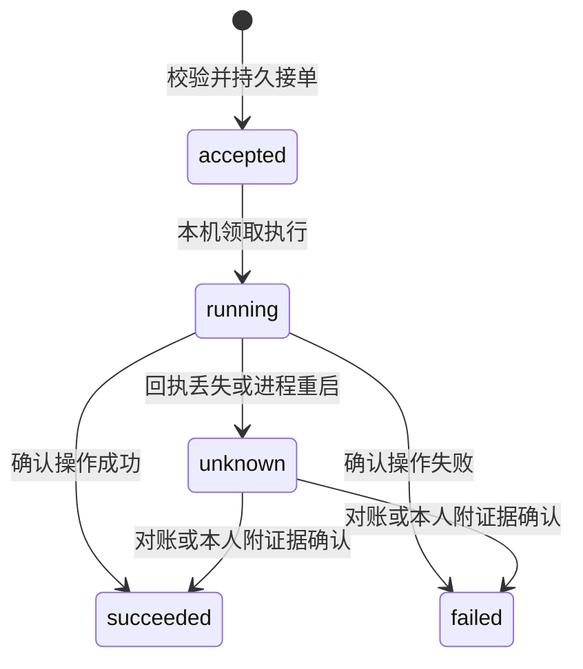

# Node 协议参考

协议版本为 `1`。产品入口为 `vibeface-node`，共享协议以 `crates/node/src/model.rs` 为准。本文描述 Node HTTP、对等传输、事件和执行账本。

## 身份与数据范围

`network_id` 是个人网络根公钥原始字节的 SHA256，`node_id` 是设备公钥原始字节的 SHA256，均编码为 64 个小写十六进制字符。地址不参与身份计算。

根签名的 `TrustBundle` 包含 `version`、`network_id`、`owner_public_key`、递增的 `revision`、设备证书数组和 `signature`。设备证书包含 `node_id`、`public_key`、`roles` 与 `revoked`。同一 revision 不允许内容不同，旧 revision 不能覆盖新授权。

角色为 `gateway`、`relay`、`replica`、`scheduler` 和 `executor`。`config.json` 控制本机启用能力，网络证书限制该设备在指定网络中的权限。

所有共享会话、事件、附件、执行账本及通知按 `network_id` 分区。一个入口可为不同个人保存隔离账户，不因此共享设备权限或业务历史。账号是本入口登录身份，不是设备证书。

## 本机配置

`config.json` 由 `init` 生成，修改后重启生效。字段名固定，不接受未知字段。

| 字段 | 含义 |
|---|---|
| `listen` | 本机 HTTP 监听地址，默认 `127.0.0.1:4790` |
| `public_url` | 浏览器使用的唯一 origin，公网为 HTTPS |
| `allow_insecure_lan` | 明确允许可信 LAN 上的明文 HTTP |
| `roles` | 本机启用的 Node 角色 |
| `roots` | 编码执行允许使用的绝对目录列表 |
| `peers` | `network_id` 与 WebSocket `url` 列表 |
| `manager` | 管理 SDK 配置，未启用时为 `null` |
| `codex_socket` | 已有 Codex App Server socket，`null` 时尝试启动私有实例 |
| `codex_bin`、`claude_bin`、`cursor_bin` | 对应 Provider 程序路径 |
| `timeout_secs` | 单次适配器超时，默认 600 秒 |
| `daily_decision_limit` | 本 Node 每个网络的 UTC 每日管理调用次数，默认 20 |

`gateway`、`scheduler`、`executor` 依赖 `replica`，配置和配对邀请都会校验此条件。无需 Agent 的入口可启用 `gateway`、`replica` 和可选 `relay`；纯 `relay` 可以只转发消息而不保存业务副本。当前不提供无本地历史的 Gateway 代理模式。

启用管理 Agent 时，`manager` 对象包含以下全部字段。程序路径在后台运行时使用绝对路径。Cursor 模式要求非空 `model`，Codex 模式可用空字符串选择其默认模型。

```json
{
	"provider": "cursor_sdk",
	"workspace": "/absolute/manager-workspace",
	"model": "auto",
	"cursor_sdk_bin": "/absolute/bin/cursor-sdk-bridge",
	"node_bin": "/absolute/bin/node",
	"codex_sdk_script": "/absolute/sidecars/codex-manager.mjs"
}
```

该对象作为 `manager` 的值，保留 `config.json` 的其他字段。`provider` 也可为 `codex_sdk`，Cursor 模式不启动 Node.js sidecar。模型名和程序路径需替换为本机可用配置。

## HTTP 入口

`public_url` 是唯一允许的 HTTP origin。所有请求校验 `Host`，有 `Origin` 时必须与配置一致。POST 使用 `Content-Type: application/json`。普通请求正文上限为 2 MiB，自定义工具回调上限为 1 MiB。

| 路径 | 方法 | 用途 |
|---|---|---|
| `/`、`/app.js`、`/style.css` | GET | 内置网页 |
| `/api/info` | GET | Node ID、版本、角色和管理 SDK 配置状态 |
| `/api/register` | POST | 创建本地账户和新的个人网络 |
| `/api/login` | POST | 登录，设置会话 cookie，返回 CSRF token |
| `/api/me` | GET | 查询当前本地账户及 CSRF token |
| `/api/logout` | POST | 退出当前登录 |
| `/api/pair` | POST | 用邀请和设备签名完成配对 |
| `/api/rpc` | POST | 会话、工单、操作与设备管理 |
| `/api/events` | GET | 当前账户网络的 SSE 更新 |
| `/api/tools` | POST | 本地管理 Agent 的受限工具调用 |
| `/sdk.v1.SdkCustomToolCallbackService/CallCustomTool` | POST | Cursor SDK 原生工具回调 |
| `/peer` | GET，WebSocket upgrade | 设备认证、同步和中继 |

仅首次回环注册可取得本机配置的调度及执行角色。其条件为本机尚无账户，且监听地址与 `public_url` 都指向回环地址。其他注册只授予本机已启用的接入、中继和副本角色，不能使用托管主机的项目目录或 Agent。

注册及登录正文为 `{"username":"name","password":"..."}`。登录返回 `account` 和 `csrf`，并设置 `vibeface_session` cookie。cookie 为 HttpOnly、SameSite=Strict；HTTPS origin 额外设置 Secure。会话有效期为 7 天。

浏览器变更请求携带 cookie、匹配的 `Origin` 和 `X-CSRF-Token`。cookie 只适用于当前 origin，切换入口重新登录。网页切换入口可携带非秘密的 conversation ID 和 basis heads。

`/api/tools` 只接受本机 SDK 调用期间签发的短期 bearer token，权限固定到一个个人网络和业务会话。它不能替代用户登录，也不是供外部 Bot 长期保存的访问密钥。管理 Agent 无法通过该 token 创建账户、配对、撤销、审批或验收工单。

Node 为管理 SDK 另开一个随机端口的回环 HTTP listener，提供 `/api/tools` 和 Cursor 原生回调；SDK 使用此入口，不依赖公网或 LAN 的 `public_url`。`/api/events` 仅接受登录 cookie，不接受管理 Agent 的 bearer token。

HTTP 错误返回 `{"error":"说明"}`。API 成功接收操作后仍需查询账本；HTTP 2xx 不等于编码工作或工单完成。

## RPC 方法

`POST /api/rpc` 使用 JSON 对象，`method` 选择方法，其余字段与 `method` 同级。登录账户确定 `network_id`，操作请求中的网络也必须一致。

| method | 主要字段 | 结果或行为 |
|---|---|---|
| `nodes` | 无 | 已授权 Node、可达性和当前可查能力 |
| `conversations` | 无 | 本地已知业务会话 |
| `create_conversation` | `conversation_id`、`title` | 以稳定 ID 创建会话，同 ID 同内容可去重 |
| `conversation` | `conversation_id`、可选 `basis_heads` | 消息、工单、heads、missing，以及执行端可查事实 |
| `message` | `conversation_id`、`message_id`、`text`、可选 `basis_heads`、`scheduler_node` | 保存用户消息并请求指定管理 Agent |
| `create_task` | `conversation_id`、`task_id`、`title`、`goal`、`acceptance`、可选 `auto_followup` | 创建工单，自动后续只接受本人授权 |
| `update_task` | `conversation_id`、`task_id`、`status`、`detail` | 追加工单状态变化 |
| `operate` | `request` | 向指定执行 Node 提交 `OperationRequest` |
| `session` | `target_node`、`session_id` | 查询原执行会话及当前事实 |
| `operation` | `target_node`、`operation_id` | 查询持久执行账本 |
| `notifications` | `client_id` | 该客户端尚未确认的通知 |
| `ack` | `notification_id`、`client_id` | 记录该客户端已读 |
| `invite` | `roles` | 在根密钥所在设备生成短期配对邀请 |
| `revoke` | `node_id` | 在根密钥所在设备撤销另一台设备 |
| `export` | `conversation_id` | 导出包含签名事件的快照 |
| `reconcile` | `target_node`、`operation_id` | 查询实际执行结果，已知时更新账本 |
| `resolve_unknown` | `target_node`、`operation_id`、`outcome`、`evidence` | 本人根据证据解决未知结果，不重发操作 |

工单状态为 `open`、`working`、`blocked`、`needs_review`、`accepted` 或 `cancelled`。`accepted` 和 `cancelled` 只能由本人设置，Agent 不能将它们改回活动状态。`resolve_unknown.outcome` 为 `succeeded` 或 `failed`，证据至少 12 字节。

`message_id`、`conversation_id`、`task_id` 和 `operation_id` 是业务去重身份。重试保留原 ID 和原内容；同 ID 换内容会被拒绝。管理 Agent 的可用工具仅为 `nodes`、`context`、`create_task`、`update_task`、`open_execution`、`send_execution` 和 `execution_status`。

## 执行请求

`operate.request` 的结构如下：

```json
{
	"operation_id": "stable-operation-id",
	"network_id": "NETWORK_FINGERPRINT",
	"conversation_id": "conversation-id",
	"task_id": "task-id",
	"target_node": "TARGET_NODE_ID",
	"session_id": "logical-session-id",
	"expected_revision": 0,
	"basis_heads": [],
	"action": {
		"type": "open",
		"executor": "codex",
		"cwd": "/absolute/project"
	},
	"resources": []
}
```

`task_id` 可为 `null`。`basis_heads` 标记本次操作依据的已知历史。目标 Node 在接单前拉取并校验其依赖闭包、派发记录和必要附件。空数组不表示全网没有其他历史。

Agent 向已关联工单的执行会话提交新工作时，必须显式提供活动工单的 `task_id`，不能省略编号来绕过验收或取消。本人可明确提交不关联工单的操作；从未关联工单的会话也允许 `null`。此约束依据执行节点已知的本地账本，不代表未同步节点之间的全局共识。

| action.type | 其他字段 | 执行器支持 |
|---|---|---|
| `open` | `executor`、`cwd` | Codex、Claude Code、Cursor Agent |
| `send` | `text` | Codex、Claude Code、Cursor Agent |
| `read` | 无 | Codex |
| `steer` | `turn_id`、`text` | Codex |
| `interrupt` | `turn_id` | Codex |
| `respond_request` | 原始 `request_id`、`response` | Codex，仅本人 |

执行器枚举为 `codex`、`claude_code`、`cursor_agent`。逻辑 session ID 与执行器原生 session ID 分开保存。审批回答必须绑定当前仍有效的原请求，Node 不自动批准。

`expected_revision` 必须匹配执行 Node 当前会话版本。打开及发送操作将工作目录和额外资源规范化，检查本机父子目录重叠。控制操作不能申请额外资源。此机制不提供跨设备共享文件系统的全局锁。

操作状态如下：



入账前的非法请求直接拒绝。`rejected` 也属于终态。导入 DAG 历史不创建执行队列；重启仅恢复本机已持久接单而尚未开始的操作。运行中操作重启后变为 `unknown`，不自动重新执行。

Codex `send` 成功启动 turn 后仍需等待进度与终止事件。`turn/completed` 中的 completed、failed、interrupted 各自保留含义，都不自动把工单变为 `accepted`。

## 事件 DAG

`SignedEvent` 包含三个字段：

- `hash` 为 `canonical_body` UTF-8 字节的 SHA256。
- `canonical_body` 为原始规范 JSON 字符串，校验时保留并核对这些字节。
- `signature` 为作者 Ed25519 签名，签名输入是 `vibeface:event:v1:` 加十六进制 hash 的 ASCII 字节。

正文结构为：

```text
Event {
  version, network_id, scope_id, author,
  sequence, previous, parents, created_at_ms,
  body, blobs
}
```

`previous` 和 `sequence` 校验同一作者的来源链，`parents` 引用当前事件依据的因果前项。父引用和附件列表按序去重。`created_at_ms` 不决定唯一全局顺序，也不能覆盖并发分支。

正文类型包括 `conversation_created`、`message_posted`、`task_created`、`task_changed`、`dispatch_recorded`、`execution_observed`、`decision_recorded`、`notification_raised`、`notification_acknowledged` 和 `context_checkpoint`。

投影前检查网络、作者证书、签名、hash、来源链、因果依赖及附件。缺口和来源分叉分别保留在 `missing.events`、`missing.blobs` 与 `missing.conflicts`。必要历史未齐或冲突未处理时，禁止继续调度和执行。

事件上限为 1 MiB。附件使用 `BlobRef { hash, size }`，单件上限为 64 MiB，传输分块并校验总长度及 SHA256。附件内容按个人网络保存，不能跨网络凭 hash 读取。

节点交换 scope 的 heads，按需拉取事件、前驱和附件，再重建 SQLite 视图。并发历史保留为不同 heads。快照和摘要不替代原始依据，历史导入和视图重建不触发 Agent 或外部写操作。

DAG 能验证已知历史位置及依赖完整，不能证明全网最新。原始副本全部失联或丢失时，不承诺恢复缺失内容，也不迁移其他设备 SDK 的隐藏状态。

## 对等连接与中继

`/peer` 支持 `ws://` 和 `wss://`。双方交换带随机 nonce 的 Hello，以设备私钥签署握手 transcript，并检查钉住网络中的当前设备授权。网络、来源及目标身份进入业务报文签名。

报文有 `request`、`response`、`broadcast` 和 `presence` 四种，包含版本、网络、来源、目标、request ID、创建时间和 payload。request 与 response 指向特定 Node；响应必须来自原请求的预期 Node。

出站 WebSocket 同时承载反向请求，适用于 NAT 后设备。中继可组成有环网络，签名消息按网络、来源、request ID 和类型去重，最多转发 16 跳。连接目录是有时效的软状态，不把历史在线记录当作当前事实。

节点间内容没有额外的端到端加密。公网使用 WSS，明文 LAN 仅在显式允许的可信网络使用。授权的中继和副本属于信任范围。

## 通知和自动后续

SSE 的 `update` 用于刷新当前网络的视图；接收溢出时发 `reset`，客户端重新查询持久状态。SSE 不是唯一历史来源。客户端读取 `notifications`，使用稳定 `client_id` 确认 `notification_id`，同一客户端换路由后仍可去重。不同浏览器具有不同 client ID，各自确认。

普通进度、审批提醒和结果通知不调用管理模型。无人在线时保留通知，重新连接后读取。浏览器系统提醒是可选客户端功能，不等于网页关闭后的手机推送。

本人授权自动后续后，产生结果的执行 Node 以 `(result_event_hash, policy_version)` 持久领取一次处理，可选择本机或其他可达调度 Node。委托结果未知时保留状态并查询原调用，不因超时再派给另一台。

`daily_decision_limit` 限制每个 Node 上、每个个人网络的 UTC 每日管理 SDK 调用次数。预算先预留，失败调用不保证退回；它不限制执行器自身调用，也不是 token 或账单上限。

每条用户消息在签名 `MessagePosted.scheduler_node` 中固定本次调度目标。客户端重试必须保留原 `message_id` 和 `scheduler_node`，网页将两者一同持久化。同一目标通过本地调用账本去重。已取得该消息的入口拒绝改写其目标；未同步节点之间没有全局消息唯一性共识，调用方不能用同一编号改换目标。切换入口后继续工作时提交一条新消息，可选择任意已授权调度节点。这个目标只属于该消息，不是会话或工单的负责人。

`reconcile` 在目标执行节点确认账本不存在时返回 `state=not_found`、`operation=null` 和目标节点身份。节点不可达返回错误，不当作不存在。网页允许本人确认旧请求结束后解除本地待核对记录，不自动重发。
