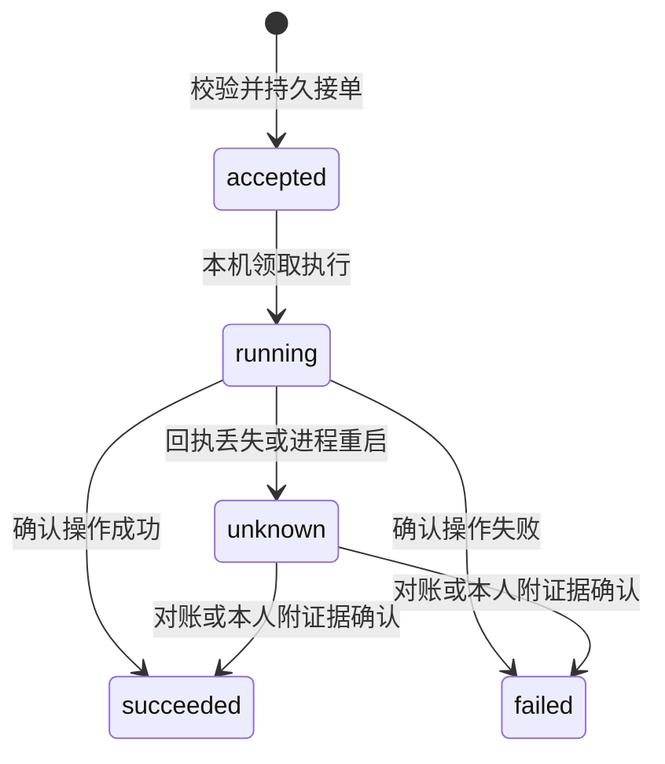

# Node 协议参考

协议版本为 `2`。产品入口为 `vibeface`。业务报文以 `crates/node/src/model.rs` 为准，授权类型和校验以 `crates/secure/src/authorization.rs` 为准。本文描述 Node HTTP、对等传输、事件和执行账本。

## 身份与数据范围

账户、设备、空间、资源和服务分别使用 `acc2_`、`dev2_`、`spc2_`、`res2_` 和 `svc2_` 标识。它们不能互换。公开传输层的 `node_id` 仍是 Node Ed25519 公钥原始字节的 SHA256，编码为 64 个小写十六进制字符。地址不参与身份计算。

客户端独立生成账户根、恢复密钥及日常设备密钥。Node 使用自己的服务密钥。根和恢复私钥不交给 Node，设备持钥证明绑定精确用途和账号。个人空间从账户标识派生，团队空间有独立根和政策。

账户文档、空间文档、设备证书、成员记录、资源记录、Grant、政策提交和 Invocation 都有独立签名 domain。公开签名对象使用 `{payload,issuer,signature}`。正文规范化、对象 hash、授权投影和请求签名由共享 Rust 实现，浏览器调用同一份 WASM。

角色为 `gateway`、`relay`、`replica`、`scheduler` 和 `executor`。`config.json` 控制本机能力，已验证的证书、Grant 与当前政策限制实际访问。公共中继能力不授予业务数据或执行权限。

客户端首次信任来自可信创建、连接卡或已保存的 profile pins。登录响应中的 pins 不能为同一响应自行建立信任。政策 stamp 包含 domain、authority epoch、sequence 和 head。已经保存的政策最低 head 不能被较旧记录覆盖。

客户端 scope 固定为 `{account_id,space_id,device_id}`。业务报文只使用 `space_id`，不接受旧字段别名。Project 是已签登记的资源，一个 Project 可以包含多个会话。事件、附件、执行账本、通知和同步均受空间及资源授权限制。公网发现目录不发布这些私人记录。一个物理 Node 可运行 Agent，也可为其他空间转发密文。

## 本机配置

`config.json` 由 `init` 生成，修改后重启生效。字段名固定，不接受未知字段。

| 字段 | 含义 |
|---|---|
| `listen` | 实际 HTTP 监听地址，默认 `127.0.0.1:4790`，决定可接入的网卡 |
| `public_url` | 展示使用的主入口 origin，公网为 HTTPS |
| `allowed_origins` | 额外允许的浏览器 origin 数组，默认空；`init --allowed-origin` 可重复指定 |
| `allow_insecure_lan` | 明确允许可信 LAN 上的明文 HTTP |
| `local_access.enabled` | 默认 `true`，允许本机可信入口自动解锁浏览器设备配置；关闭会使已有本机会话失效 |
| `local_access.listen` | 独立回环监听地址；初次 `127.0.0.1:0` 自动选择端口并写回配置，之后保持同一浏览器 origin |
| `roles` | 本机启用的 Node 角色 |
| `roots` | 编码执行允许使用的绝对目录列表 |
| `network` | 公共发现、候选直连地址、mDNS 与公共中继配置 |
| `manager` | 管理 SDK 配置，未启用时为 `null` |
| `codex_socket` | 已有 Codex App Server socket，`null` 时尝试启动私有实例 |
| `codex_bin`、`claude_bin`、`cursor_bin` | 对应 Provider 程序路径 |
| `timeout_secs` | 单次适配器超时，默认 600 秒 |
| `daily_decision_limit` | 本 Node 每个个人空间的 UTC 每日自主管理调用次数，默认 20；本人主动聊天不受此额度限制 |

`gateway`、`scheduler`、`executor` 依赖 `replica`，配置和设备角色授权均须满足此条件。无需 Agent 的入口可启用 `gateway`、`replica` 和可选 `relay`；没有业务 Grant 的 Gateway 只转发指向已验证 Project 宿主的请求，不因此获得业务副本。纯 `relay` 可以只转发密文而不加入个人身份网络。

启用管理 Agent 时，`manager` 业务配置只保留 Provider 和模型，不接受宿主 SDK 程序路径：

```json
{
  "provider": "codex_sdk",
  "model": "your-model-id"
}
```

该对象作为 `manager` 的值，保留 `config.json` 的其他字段。管理 Agent 按本次空间与资源选择唯一只读项目目录，不使用全局工作区或全部执行根。它在固定镜像内使用受信 sidecar，必须另外配置 `execution_isolation` 和受信模型网关，见[执行镜像说明](execution-image.md)。Cursor SDK 管理目前拒绝，不回退到宿主进程。

`manager_capabilities` 与执行器能力分别声明，实际支持情况以当前运行时返回值为准。适配器协议包含流式进度、取消请求和本机原生会话延续，不提供原生 steer 或 Provider run 对账。Cursor 文本支持增量和快照，Codex 文本是按 item 替换的快照。`cancel=true` 表示可请求取消；Codex 的 `cancel_confirmation=false` 表示 CLI 退出不能证明分离的工具进程已退出。`verified=false` 不表示已通过当前环境的真实模型验收。配置存在、进程可达和已验证是不同状态。

## HTTP 与客户端通道

允许的浏览器入口由 `public_url`、`allowed_origins` 和本机 HTTP 别名组成。本机别名为 `127.0.0.1`、`localhost`、`0.0.0.0`，端口使用 `listen` 的端口。允许入口不会改变监听网卡或开放防火墙。

显式入口是不含路径、查询参数或凭证的完整 HTTP 或 HTTPS origin。非本机 HTTP 入口需要 `allow_insecure_lan`。同一主机和端口不能同时配置两个 scheme。HTTP 检查 Host，带 Origin 时必须匹配该 Host 对应的同一入口。普通 HTTP 正文上限为 2 MiB，自定义工具回调上限为 1 MiB。

| 路径 | 方法 | 用途 |
| --- | --- | --- |
| `/`、`/app.js`、`/transport.js`、`/style.css` | GET | 内置可信网页客户端 |
| `/generated/vibeface_secure.js`、`/generated/vibeface_secure_bg.wasm` | GET | 同一 Rust 密码学实现的浏览器构建 |
| `/api/info` | GET | Node 公开身份与能力信息 |
| `/api/network/ws` | GET，WebSocket upgrade | 直连、发现、中继及端到端客户端通道 |

公开入口不提供用户名密码注册、登录 cookie 或明文业务 RPC。网页的密钥存储需要安全上下文。localhost 或可信 HTTPS 页面可启动客户端，普通 LAN HTTP 页面不能降级为无密钥认证。

独立本机 listener 额外挂载 `/api/local/status`、`/api/local/launch`、`/api/local/exchange`、`/api/local/session`、`/api/local/settings` 和 `/api/local/network/ws`。它使用本机私有 launch 凭据、短时一次性 token 与 HttpOnly cookie；这些路径不出现在公开 listener。cookie 仅解锁此浏览器保存的设备配置，业务仍通过真实 Noise、client-policy 验证与签名 Invocation。详见[本机自动登录](node.md#本机自动登录)。

WebSocket 建立后先接收文本 `welcome`。直连客户端发送 `{"type":"direct","service":"client"}`。通过中继时发送 `{"type":"dial","target":"NODE_ID","service":"client"}`。收到 `ready` 后，真实两端执行 Noise XX 握手，协议 context 为 `vibeface:client:v2`。客户端从可信入口钉住 Node 公钥和 NodeID，服务端把已验证的客户端授权绑定到该 Noise 会话。

握手后的应用消息均为二进制加密记录。文本应用消息、身份错配、篡改及重放关闭通道。大消息通过 `sealMessage` 和 `openRecord` 分片重组，不能直接把一个超长 JSON 塞入单个 Noise record。

解密后的请求为 `Request { id: string, method, params, invocation? }`，响应为 `Response { id, result, error? }`。`error` 是错误说明字符串，不包含成功结果。请求 ID 仅用于响应匹配，业务写入仍依靠稳定的 message ID 和 operation ID 去重。

| method | params | 用途 |
| --- | --- | --- |
| `info` | `{}` | 当前 Node 的公开信息 |
| `identity` | `{method,params}` | 两阶段账户创建和签名政策管理 |
| `authenticate` | `{account_id,space_id,device_public_key,resource_id?,audience?}` | 按所选资源和宿主验证与 Noise 相同的日常设备，并绑定授权会话 |
| `prepare_invocation` | `{body,intent}` | 先验证独立签名 PrepareIntent，再返回未签 Invocation 模板和最终业务正文 |
| `rpc` | 下节业务对象，顶层另带签名 `invocation` | 按签名正文执行已授权业务 |
| `subscribe` | 含空间、资源和授权 ID 的正文，顶层另带 `invocation` | 订阅当前授权资源的变化 |

`identity` 的 `status` 返回公开初始化状态与 Node 身份。首次创建使用以下步骤：

1. 从本机安装卡取得 Node 公钥、NodeID、capability 和 claim nonce。它们不能从对端自报的声明中学习。
2. 调用 `identity` 的 `node_claim`，正文为 `{capability}`。共享 `verifyNodeClaim` 核对卡中的公钥、nonce、签名与有效期。
3. 客户端调用 `prepareAccountCreation`，将 `nodeRequestJson()` 发给 `node_possession`，取得 Node 对精确服务证书的持钥证明。
4. 客户端调用 `finishAccountCreation`，把生成的 `{pins,authorization}` 发给 `bootstrap`。Node 持久绑定申请设备、账户和证书，消费安装授权。完全相同的请求可以幂等重试，冲突请求拒绝。
5. 客户端保存自己创建的账户和空间 pins，再通过顶层 `authenticate` 登录。

已有账户添加另一台 Node 使用独立的 Service 登记，不重新创建账户，也不复用普通客户端的 Offer。客户端从新 Node 的安装卡独立核对公钥和 claim nonce，取得并验证 `node_claim` 后，使用已有账户的根材料及当前已验证授权调用 `prepareAccountNodeEnrollment`。`requestJson()` 返回 `{intent,pins,bundle}`，发送给新 Node 的 `account_node_possession` 后得到 `{proof}`。

`prepareAccountNodeEnrollmentCommit` 将持钥证明绑定到申请，生成发给当前账户权威 Node 的 `account_node_commit` 请求。权威 Node 原子提交账户政策和回执，返回 `{journal_delta}`。客户端用 `finishAccountNodeEnrollment` 核验回执，再把 `installationJson()` 发给新 Node 的 `account_node_install`。安装响应中的 `pins` 是提交后的 pins，不是安装对象中用于验证原申请的旧 pins。完全相同的持钥、提交及安装请求可幂等重试。

这条登记只增加账户所有的 Node Service 证书，不增加业务 Grant，也不新建 Project。完成后客户端重新 `authenticate`，使用新的账户政策头。只有传输证书的 Gateway 可以转发指向原 Project host 的请求，不能凭登记取得该 Project 的历史或执行权限。

登录返回 `{scope,authorization,pins,resources}`。`authorization` 是 `{journal,grant_leaf}`。客户端用独立保存的 pins 调用 `verifyClientAuthorization`，核对预期账户、空间、自己的设备公钥及授权目标 Node。可见 Project 必须来自已经验证的政策投影。登录返回的目录不等于全空间资源目录。

Project 的宿主为 B、入口为 A 时，客户端分别保存 A 的 Noise 公钥和 B 的已验证服务身份。登录显式选择资源及 B 的 audience。客户端用 `signForwardedClientInvocation` 固定 presenter 为 A，保留原 actor、正文和 B audience，再由 A 转发到 B。A 的本地 Grant 或任务绑定不能给另一个宿主授权，也不能将 B 的公钥误作与 A 握手的 pin。

客户端先构造完整业务意图，确定 action、稳定授权 ID 和资源，再用 `signClientPrepareIntent` 对原始正文和独立已验上下文签名。所有调用，包括直连宿主，都以 `{body,intent}` 请求 `prepare_invocation`。上下文来自已验账户、TaskCreated、TaskBinding 和用户意图，不能从服务端模板复制。资源宿主在读取任务或会话元数据前验证该签名、资源 Grant、真实传输、audience、presenter、nonce 和政策有效期。

返回的 `{invocation,body}` 不能直接盲签。先验证 TaskBinding 和允许的路径规范化，逐项核对最终正文，再用 `signClientInvocation` 或 `signForwardedClientInvocation` 对照自己的 action、ID 和正文签名。最终 Invocation 使用独立 nonce，PrepareIntent 本身不能执行写入。发送时必须使用与签名相同的 body。Node 自己获取并验证政策新鲜度回执，调用方不能自报最新状态。

`InvocationContext.task` 是已验证 TaskCreated 的裸 64 位事件 hash，与 DAG 和 TaskBinding 的 `task_ref` 相同。编码执行实例放在 `execution_session`，管理 Agent 的 SDK 实例放在 `sdk_session`，二者不能混用。本人账户请求的 `sdk_session` 为 null。

政策安装使用 `identity` 的 `policy_commit`，参数为 `{journal}`。签名更新必须通过已有 pins 和当前授权验证；新根不能从这条入口自行取得信任。设备登记、撤销与恢复使用新的签名政策记录，旧 `NetworkState`、邀请和 checkpoint 恢复格式不受支持。

本机 `access --json` 输出含入口 URL、NodeID、公钥及首次认领使用的 capability 和 claim nonce。认领后的输出不再包含可用的安装授权。capability 不放入服务日志、公共目录或 DAG。知道 Node 地址或公开身份不能抢占初始化，也不能取得私人网络权限。

管理 SDK 的工具调用走隔离 sidecar 的受信通道，绑定账户、空间、资源、原发起人和当前 SDK 会话。它不提供外部 Bot 可保存的长期身份，不能添加或撤销设备、回答审批或验收工单。

HTTP 成功或通道返回结果表示本次请求已处理。消息是否在目标入队以版本化调度回执为准，工作是否完成仍查询执行账本及结果。

## RPC 方法

`rpc` 通道方法的 `params` 使用 JSON 对象，`method` 选择业务方法，其余字段与 `method` 同级。每次请求显式填写 `space_id`、`resource_id` 和 `authorization_id`，并在通道请求顶层携带已签 Invocation。操作请求中的空间必须一致。已有会话、任务、会话实例及操作的资源由数据库核对，调用方不能改写归属。

| method | 主要字段 | 结果或行为 |
|---|---|---|
| `nodes` | `resource_id` | 已授权 Node、可达性和当前可查能力 |
| `bots` | `resource_id` | 当前授权资源的持久机器人定义 |
| `create_bot` | `bot_id`、`conversation_id`、`name`、`instructions`、可选 `project` | 本人显式创建机器人并绑定独立聊天历史；完整请求精确去重 |
| `conversations` | `resource_id` | 本地已知业务会话 |
| `create_conversation` | `conversation_id`、`title` | 以稳定 ID 创建会话，同 ID 同内容可去重 |
| `conversation` | `conversation_id`、可选 `basis_heads` | 本机已知消息、机器人定义、executions 投影、历史目标、heads、missing、调度队列及事实新鲜度 |
| `message` | `conversation_id`、`message_id`、`text`、可选 `basis_heads`、`scheduler_node`、`report_results` | 原子保存用户消息、汇报意图和本机 inbox 或 outbox，返回调度回执 |
| `create_task` | `conversation_id`、`task_id`、`title`、`goal`、`acceptance` | 创建工单；`auto_followup=true` 被拒绝，授权使用 `set_followup` |
| `update_task` | `conversation_id`、`task_id`、`status`、`detail` | 追加工单状态变化 |
| `set_followup` | `conversation_id`、`task_id`、`mode`、`expected_version`、可选 `scheduler_node` | 本人设置具体任务的后续权限，模式为 `off`、`report` 或 `continue` |
| `cancel_manager` | `conversation_id`、`trigger` | 本人请求停止指定管理轮，返回取消请求状态，不表示后台任务已停止 |
| `resolve_manager_unknown` | `conversation_id`、`trigger`、`evidence` | 本人核对旧管理轮及原操作证据后解除管理写冻结，不重做旧触发 |
| `task_control` | `conversation_id`、`task_id`、`action`，写控制另需 `operation_id`、`expected_operation_id`、`expected_revision` | 读取具体任务状态，或按原绑定执行 `steer`、`interrupt`、`respond_request` |
| `execution_control` | `conversation_id`、`operation_id`、`expected_operation_id`、`expected_revision`、`action` | 从原签名派发解析目标和执行资源，按真实能力控制后台工作，不要求 Task |
| `read_artifact` | `conversation_id`、`blob_hash`、可选 `offset`、`limit` | 分页读取当前空间和资源中、该会话实际引用的 UTF-8 文本附件 |
| `context` | `conversation_id`、可选 `blob_hash` | 读取当前资源的 DAG 上下文或由其事件引用的附件 |
| `bind_execution` | `conversation_id`、`task_id`、`task_ref`、`target_node`、`session_id`、`executor`、`cwd` | 取得明确执行意图的已签任务绑定 |
| `operate` | `request` | 向指定执行 Node 提交 `OperationRequest` |
| `session` | `target_node`、`session_id` | 查询原执行会话及当前事实 |
| `operation` | `target_node`、`operation_id` | 查询持久执行账本 |
| `notifications` | `resource_id`、`client_id` | 该客户端尚未确认的通知 |
| `ack` | `notification_id`、`client_id` | 记录该客户端已读 |
| `export` | `conversation_id` | 导出包含签名事件的快照 |
| `reconcile` | `target_node`、`operation_id` | 只读查询实际执行事实，保留 Unknown、资源锁及原接单记录 |
| `resolve_unknown` | `target_node`、`operation_id`、`outcome`、`evidence` | 本人根据证据解决未知结果，不重发操作 |
| `seal_execution` | 完整旧 `binding` | 原执行端确认无活动或未知操作后封存旧绑定 |
| `rebind_execution` | 完整旧 `binding`、`previous_seal`、`target_node`、`session_id`、`executor`、`cwd` | 本人明确封存原绑定后建立新的执行安排 |

工单状态为 `open`、`working`、`blocked`、`needs_review`、`accepted` 或 `cancelled`。`accepted` 和 `cancelled` 只能由本人设置，Agent 不能将它们改回活动状态。`resolve_unknown.outcome` 为 `succeeded` 或 `failed`，证据至少 12 字节。

`bot_id`、`message_id`、`conversation_id`、`task_id` 和 `operation_id` 是业务去重身份。重试保留原 ID 和原内容；同 ID 换内容会被拒绝。聊天 Agent 的工具为 `nodes`、`context`、`command`、`delegate`、`continue_execution`、`execution_status`、`stop_execution` 和只读的 `call_lookup`。只读结果回调只得到查询工具。

Bot 定义包含独立的 `bot_id`、内部 `conversation_id`、`name`、`instructions`、可选 `project` 和来源 `event_hash`。`project` 为 `{ target_node, cwd }`，只表达执行偏好，不授予权限。`BotCreated` 进入对应聊天的签名 DAG，Store 从事件重建投影。创建新机器人时，新聊天与 Bot 定义在同一事务保存。导入或重建同版本定义不启动模型。

Node 的 manager 配置选择 SDK Provider 和模型，凭证通过受信模型网关保留在隔离边界外，Bot 定义保存职责。每个 Bot 的内部聊天 scope 独立，原生 SDK 缓存仍按空间、scope 和本机节点保存。缓存不是共享聊天的事实来源。

写工具在副作用前保存稳定调用引用与已准备的实际请求。程序生成 operation/session ID 并固定目标与 revision；恢复先读取原调用，不能根据同一命令文本猜测是否重复，也不能换目标重派。

`conversation.scheduler` 包含 `jobs`、`provider`、`model`、`capabilities` 和 `write_frozen`。每个 job 保留 `trigger`、`target_node`、`kind`、`sequence`、`state` 及可用的 `message_id`、`read_only`、`reply_message_id`。`kind` 为 `human` 或 `autonomous`。完成消息替换同一调用的临时文字，不把临时文字当成已持久保存的回答。

任务包含 `followup_mode` 和 `followup_version`。已验证的 `binding` 包含目标、会话、原操作、revision、真实 `capabilities` 和 `pending_requests`。远端摘要保留缓存或未知标记，`facts_freshness=local_known_history` 不证明全网最新。

`task_control.action=status` 是只读查询。其他动作返回完整 `OperationRecord`，重试必须保留原控制 `operation_id` 和内容。Node 检查原操作及 revision，解析真实 turn 和审批请求。`steer` 另需 `text`，`respond_request` 另需 `request_id` 和 `response`。过期请求被拒绝，模型不能回答审批。

`execution_control.action` 为互斥对象，支持 `{ type: "interrupt" }`、`{ type: "steer", text }` 或 `{ type: "respond_request", request_id, response }`。Node 从 `expected_operation_id` 找到原派发，不信任客户端传入执行目标。审批仍要求本人和有效原请求；重试保留完整载荷与原控制 ID。无 SDK 会话的短命令只声明实际支持的查询能力，不伪造 SDK 中断。

`read_artifact` 返回 `{ blob_hash, text, offset, next_offset, size }`。偏移与长度按 UTF-8 字节计算，`limit` 范围为 4 至 65536，默认 65536。偏移必须位于字符边界；下一页使用返回的 `next_offset`，为 `null` 时结束。Node 核对签名附件引用、长度和哈希，正文未同步、非 UTF-8 或仅凭其他会话的哈希猜读都会拒绝。

## 可靠调度回执

可靠调度版本为 `1`。入口在同一事务保存消息、不可改写的汇报意图以及 inbox 或 outbox。远端投递前先查询目标的 `reliable_schedule.version`，不向旧版目标发送可能启动执行的旧协议请求。

`message` 返回 `accepted`、`queued`、`state`、`trigger`、`message_id`、`scheduler_node` 和 `receipt`。目标调度节点持久入队后，回执结构为：

```json
{
	"version": 1,
	"space_id": "spc2_<64 lowercase hex>",
	"conversation_id": "conversation-id",
	"trigger": "SIGNED_EVENT_HASH",
	"target_node": "SCHEDULER_NODE_ID",
	"state": "queued"
}
```

入口仅写入 outbox 时，`accepted=true`、`queued=false`、`state=pending_delivery`。只有目标提交 inbox 后的匹配回执才能确认已入队，HTTP 成功或本机已保存不替代这个确认。`queued=true` 表示已经可靠接收，查询时 `state` 可能已推进至运行或终态。

投递以空间、资源、会话、trigger、原目标和版本核对回执。ACK 丢失后向同一目标重投同一 trigger，目标返回原 job。已投递项通过原目标的 `manager_status` 查询进展和结果，不因离线或超时改派另一台。

每个会话的本机管理队列有界，最多保留 256 个待处理触发；本机每个空间的未投递 outbox 也上限为 256。单消费者按持久状态领取，本人待处理消息优先于自主后续。提示通知只负责唤醒，周期扫描补上丢失的唤醒。每轮按持久固定的依据准备上下文，后发消息不会隐式算作已处理。

job 状态为 `queued`、`claimed`、`running`、`cancelling`、`completed`、`failed`、`cancelled` 或 `unknown`。`queued` 和确认尚未跨启动边界的 `claimed` 可恢复首次执行。跨重启的 `running` 与 `cancelling` 进入 `unknown`，不自动重新调用 SDK。最终回答和 job 终态一次提交。导入 DAG 或重建视图不创建 job，也不重放模型、工具或执行操作。

取消先封存旧 attempt 的工具权限并排空已接纳工具，再检查 SDK 取消证据。`cancelling` 不是停止成功，无法证明终止时进入 `unknown`。旧管理轮保持未知，工具权限隔离后可创建新的只读管理轮。`resolve_manager_unknown` 核对原 attempt 关联的业务操作；执行仍未知时须先走 `reconcile` 或 `resolve_unknown`。人工结论不重跑旧 trigger，已有只读 token 不自动获得写权限。

本机版本化队列、outbox、原生 SDK 会话及操作账本不通过 DAG 迁移。维护空闲检查包含待投递、排队、活动和未知项，新进程通过更新健康门后才消费。存在新调度记录时不承诺任意降级旧程序。

`authorization_id` 标识这次签名调用。`operate` 使用原 `operation_id`，结果不明时仍保留该 ID。查询 `operation` 则生成独立的授权 ID，不能把被查询的操作 ID 当作本次读取的身份。

## 执行请求

以下展示显式 Task 的 `operate.request` 业务字段。该分支实际发送时还必须附上完整、已验证的 `binding` 对象，不能只发送绑定编号：

```json
{
	"operation_id": "stable-operation-id",
	"space_id": "spc2_<64 lowercase hex>",
	"conversation_id": "conversation-id",
	"task_id": "task-id",
	"target_node": "TARGET_NODE_ID",
	"session_id": "logical-session-id",
	"expected_revision": 0,
	"basis_heads": [],
	"action": {
		"type": "open",
		"executor": "codex",
		"cwd": "/absolute/project"
	},
	"resources": ["/absolute/project"]
}
```

`task_id` 可为 `null`。普通打开和发送操作不创建隐式 Task。`session_id` 可为 `null`，SDK 动作必须指定真实逻辑会话，短命令必须为 `null` 且 `expected_revision=0`。`basis_heads` 标记本次操作依据的已知历史。目标 Node 在接单前拉取并校验其依赖闭包、派发记录和必要附件。空数组不表示全网没有其他历史。

向已关联显式 Task 的执行会话提交新工作时，必须保留活动 Task 的 `task_id`，不能省略编号来绕过验收或取消。普通无 Task 操作使用独立的未绑定会话，接单与领取执行事务都核验会话归属原 conversation。显式 Task 路径仍在派发前取得唯一执行绑定，执行端独立验签。

显式 Task 的 `task_ref` 必须是共享事件 verifier 核验的 `TaskCreated.hash`。

| action.type | 其他字段 | 执行器支持 |
|---|---|---|
| `open` | `executor`、`cwd` | Codex、Claude Code、Cursor Agent |
| `send` | `text` | Codex、Claude Code、Cursor Agent |
| `read` | 无 | Codex |
| `steer` | `turn_id`、`text` | Codex |
| `interrupt` | `turn_id` | Codex |
| `respond_request` | 原始 `request_id`、`response` | Codex，仅本人 |
| `command` | `command`、`cwd`、`timeout_secs` | Node 受限命令，不调用编码 SDK |

执行器枚举为 `codex`、`claude_code`、`cursor_agent`。逻辑 session ID 与执行器原生 session ID 分开保存。审批回答必须绑定当前仍有效的原请求，Node 不自动批准。

`OperationRequest.binding` 是共享的 `SignedBinding`。客户端先通过已授权的 `bind_execution` 取得证明，再调用共享 `verifyTaskBinding`，用已验证的任务创建事件和自身执行意图逐字段核对，随后签署包含该证明的最终业务正文。执行端实际接单时再次验证，不能只依靠请求中的目标字段。

普通会话和命令没有 Task binding。`ExecutionWork` 明确区分 `task_session`、`conversation_session` 和 `command`。普通会话首次 Open 绑定本次 operation，后续请求引用原 Open 的 admission、invocation 和 C 已成功创建会话的回执。命令绑定完整请求 hash 与规范目录，不创建会话或虚构 Task。

自主继续的签名来源另固定原调度节点、结果 trigger 和 followup version。首次接单与领取执行都验证当前授权；原件读取不授予继续执行权限。

绑定正文包含 `space_id`、`conversation_id`、`task_ref`、`task_id`、`authority_node`、`generation`、`target_node`、`session_id`、`open_spec`、`previous_binding_hash` 和 `previous_seal`。`task_ref` 固定到真实 `TaskCreated` 事件 hash。该创建事件的作者 Node 对首个执行位置执行持久 CAS，两个调度器向不同目标并发派发也只能取得一份绑定。这个 Node 只负责该绑定的唯一确认，不是会话调度负责人。

已有绑定不替代政策新鲜度。原创建 Node 或当前政策权威不可达时，只有仍满足新鲜度和资源授权的请求可以继续。新绑定无法取得唯一确认时拒绝派发，不能在另一台设备自行建立替代，也不临时创建另一份任务绕过确认。

普通执行不合成内部任务，也不能借无 Task 分支使用已经具有显式绑定的会话。

更换执行位置由本人调用 `rebind_execution`，原执行端先明确封存旧绑定，新代绑定引用前代证明。`unknown` 阻止封存和迁移，不用超时假定原执行已经停止。

`expected_revision` 必须匹配执行 Node 当前会话版本。打开及发送操作将工作目录和额外资源规范化，检查本机父子目录重叠。控制操作不能申请额外资源。此机制不提供跨设备共享文件系统的全局锁。

短命令复用同一操作账本、目录互斥和结果回送，不创建 `ExecutionSession`。输出有界，环境不继承 Node 或 Provider 凭证，实际文件读写受平台沙箱限制。缺少沙箱能力时拒绝执行，不降级为裸 shell。超时或取消后的副作用无法证明时保留 `unknown`。

macOS 使用系统 `sandbox-exec`。Linux 要求支持 Landlock ABI 6 的内核及 seccomp，旧内核明确拒绝该工具；还会拒绝无法按目录约束的文件元数据修改。受限短命令不是完整开发环境，依赖受限进程操作的复杂工具需使用已有编码执行器。

Bot 事件和可空 `session_id` 使用当前版本结构，不提供旧版本兼容。业务数据库直接使用 `user_version=3` 的最终初始 schema，不执行旧库升级。重新部署使用新数据目录及同版本节点，同版本重启仍保留执行账本并核对未知结果，不重放副作用。

操作状态如下：



入账前的非法请求直接拒绝。`rejected` 也属于终态。导入 DAG 历史不创建执行队列；重启仅恢复本机已持久接单而尚未开始的操作。运行中操作重启后变为 `unknown`，不自动重新执行。

Codex `send` 成功启动 turn 后仍需等待进度与终止事件。`turn/completed` 中的 completed、failed、interrupted 各自保留含义，都不自动把工单变为 `accepted`。

## 事件 DAG

`SignedEvent` 包含三个字段：

- `hash` 为 `canonical_body` UTF-8 字节的 SHA256。
- `canonical_body` 为原始规范 JSON 字符串，校验时保留并核对这些字节。
- `signature` 为作者 Ed25519 签名，签名输入是 `vibeface:event:v2:` 加十六进制 hash 的 ASCII 字节。

正文结构为：

```text
Event {
  version, space_id, resource_id, cause, scope_id, author,
  sequence, previous, parents, created_at_ms,
  body, blobs
}
```

`previous` 和 `sequence` 校验同一作者的来源链，`parents` 引用当前事件依据的因果前项。父引用和附件列表按序去重。`created_at_ms` 不决定唯一全局顺序，也不能覆盖并发分支。

正文类型包括 `bot_created`、`conversation_created`、`message_posted`、`task_created`、`task_changed`、`dispatch_recorded`、`execution_observed`、`decision_recorded`、`notification_raised`、`notification_acknowledged` 和 `context_checkpoint`。

投影前检查空间、资源、作者证书、签名、hash、来源链、授权依据、因果依赖及附件。`cause` 保留事件产生时的授权依据，导入历史不能凭作者身份重新授予权限。缺口和来源分叉分别保留在 `missing.events`、`missing.blobs` 与 `missing.conflicts`。必要历史未齐或冲突未处理时，禁止继续调度和执行。

事件上限为 1 MiB。附件使用 `BlobRef { hash, size }`，单件上限为 64 MiB，传输分块并校验总长度及 SHA256。附件只能经当前授权资源中的事件引用读取，不能跨空间或资源凭 hash 读取。

节点交换 scope 的 heads，按需拉取事件、前驱和附件，再重建 SQLite 视图。并发历史保留为不同 heads。快照和摘要不替代原始依据，历史导入和视图重建不触发 Agent 或外部写操作。

DAG 能验证已知历史位置及依赖完整，不能证明全网最新。原始副本全部失联或丢失时，不承诺恢复缺失内容，也不迁移其他设备 SDK 的隐藏状态。

## 发现、对等连接与公共中继

`network` 配置包含 `bootstrap_urls`、`advertise_urls`、`mdns` 和 `relay_enabled`。地址使用 `/api/network/ws` 的完整 WS 或 WSS URL。`bootstrap_urls` 提供可替换的会合入口，`advertise_urls` 是本 Node 声明的候选直连地址。Node 可通过 mDNS 获取局域网候选地址，随后仍要核验身份。

`Reachability` 包含 `node_id`、`public_key`、`direct_urls`、`relay_urls`、`issued_at`、`expires_at` 和 `signature`。设备使用 Ed25519 的 `reachability` domain 签名。记录有效期受限，只按已知 NodeID 查询，不提供全网枚举。签名证明设备声明该路径，不证明设备属于本人或路径此刻可达。

NAT 后的 Node 主动连接会合入口，在随机 challenge 上签名后预约 relay。中继使用单独的出站 attach 通道连接目标，建立通道后只搬运二进制记录。中继限制为 128 个连接、64 份预约和 32 条电路。每条电路最多传输 64 MiB、持续 30 分钟，并限制每秒流量。中继不解释工单或执行命令。

私网 Node 在该流上执行 context 为 `vibeface:peer:v2` 的独立 Noise 握手。业务报文保留空间、来源、目标、请求 ID、签名和去重约束，真实业务访问还须验证资源授权、传输证据与当前政策。公共 relay 不需要也不得获得私人网络成员身份。TLS 保护逐跳传输，Noise 保护真实通信两端之间的业务内容。

request 与 response 指向特定 Node，响应必须来自原请求的预期 Node。路径变化不能改变已绑定执行目标，也不触发业务写入重放。连接目录和在线状态是有时效的软状态。

## 通知和自动后续

加密通道的 `changed` 提醒用于刷新当前授权资源的视图。提醒不是唯一历史来源，重连后重新查询持久状态。客户端读取同一资源的 `notifications`，使用自己的稳定 `client_id` 确认 `notification_id`，同一客户端换路由后仍可去重。不同浏览器具有独立设备身份，各自确认。资源或身份不匹配的读取和 ACK 拒绝。

管理进度包含 `conversation_id`、`trigger`、`invocation_id`、`source_node`、递增 `sequence` 和 `progress`。`progress.type` 为 `text_delta`、`text_snapshot`、`status` 或 `tool`。文字按 `item_id` 关联，delta 追加，snapshot 替换全文。执行进度关联原任务、目标、session、operation 和 native turn，不能串入其他任务。临时进度不逐 token 写 DAG，持久回答和执行结果仍来自账本及签名事件。

客户端读取 `conversation` 时，入口为该已授权会话建立有界的只读观察，从原管理节点和执行节点读取进度。节点间 `progress_read` 校验空间、资源、来源和会话，响应包含 `version`、`cursor`、`reset` 和 `events`。游标缺口或源进程重启要求重新读取持久 snapshot，不生成重放写操作。连接关闭、权限撤销或观察租约过期后停止观察，代理进度不再次转发形成循环。

普通进度、审批提醒和结果通知不调用管理模型。无人在线时保留通知，重新连接后读取。浏览器系统提醒是可选客户端功能，不等于网页关闭后的手机推送。

后续权限使用 `DecisionRecorded.tool_configuration` 中带类型的签名记录，类型为 `followup_intent_v1`、`task_origin_v1` 和 `task_followup_grant_v1`。自然语言或模型传入的参数不构成授权。

`message.report_results` 默认 `true`。汇报意图固定原消息 hash、空间、资源、会话和目标 Scheduler，普通执行通过签名请求中的 `manager_authority.trigger` 关联原消息，终态只触发只读总结，不创建隐藏 Task。`false` 保存明确的 `off` 意图，重试不能改变。原始结果与通知始终保留，模型不能借回调获得新的写权限。

`set_followup` 仅本人可用，固定到现有任务的 `task_ref`。`off` 禁止自主后续，`report` 只允许读取结果并保存最终 assistant 回答，`continue` 允许在本任务范围内继续业务工作。稳定 grant ID 配合单调版本，`expected_version` 必须使用会话快照返回的当前 `followup_version`。并发或旧版本修改被拒绝，既有授权不能用重试改变目标。

领取后续、签发工具权限及每次业务写入前都复核本机已验证的最新授权、任务状态和版本。撤销封存旧权限；离线节点尚未获知撤销时，不保证全网立即停止。审批、验收与未知确认始终由本人处理。

产生结果的原执行 Node 保存 completion marker，验证原结果和政策后将同一 trigger 投递给授权固定的 Scheduler。结果早于补授权时仍可在授权可见后投递一次，不重做执行。委托结果未知时保留状态并查询原调用，不因超时再派给另一台。未授权模型后续不影响原始结果与通知保存。

`daily_decision_limit` 只限制每个 Node 上、每个个人空间的 UTC 每日自主管理 SDK 调用。本人主动聊天不受这个额度限制。预算先预留，失败调用不保证退回；它不限制执行器自身调用，也不是 token 或账单上限。额度耗尽不把执行结果标为未知。

每条用户消息在签名 `MessagePosted.scheduler_node` 中固定本次调度目标。客户端重试必须保留原 `message_id` 和 `scheduler_node`，网页将两者一同持久化。同一目标通过本地调用账本去重。已取得该消息的入口拒绝改写其目标；未同步节点之间没有全局消息唯一性共识，调用方不能用同一编号改换目标。切换入口后继续工作时提交一条新消息，可选择任意已授权调度节点。这个目标只属于该消息，不是会话或工单的负责人。

`reconcile` 在目标执行节点确认账本不存在时返回 `state=not_found`、`operation=null` 和目标节点身份。节点不可达返回错误，不当作不存在。网页允许本人确认旧请求结束后解除本地待核对记录，不自动重发。

消息请求中的 `entry_node` 固定为首次接收的 Gateway。未确认的同一消息只能回原入口核对或重试；换入口可只读查看历史，不能重签原请求。Node 在落盘前核对该字段。

## 本机存储格式

身份政策、资源目录、DAG、执行接单、nonce、附件和通知使用同一个 `node.sqlite3`。Atlas 声明为 `crates/node/schema.hcl`，唯一初始 SQL 为 `crates/node/migrations/202610180001_initial.sql`。运行程序从空库执行这份内嵌 SQL，记录结构指纹及 `ready` 状态；运行时不依赖 Atlas CLI。

目录格式为 `vibeface-node`，data epoch 为 `3`，layout version 为 `1`，与政策 authority epoch 和恢复代数分开。事件和会话必须显式引用已签资源目录，没有旧资源默认值。授权、接单和不可重放记录在同一 SQLite 事务中提交，DAG 投影重建不清空这些账本。

本版本不迁移旧库或旧恢复包。旧格式、丢失标记、缺库、空库、结构或指纹不符都在写入和启动 Provider 前拒绝。初始化只接受新的空目录，不清空或改写旧目录。空库重放及与真实 Rust 初始化结果的对照由 `scripts/verify-schema.sh` 验证。
